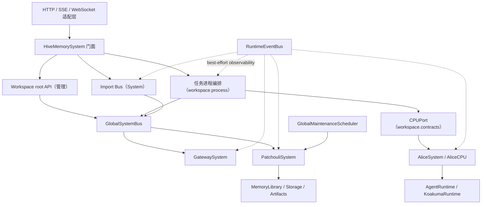

# HiveMemory 当前系统架构

本文描述当前开发分支中已经生效的后端总体结构，同时解释这些边界为什么会形成。历史架构名称、重构过程和未落地设想不构成当前实现依据，但它们揭示出的核心矛盾——前台响应与后台整理、长期知识与临时执行、统一入口与领域自治——仍然是理解现有设计的钥匙。

## 1. 架构要解决的三组矛盾

### 1.1 低延迟检索与高质量记忆生成

用户希望在提出问题时立即获得相关历史，记忆整理却需要更慢的语义感知、证据保留、去重、合并和生命周期判断。如果把这些过程串成一个同步“大脑”，系统不是牺牲响应速度，就是被迫降低记忆质量。

HiveMemory 因而保留了原项目“双系统”的核心思想：热路径负责为当前请求快速准备可用上下文，冷路径负责在交互完成后沉淀和维护长期知识。二者共享同一记忆事实核心，却拥有不同的时延预算和失败策略。

### 1.2 长期知识与临时执行

记忆需要跨会话保持身份、来源和版本，Agent 执行则围绕一次 run、一个 frame 和一组临时工具结果展开。早期实现曾把两类状态放进同一运行时，结果是 Patchouli 既要管理知识，又要管理 Agent loop；任何一侧变化都可能穿透另一侧。

当前架构将 Patchouli 与 Alice 分开：Patchouli 是长期记忆与知识平面，Alice 是临时执行与控制平面。二者之间由 workspace 的任务进程居中交接：Patchouli 交出话题与未编译的检索结果（`PreparedAgentRun`），进程编译并组装与执行者无关的输入清单（`CPUInputManifest`），经 workspace 定义的 CPU 端口交给执行者（当前为 Alice），执行者交回 CPU 中立的执行结果（`CPUExecutionResult`）。这些交接模型不是共享内部状态的借口。

### 1.3 统一入口与领域自治

主动对话、外部交互导入和系统指令都需要理解“这条输入要去哪里”，但入口判断本身不应取得记忆或执行的所有权。Gateway 因此独立为系统级守门人：它形成决策，却不执行检索、不生成回答，也不写入记忆。

应用层用例再把 Gateway 的入口决策、Patchouli 的记忆事务和 Alice 的执行能力编排为完整用例（chat 任务进程的进程表与编排位于 `workspace.process`，Import Bus 位于 System）。这样既保持统一入口，又避免 Gateway 演变成新的 God Object。

## 2. 当前基线

- 最新已发布 Git 标签：`v0.7.1`（2026-10-30）；
- 当前发布基线：`v0.7.1`；
- 当前代码、构建与运行时版本：`0.7.1`，唯一声明位于 `src/hivememory/_version.py`；
- v0.7.0 在 v0.6.x 的独立 Gateway、Gateway workflow、Passive Ingress 与 Local Work Queue Runtime 之上，完成了 workspace 体系：任务请求的唯一注册入口与任务进程、两阶段认证与授权、能力层、执行线程、会话资源与写入意图登记；全局命令只解析、不执行；
- v0.7.1 以 plugin 模式接入第一个外部 harness Claude Code：对话经 Import Bus 回流（第 6 节），记忆经 MCP 入口检索与读取（第 6.1 节）；`TurnEvent` 成为唯一的交互原子事件，推理模型默认空闲卸载、按需加载；
- Python 包、FastAPI/OpenAPI、health 响应和前端包清单保持同一版本；Git tag 仍是“已经发布”的唯一判断依据。

版本规划与完成度以[路线图](../ROADMAP.md)为准，系统当前由什么组件组成则以本文和代码为准。

## 3. 顶层结构

`SystemAssembler` 是组合根，负责构造共享运行时、三个同级子系统、workspace 设施和应用服务。`HiveMemorySystem` 持有最终组件图、作为入口使用的门面并管理生命周期。

代码按层组织，依赖只能指向同层或更低层（`tests/unit/architecture/test_package_layers.py` 守护）：

| 层 | 包 | 职责 |
|:---|:---|:---|
| L0 | `core` / `config` / `utils` / `i18n` | 依赖中立的模型、Route 泛型原语、事件常量、错误类型、访问值类型与端口协议；配置段模型 |
| L1 | `components` | 进程内运行时机制：总线、调度器、work queue、运行时事件、串行门、trace context、取消收尾 |
| L2 | `engines` / `infrastructure` / `prompts` | 算法与外部技术适配器 |
| L3 | `workspace` / `patchouli` / `gateway` / `alice` + `agent_runtime` | 各子系统与 workspace 设施；彼此只导入对方公开的 `contracts` 子包 |
| L4 | `system` | 组合根、门面与系统级能力；除入口外不被任何包导入 |
| L5 | `server` / `mcp_server` | 入口（传输层 adapter）：`server` 是 HTTP 应用与路由，`mcp_server` 是外部 harness 经 MCP 访问记忆的操作适配器，由 `server` 接入 `/mcp` |

下层需要上层能力时以端口协议声明，由组合根实现并注入；根配置与加载（`config.app`）只供 `system` 与 `server` 使用，各组件只接收自己的配置段。

Workspace 的资源归属、IdentityScope 传播、Topic/Asset 边界和 shutdown 清理顺序见
[Workspace](../workspace/README.md)；本文只保留总体组件关系和跨子系统生命周期概览。



### 3.1 System：编排舞台，而不是扮演所有角色

System 层拥有：

- 系统装配、门面与生命周期（启停顺序与关闭收尾）；
- 根配置加载（`config.app`），并把各配置段注入对应组件；
- `GlobalSystemBus`、可选 `RuntimeEventBus` 和全局维护调度器等共享设施实例的装配与关闭（机制实现在 `components`）；
- Provider / Model 注册表，以及调用来源接入登记与 Principal authentication；
- Import Bus（外部 harness 交互导入）与就绪检查。

资源能力（能力层、认证入口与准入、读取视图、WorkspaceAsset）与任务进程表及 chat 任务进程编排属于 workspace（`workspace.process`）。System 更像舞台管理者：它知道谁应先出场、关闭时谁先收尾，也持有全局时钟和观测设施；但它不替任何角色完成领域工作。System 不实现 Gateway 分析、记忆域算法或 Agent 执行循环，否则顶层编排很快会重新变成无法测试和替换的总管对象。

### 3.2 Gateway：真理之眼的工程边界

Gateway 是系统级入口决策子系统。它负责入口拦截、系统指令、候选话题准备、话题路由和用户查询分析，最终只返回两类公共结果：

- `GatewayCommandOutcome`：系统指令已经形成终态，调用方应短路后续对话链；
- `GatewayDecisionOutcome`：提供话题、查询、意图与检索计划，供 Patchouli 和 System 消费。

在项目的概念语言中，Gateway 延续了“真理之眼（The Eye）”的角色：它站在图书馆入口辨认来意、整理查询并选择通路。但这一比喻不能掩盖工程边界——Gateway 不持有记忆库，也不执行 Agent。它给出的是可被下游审查和消费的决策，而不是一段不可解释的“智能判断”。

### 3.3 Patchouli：帕秋莉大图书馆与记忆事实核心

Patchouli 是记忆与知识平面，拥有：

- 记忆、话题和 Agent Profile 的存储与查询；
- Retrieval、Perception、Generation、Lifecycle 与 MemoryCompiler 协作；
- 主动对话的 `prepare -> finalize` 记忆域事务；
- 记忆生成任务、PendingAtom 结算与引用/反馈记录；
- 存储健康、模型预热和 Patchouli 维护任务。

Patchouli 对应“大图书馆”本身：检索使魔负责快速找书，感知与生成链负责整理新材料，生命周期能力负责让知识在使用、衰减和归档之间演化。这个形象的工程含义是，所有会影响长期记忆真相的状态只能有一个权威所有者。

Patchouli 消费 Gateway 已形成的决策，不重新承担入口分析；它也不因为需要 Alice 的运行结果，就取得 Agent loop 的控制权。

### 3.4 Alice：使用记忆知识完成工作的多智能体执行体系

Alice 是 Agent 执行与控制平面，拥有：

- Agent Profile 驱动的运行参数与访问登记决定的操作策略；
- 流式执行的 Agent run（交付由任务进程负责）；
- Agent loop、ExecutionFrame 和有限深度的子 Agent 编排；
- Koakuma MTP 解析、执行与回填；
- 当前 frame 的 ACK 别名清单与 CALL 父子 frame 调度。

写入意图登记、完整引用解析与可失效的原子/Profile 读取缓存由 workspace 拥有。Alice 通过绑定线程 context 的操作提交函数访问这些能力，包括 SEARCH 和 CALL 目标 Profile；引用记录由 workspace 统一完成，正式记忆仍由 Patchouli 物化和结算。运行清单与主、子 frame 仅携带注册时创建的只读观测标签，标签不参与资源授权。

Alice 是在图书馆中工作的 Agent 执行环境。它可以阅读书页、使用工具、提出写入或修订意图，也可以把工作委派给子 Agent；但正式书目如何产生、更新和归档仍由 Patchouli 决定。

因此 Alice 的执行运行时（AgentRuntime、frame 与 Koakuma）不拥有长期记忆存储，也不决定 prepare/finalize。chat 任务进程编排（`workspace.process`）作为 chat 任务类型的执行步骤位于 workspace 包内，经公开路由调用 Gateway、Patchouli，经 CPU 对象端口调用执行者，不持有其他子系统的内部运行时对象。这个限制并非削弱 Alice，而是让运行失败、模型替换或 frame 调度变化不会直接破坏长期知识。

## 4. 共享运行时：连接而不混合

### 4.1 GlobalSystemBus

`GlobalSystemBus` 是进程内的公开跨子系统 RPC / PubSub 总线。顶层应用服务经公共契约调用子系统，总线路径只使用提供方 contracts 声明的类型化公开路由，不直接穿透子系统 Runtime。Patchouli 和 Gateway 的 local bus 只服务内部协作；Alice 没有用于代理 Patchouli 操作的 local bus。

选择总线的目的不是模拟微服务，而是让调用方依赖“能力名称与公共模型”，而不是对方的对象图。这样才能看出一项能力究竟是公共契约还是偶然的内部方法。

总线不是网络协议、持久化队列或分布式消息系统。给它附加不存在的可靠投递承诺，反而会掩盖真实风险。公开路由和事件见[routes-and-events.md](../contracts/routes-and-events.md)。

### 4.2 RuntimeEventBus

`RuntimeEventBus` 是独立的尽力而为观测通道。它之所以不复用业务 Pub/Sub，是为了守住一条重要边界：看见系统发生了什么，不等于参与决定系统应该做什么。它为事件分配进程内递增序号，保留有界回放缓冲，并在订阅者队列积压时丢弃最旧事件。观测失败不得改变业务结果。

### 4.3 GlobalMaintenanceScheduler

全局调度器提供统一维护时钟和任务生命周期；子系统注册自己拥有的任务。当前 Patchouli 注册 idle buffer flush 与 memory gardening。调度器只回答“何时运行、如何停止和如何观测”，不回答“怎样整理记忆”，因此不会取得这些任务的业务所有权。

### 4.4 Local Work Queue Runtime

Local Work Queue Runtime 统一进程内 work 的 enqueue、状态迁移、并发、retry wait、timeout、cancel、
backpressure 与 shutdown drain。Interaction Submission 与 Memory Generation 使用独立业务 lane、payload、
成功条件和失败策略；work queue 机制（`components.work_queue`）只拥有机械生命周期，不解释 Patchouli 业务。

当前 Store 是 in-memory，只承诺单进程生命周期内的 accepted 与状态查询，不承诺重启恢复或 durable
accepted。当前契约见 [运行时机制：总线、调度器与 Work Queue](../components/runtime-and-bus.md#3-local-work-queue-runtime)，
SQLite 后续见[持久化治理](../governance/reliability/durability-and-recovery.md#46-sqlite-workstore-持久化门槛与设计约束)。

## 5. 主动对话：一次跨平面的受控交接

```text
TaskProcessService（workspace.process）
  -> Gateway PROCESS (ACTIVE_CHAT)
     -> command: 返回命令结果并短路
     -> decision: 继续
  -> workspace Profile 读取能力（CPU 分配的一部分，先于 prepare；按需经公开路由冷读）
  -> Patchouli PREPARE_AGENT_RUN（话题与检索）
  -> CPU 分配：附件租借与编译、记忆编译、组装 CPUInputManifest
  -> Actor 执行：派生线程 context，经 CPU 端口（当前为 Alice，直接调用运行服务）
  -> CPU 结束：同步撤销线程 context
  -> 任务进程封口交互记录（InteractionPayload）
  -> Patchouli FINALIZE_AGENT_RUN
  -> 释放附件租借（已接纳写入继续生成）
  -> 在进程自己的 task 中关闭进程，交付 Agent 结果（记忆任务独立经事件观察）
```

这条三段式链路刻意把“准备知识”“执行工作”“沉淀结果”分开。若把 finalize 藏进 Alice，执行者就必须承担交互提交与 cleanup 的领域责任；若把 run 藏进 Patchouli，记忆域又会重新拥有模型执行。显式交接让每一步都可以单独失败、观测和补偿。

关键语义：

1. Gateway 必须先形成命令终态或完整决策；
2. Patchouli prepare 只准备话题并检索记忆，返回 `PreparedAgentRun`（未编译的检索原子）；
3. 任务进程在 CPU 分配时解析 Agent Profile、取得附件租借、编译附件与记忆，组装 `CPUInputManifest`；CPU 消费输入清单、独立的线程 context（只用于提交操作请求，CPU 执行结束即撤销）和单次生成覆盖参数，任务进程只经 CPU 端口调用它，因此执行者可以替换而不改动进程；
4. 执行结果为 completed/cancelled/failed 且有输出时，先追加 ConversationSession，再进入 finalize；无输出、进程异常与 finalize 前断连不提交；
5. prepare 成功但 finalize 未成功时，任务进程请求 Patchouli cleanup，清理可能预创建的空话题；附件租借无论结局如何都在进程结束时释放；
6. 任务进程封口交互记录（只组装、不解析：交互内容只以结构化 `turn_events` 表达，由感知层解析），finalize 原样提交 interaction，并记录检索命中；WRITE/UPDATE 已在 actor 操作内独立派发。

## 6. Import Bus：让外部经历进入记忆，而不是伪造一次对话

Import Bus 属于 System 应用层，而不是 Patchouli 或 Alice 的替代 chat 入口。它解决的是“如何把其他 harness 已经发生的经历带入 HiveMemory”，而不是要求系统重新扮演一次对话参与者。外部 harness 在一轮交互结束后提交这一轮的完整记录（用户消息、回复、思考、外部工具的调用与结果、结局，以及只供落位参考的最近几轮）；当前的接入方是仓库中的 Claude Code 连接器插件（`integrations/claude-code/`）。

```text
POST /api/v1/import/turns
  -> 统一认证网关：以连接器声明的 principal、接入凭据（import adapter）与 (user, 具体 Agent) 声明取得请求级 context
  -> ImportBusService：导入授权（准入与目标，不检查 actor 操作白名单）
  -> ImportBusIngestor：按 (user, Agent, source, 外部会话) 串行
     -> 推导 interaction_id，经 Patchouli interaction.status 查询进度
     -> Gateway PROCESS (PASSIVE_MEMORY)：只取话题落位，不运行查询分析
     -> core 共用封口函数 seal_interaction
     -> Patchouli interaction.submit（感知队列接纳）
     -> Patchouli interaction.wait：等待感知应用完成
  -> accepted / duplicate / skipped
```

因此，Import Bus 刻意保持较窄的能力面：

- 只向记忆网络输入：不检索记忆，也不向调用方返回记忆上下文；Gateway 在这一模式下不运行查询分析，决定的检索计划是不检索的默认值；
- 禁止系统指令分支；形如 `/clear` 的文本仍按普通外部消息处理；
- 不运行 Alice，不生成面向用户的回复，不执行 MTP 或全局命令；
- 与主动链路同样在认证之后由授权点组装 `IdentityScope`；导入授权不检查 actor 操作白名单，因为导入提交的是已经发生的交互，不调用任何 actor 操作；
- 交互记录与任务进程使用同一个封口函数，经 Patchouli 公开提交路由进入同一条感知队列；
- 应用完成后才确认：同一轮重发得到同一 `interaction_id`，已应用返回 duplicate；等待超时以 503 交回、重发时继续等待，应用失败以 500 交回、重发时重新路由并以同一标识再次提交。Import Bus 不持有提交队列，不维护第二个 outbox，也不注册维护任务。

链路、失败分类与关闭语义见 [Import Bus](../system/import-bus.md)。

### 6.1 外部 harness 的记忆访问

对话回流只把外部经历送进记忆网络；外部 harness 读取记忆走另一条路径：HiveMemory 在同一个 HTTP 服务上提供 MCP 端点，Claude Code 插件声明它之后，agent 经两个只读工具检索与读取记忆。

```text
POST /mcp（插件 .mcp.json 声明；请求头带 principal、接入凭据、user 与 Agent 声明）
  -> mcp_server：解析声明，经统一认证网关（mcp adapter）签发一份请求级 context
  -> 门面取得的操作入口：请求级提交 execute_request（只开放检索与读取）
  -> actor API：retrieve / resolve_references（按访问登记白名单逐次授权）
  -> MemoryCompiler 呈现为工具结果；调用结束撤销 context
```

外部 harness 的任务对 HiveMemory 不可见，不建进程、不派生线程，每次工具调用只是一份请求级 context。MCP 入口与 Alice 的 MTP 适配器同为操作适配器：都把协议调用归一为固定类型的操作请求，经同一个操作入口进入同一组 actor API 方法，入口仍是 actor API 唯一的调用方。连接器把插件自身两个工具的调用标为 SEARCH、READ 后导入，生成视图对它们只留一行摘要，经 MCP 取回的记忆因此不会被再提取一遍。契约见 [MCP 记忆访问](../contracts/mcp.md)。

## 7. 生命周期顺序与设计理由

启动顺序：

```text
Gateway -> Patchouli -> Alice -> Scheduler
```

启动时先让入口决策可用，再挂载记忆和执行能力，最后接受后台维护。Import Bus 没有启动步骤：它只在请求到来时经认证网关工作。

停止顺序的逐步列表与各步约束只由 [System 组合根](../system/composition.md#3-停止顺序)维护，这里只说明它遵循的原则：先拒绝新的认证与维护，等待在途导入完成（提交队列此时仍在运行，已提交的轮次能得到确认）；再关闭在途任务进程并清空会话，随后撤销执行、记忆和入口能力；最后关闭 workspace 读取视图（停止新读并清理派生缓存，不触碰 canonical 数据）、清空进程级 WorkspaceAssetStore，并撤销全部已签发的访问 context。这个顺序避免系统在半关闭状态继续创建需要下游处理的新工作，并保持当前 settlement ref 交接约定在 Patchouli drain 期间仍有可用的 Store。

## 8. 当前不变量

下面的不变量不是代码风格偏好，而是用来判断新设计是否开始自相矛盾的检查线：

- Gateway、Patchouli、Alice 是由 System 装配的同级子系统，workspace 设施与它们同层；
- 包依赖遵循分层规则：下层不导入上层，子系统之间只导入对方的 `contracts`，system 只被入口导入；
- 跨子系统业务调用依赖公开契约：任务进程调用 CPU 对象端口，执行者提交 workspace 操作请求，其他子系统业务调用使用 `GlobalSystemBus` 公开路由；
- local bus 路由不得成为其他子系统的隐式 API；
- Gateway 命令结果与普通决策互斥；
- `PASSIVE_MEMORY` 模式不得产生命令结果；Import Bus 不检索记忆、不返回记忆上下文，只在交互应用完成后确认；
- Alice 不直接请求 Patchouli，也不持有其 Runtime / Service；MTP 与 MCP 都经 workspace 的操作入口访问记忆能力，MCP 的请求级 context 只能检索与读取；
- 观测事件是旁路信息，不参与业务正确性判断；
- 当前实现是单进程异步架构，不承诺分布式投递语义。

## 9. 如何发现新的设计矛盾

评审架构变化时，可以先问以下问题：

- 一个模块是否开始维护本应属于另一个模块的长期状态？
- 为了完成调用，是否不得不取得对方 Runtime、Controller 或 local bus 的引用？如果是，公共契约可能缺失，或者能力归属判断有误；
- 同一个业务终态是否同时由返回值、事件和缓存分别表达，并可能互相不一致？
- fallback 是否只替代了可恢复的外部失败，还是正在掩盖投影错误和状态不变量破坏？
- 为了增加观测，是否让业务流程开始依赖订阅者成功？
- 新后台任务是否拥有明确的取消、排空和长期状态边界，还是只把协程留在内存中？

这些问题没有自动答案，但能把“架构看起来更整齐”转换成可以验证的所有权与失败语义。

关于身份标识和并发复杂度的长期取舍见[ADR-0002：全局唯一身份与按需并发保护](./decisions/0002-unique-identities-and-minimal-concurrency.md)。当前系统把 UUID 生成的领域 ID 视为唯一身份，不为随机碰撞预先建立业务级恢复机制；队列 retry、ordering、状态迁移原子性和跨边界快照仍按各自契约保留。

## 10. 已知限制

- 复合意图的下游消费和自定义入口规则不是当前能力；
- RuntimeEvent 只有进程内有界缓冲，不是耐久审计日志；
- MTP RUN 的用户代码执行还没有强隔离沙箱；
- 通用持久化 Job Queue、Document Ingestion 与 Deep Research 尚未实现；
- 发布必须使用与包版本完全匹配的 Git tag，并通过版本一致性和 Release artifact 校验。

## 11. 验证入口

- 组合与生命周期：`src/hivememory/system/assembler.py`、`src/hivememory/system/system.py`；
- 包分层：`tests/unit/architecture/test_package_layers.py`；
- 主动链路：`src/hivememory/workspace/process/`；
- Import Bus：`src/hivememory/server/routers/import_bus.py`、`src/hivememory/system/application/import_bus_service.py`、`src/hivememory/system/services/import_bus/`，连接器插件 `integrations/claude-code/`；
- 子系统宿主：`src/hivememory/{gateway,patchouli,alice}/system.py`；
- 主要测试：`tests/unit/system/`、`tests/unit/gateway/`、`tests/e2e/pipeline/`。

相关文档：[系统边界](./boundaries.md)、[子系统契约](../contracts/subsystem-contracts.md)、[MTP](../contracts/mtp.md)、[路线图](../ROADMAP.md)。
