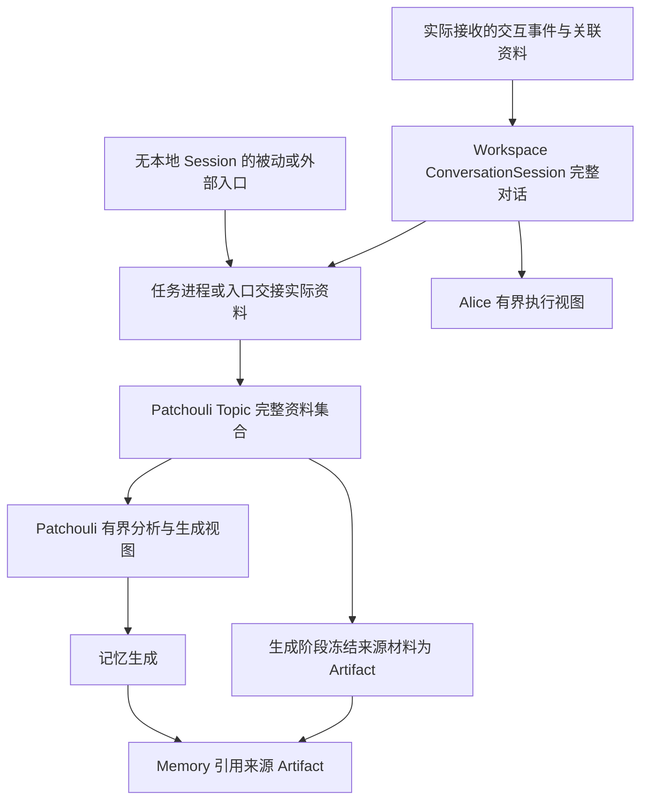

# 从 ConversationSession 到 Topic 与 Memory Artifact 的原始资料保存

本文是一项未排期的开放设计。2026-10-16 按 owner 的方向，将原先围绕 page folding 的证据旁路扩展为完整资料链：**ConversationSession 保存完整对话，Topic 保存已交接的完整资料，记忆生成阶段冻结相应来源 Artifact，再由 Memory 引用。** 会话原始数据是否持久化另行计划；本文不以新增独立原始记录仓库为前提。

当前能力仍以 [Workspace 架构](../architecture/workspace.md)、[感知与短期话题](../patchouli/perception.md)、[Artifacts 与来源追踪](../patchouli/artifacts.md)和[记忆生成](../patchouli/generation.md)为准。Alice compact、Topic page folding 的算法、预算与检查点集中在[短期记忆与上下文压缩](./short-term-memory-and-context-compaction.md)。本文维护原始资料的保存、交接与来源生命周期。

## 1. 问题与范围

上下文压缩允许原文退出模型的工作视图，但摘要具有损失，不能因此让原文在资料层消失。后续用户纠正、记忆更新、高保真提取、审计和调试，都可能重新需要当时未被摘要选中的细节。未来的对话编辑、回退和分支，也需要能够区分完整记录与某次执行使用的派生视图。

保存原文、控制模型输入、生成正式记忆是三项独立决策：

- 原文保存决定哪些实际接收的资料仍可查回，以及保留期限、容量和删除规则。
- 上下文压缩决定某次模型调用需要看到哪些内容；Alice 与 Patchouli 分别维护各自视图。
- 记忆生成决定哪些内容形成或更新正式 Memory，并记录其来源。

“已退出上下文”不等于“资料可删除”，“保存了资料”也不等于“已生成 Memory”。本文所说的完整，是约定接收范围内实际取得的原始事件、工具输入输出、交互结局和关联资料，不承诺恢复外部 harness 从未交付的内容，也不包含模型未公开的内部推理。

## 2. 当前实现基线与缺口

以下为 2026-10-16 核对的代码事实，用于说明本 Idea 的起点。

| 环节 | 当前证据 | 与全链路目标的差距 |
|:---|:---|:---|
| Session | [ConversationSessionService](../../src/hivememory/workspace/sessions/service.py)按封口顺序保存 `ConversationTurn` 与 payload 深拷贝；有容量限制，同会话只允许一个进程认领；删除不级联 Topic/Memory，关闭时清空 | 当前为进程内记录，尚无编辑、回退、分支或会话持久化；保存范围仍受当前 payload 与生产者实际输出约束 |
| 主动交接 | [交互封口](../../src/hivememory/workspace/process/sealing.py)组装 `InteractionPayload`；任务进程对有输出的 completed/cancelled/failed 封口、追加会话并提交 finalize | 当前是封口交接，未结束轮次的流式资料同步仍是方向；Session 写入与 Patchouli 应用不是跨系统原子事务 |
| Topic | [PerceptionFamiliar](../../src/hivememory/patchouli/services/perception.py)把交互投影为 block，维护 Topic 和 apply journal；overflow 更新摘要并移除旧前缀 | 没有与工作视图分离的完整资料集合，folding 前也不保存原文；journal 不能充当完整历史 |
| 结算与生成 | [TopicMaterializeTask](../../src/hivememory/engines/perception/models.py)从现存 blocks 冻结结算材料并过滤 `worth_saving=False`；[生成协调器](../../src/hivememory/patchouli/control/memory_generation/coordinator.py)构建模型视图与 `InteractionArtifactInput`，主动生成只取近期 blocks | 进入生成的资料受当前 blocks、价值过滤及近期窗口限制，不能补回此前已折叠的前缀；模型选择也不能证明全部资料已保存 |
| 来源 Artifact | [InteractionArtifactBuilder](../../src/hivememory/engines/artifacts/interaction.py)冻结交到它的 blocks；生成链捕获 InteractionArtifact、按结果挂载来源引用 | 当前 interaction/document 来源捕获为 best-effort，不能据此宣称完整证据必然保存；强制写入的 Memory version artifact 是另一项承诺 |

当前 Session 与 Topic 都是进程内资源；既有 Artifact 已有文件保存能力，这不等于前面两层已具备重启恢复。2026-10-13 owner 保留“未来对话流式同步到 Patchouli 需要接收容器”的方向，见[外部会话与 Topic 投影](./external-session-and-topic-projection.md)；容器、同步协议与失败恢复尚未落地。

## 3. 候选资料链与所有权

图中的 Session → Topic 表达事实交接，不要求 Patchouli 反向查询 workspace 的会话服务。Session 继续由 workspace 管理，Topic 和来源 Artifact 继续由 Patchouli 管理；任务进程、Import Bus 或外部 adapter 在各自提交边界交付实际内容及来源。Patchouli 持有已接收资料的正文或可独立管理寿命的稳定引用，不把 Session 的可变历史当作运行时读取依赖。

| 位置 | 候选保存责任 | 生命周期边界 |
|:---|:---|:---|
| ConversationSession | 实际接收的完整对话、顺序、交互结局及来源关联，服务于会话连续性与未来编辑能力 | workspace 管理会话资源，compact 不修改原记录；会话删除与关闭不自动删除已交接资料 |
| Topic 完整资料集合 | 归入该 Topic 的原始交互与相关资料，正文或稳定引用均可；按话题组织，不复制整个 Session | Patchouli 管理接收、保留、冻结与释放；完整资料不随 page folding 的工作窗口裁剪而消失 |
| Artifact | 冻结生成时关联的来源材料与覆盖范围，作为稳定证据 | Patchouli 管理不可变快照及引用；可复用既有 Interaction/Document Artifact，不在本文新增固定类型 |
| Memory | 可提炼、合并、修订的知识结果，通过来源引用关联证据 | Memory 变化不回写原始记录；Memory 是否保留与证据是否保留分别决定 |

同一 Session 可以涉及多个 Topic，同一 Topic 也可以汇集多个 Session、多个 Agent 和被动入口的材料。Topic 的完整资料是本话题实际接收的集合，不代表任一 Session 的完整副本。来源、Workspace 归属与读取授权继续分别表达，provenance 不能授予访问权。

不要求每层再建一份独立物理副本。共享正文、快照或引用的取舍，以各自生命周期内可兑现的读取保障为准；引用若依赖 Session 不被删除，就还没有完成向 Topic 的独立资料交接。

## 4. 完整资料与有界工作视图

Topic 完整资料保存“有哪些来源材料”；`state_summary + recent_blocks` 等派生视图回答“当前分析或生成看什么”。两者应独立演进：page folding 只推进后者，既不决定原文是否值得保存，也不自动宣告该段材料已被物化为正式记忆。

这不要求 active blocks 始终保留全部历史。若把所有正文留在同一个活跃输入中，Perception 会同时管理模型窗口和资料保全，settlement extractor 仍可能超出上下文窗口。候选方向是在 Topic 所有权下分开完整资料与工作窗口，共享稳定来源关联；具体数据布局留待 Plan 决定。

Alice compact 和 Topic folding 可以复用 token 计算、分段与摘要校验等机制，但拥有独立覆盖范围、检查点和保留策略。Alice 已压缩的进度不能证明 Patchouli 已接收资料，Topic 已折叠也不能证明 Memory 已生成。详细设计由[压缩 Idea](./short-term-memory-and-context-compaction.md)维护。

外部 harness 交付的 summary/checkpoint 应标明来源、覆盖范围与已知损失，作为辅助资料保存，不能冒充未提供的原始事件，也不能直接覆盖 Topic 的既有摘要。对于未知事件、多模态引用或无法形成完整 action 的片段，保存原事件与报告投影缺口应当优先于静默丢弃。

## 5. 交接、冻结与来源引用

### 5.1 从接收记录到 Topic 资料

进程或入口应交付实际发生的事实与已冻结来源，Patchouli 在领域内产生 block 等工作投影。接收、接纳、应用和保存完成需要有可区分的含义，不能用 best-effort 运行时事件证明资料已可靠交接；跨入口的共同提交与路由边界仍由[外部会话与 Topic 投影 Idea](./external-session-and-topic-projection.md)维护。

封口交互身份、事件关联和顺序必须在重试时稳定。相同提交不重复追加正文，内容冲突不当作普通重试；乱序、迟到和不完整工具结果保留其真实状态。资料是否可用于生成、是否有记忆价值，与资料是否已被保存分别表达，不能以 `worth_saving=False` 自动授权删除唯一原文。

对于未来未结束轮次的增量交接，需区分可继续追加的资料与已封口内容，并明确取消、失败、断连后覆盖范围。这里只保留完整性目标，不提前决定一个新开放轮次模型；流式接收、封口和生成时点见[长时间运行 Agent Idea](./long-running-agent-intra-turn-context-folding.md)。

### 5.2 从 Topic 资料到 Artifact

生成接纳或执行时，应绑定稳定的来源范围，避免任务重试读取已变化的 Topic 或 Session 而悄悄切换证据。候选方向是在生成阶段将选定的完整来源冻结为 Artifact，或者复用内容与覆盖范围相同的已有 Artifact。冻结资料集可以比该次模型真正读取的片段更广，但不能声称未读部分已经影响生成结论。

生成来源至少需要能够解释三件事：原始资料来自哪里、这份快照覆盖哪些交互/事件、某次提取实际消费哪些范围。具体粒度、引用结构与 schema 需结合既有 Artifact 模型评估，不在本文冻结字段或新增类型。工具结果若只保存短标识、附件若只留下随时可能失效的临时 ref，也不能声称已经保存了其完整正文。

候选生命周期要求是：Topic 结束或被驱逐之前，仍有保留责任的资料应已由生成任务接管、形成独立来源快照，或按明确保留规则继续可用；不能因为模型只消费了摘要，就删除尚无其他承接方的完整资料。冻结任务接纳不等于 Artifact 已写入，二者之间如何持有材料仍需设计。

### 5.3 Memory 的来源关联

Memory 关联来源 Artifact，不把原始对话嵌入每条知识正文。一份来源可以支撑多条 Memory，也可以在后续修订或高保真处理中被再次读取；生成任务的身份与原始交互身份不互相替代。

没有产生 Memory 的资料，也需要明确释放规则。TOUCH、DISCARD、生成失败或取消，不应隐含地决定是否保留证据。当前不同结果的挂载行为见[Artifacts 当前文档](../patchouli/artifacts.md)；本 Idea 只要求后续计划明确完整资料链在这些结果下的承诺。

## 6. 材料消费与高保真处理

保存完整资料不意味着一次 generation 请求读完全部历史。默认分析与生成继续使用有界视图；需要高保真提取时，可按稳定范围分片读取原文，形成候选记忆，再由 Generation 的去重、合并与更新机制处理结果。

异步 refinement 是可探索的消费策略，不是把原文推回 Alice 每轮输入的通道。它需要明确质量收益、资源预算、背压、可取消性、重试和幂等，并记录每次实际处理的资料范围。后续原文重读不应依赖已经失效的会话 cursor 或临时工作窗口。

同一份原文可能被主动 WRITE/UPDATE、普通 settlement 和 refinement 重复消费。Perception 管理资料及话题生命周期，不负责追踪“每一块是否已经生成过一条记忆”；生成侧管理重复提取、去重与来源关系，避免为了保存完整资料再引入一套与 Memory 结算竞争的状态机。

本方向应保留前台响应的延迟目标。来源保存与高保真消费可以分别安排，但异步执行不能被解释为允许先释放唯一资料副本，再期待后台补回。

## 7. 保留、容量、删除与失败

### 7.1 进程内完整性与持久化分别承诺

本 Idea 先讨论运行周期和明确保留范围内的完整资料链，不承诺进程崩溃后的会话恢复。会话正文的持久化、恢复、分页和跨进程存储可以另行计划；既有 Artifact 存储能力可以继续复用，不要求为全链路先建设统一持久化服务。

即使暂不持久化，也必须给出进程内资料的容量与释放边界。容量用尽、接收拒绝、资料过期和来源不可回查应当可区分，不能以“短期”作为静默淘汰唯一原文的理由。普通 Session 删除不能意外使已被 Topic 或生成任务接管的资料失效。

### 7.2 保存承诺决定失败处理

旧稿建议“保存失败后 warning，继续裁剪”。它只适用于明确允许证据缺失的可选增强，无法同时兑现完整保全目标。后续计划必须先选择每条交接的保障，再定义失败处理：

- 承诺完整保全的范围，在确认其他持有者已接管之前不能丢弃唯一副本。可探索保留原状、暂缓裁剪或显式背压，具体方式需与延迟和容量共同设计。
- 若提供允许有损运行的模式，需要明确对外说明覆盖缺口；保存失败、来源读取失败和原始资料本就未提供不能混为一类，也不能仅凭 warning 宣称链路完整。

当前来源 Artifact 的 best-effort 行为应作为需评估的基线，不能被本文直接改写为新的强制提交契约。Artifact 写入成功、Memory 内容提交成功与资料释放之间的次序及补偿，待独立计划确定。

### 7.3 引用、隐私与删除

保留策略需要覆盖 Session、Topic 资料、生成任务持有内容和 Artifact。普通会话删除、Topic 生命周期结束、Memory 删除与用户要求删除来源资料是不同操作；是否级联、如何处理共享来源、引用失效和孤立 Artifact，需要明确规则。

来源读取仍执行 Workspace 硬边界和资源 policy。多 Agent、多入口和跨会话聚合不能使原本不可见的资料因一个来源引用而变得可见。容量统计、保留期限、敏感内容处理、授权读取与垃圾回收均需在实施前给出可验证的范围。

## 8. 与编辑、回退和分支的关系

完整会话记录是这些能力的前提，但不会自动带来版本化能力。未来应区分“当前选中的会话历史”与“当时已经交接并用于生成的来源”。修改或回退 Session，不应原地改写已有 Artifact，也不应无条件撤回独立提交的写入或删除正式 Memory。

候选方向是让资料交接、压缩检查点和来源引用绑定具体历史范围；未来引入修订或分支后，再绑定对应版本。受影响的 Alice/Topic 派生视图可以失效并重建，既有 Artifact 保留当时事实；如何纠正已生成 Memory 则由显式的更新、失效或回档规则决定。

本次不提前引入完整分支图、统一事件日志或修订字段。后续模型只需避免把“某个 Session 当前内容”作为长期稳定证据，并为旧版资料保留、分支共享、删除和重算留下清晰边界。

## 9. 已知缺口、历史承接与待设计范围

### 9.1 历史承接

2026-10-01，原占位计划“话题折叠、Actor 上下文与原始证据统一改造”（`docs/plans/topic-folding-context-and-raw-evidence.md`）退回 Idea，原 Todo“Page Folding 跨入口上下文与证据后续技术债”（`docs/todo/page-folding-cross-ingress-follow-ups.md`）拆分。后台部分并入本节，前台部分并入[长时间运行 Agent Idea](./long-running-agent-intra-turn-context-folding.md)第 14 节；原文件删除前最后版本见 commit `74b5056`。

2026-10-16，本篇从“折叠时额外保存旧页”调整为 Session → Topic → Artifact 的全链路资料保存。原稿中的 Agent Context Flow 定位已失效：Alice 的对话历史来自 Session，Topic folding 面向 Patchouli 的分析与生成。原第 9 节中的 token/block 联合预算、摘要增长、超大 block 和 summary-only Topic 等压缩问题，转由[短期记忆与上下文压缩 Idea](./short-term-memory-and-context-compaction.md)维护；原文保存、跨入口 provenance、生成与删除生命周期继续由本文承接。

### 9.2 保留的资料链问题

| 工作域 | 尚需回答的问题 |
|:---|:---|
| 完整范围与跨入口 | 哪些事件、工具结果、多模态与附件内容被承诺保存；来源未提供与投影丢失如何区分；混合来源 Topic 如何保留可靠 provenance |
| 交接与引用 | 封口及流式资料何时算保存成功；正文复制与稳定引用如何取舍；Session 删除、Topic 结束或接纳结果未知时由谁继续持有 |
| 冻结与生成 | 来源范围何时绑定，如何与有界视图、普通 settlement、主动生成和异步 refinement 对齐；过滤、失败、取消及无 Memory 结果后的资料如何处置 |
| 容量与生命周期 | 进程内完整性的容量、保留期限、背压和释放条件；Artifact 引用共享、孤立资料、敏感内容删除及 shutdown 的承诺范围 |
| 后续编辑能力 | 未来修订/分支如何寻址来源、使派生视图失效并处理既有记忆；与会话持久化的范围如何分别安排 |

### 9.3 升级为 Plan 的门槛

进入实施计划之前，需要明确一个可独立验收的切片，而不是要求同时完成 compact、流式同步、持久化和高级会话功能：

1. 通过实际案例明确要保全的资料范围、质量收益与当前丢失点，并决定接收和交接成功的含义。
2. 确定 Session、Topic、任务持有材料与 Artifact 的生命周期和稳定引用保障，覆盖跨入口、失败、重试、取消与关闭。
3. 明确保留、容量、隐私和删除规则；证明完整保全承诺与延迟目标、失败处理相容。
4. 如纳入高保真 refinement，明确分片消费、生成侧去重、来源关联与预算，并验证其不依赖无界模型输入。
5. 绑定版本或里程碑，确定相关契约、迁移与验证归属；实现、验收和代码审查完成后，再按最终代码更新 Workspace、Perception、Generation、Artifacts 与 Passive Ingress 的当前事实文档。

会话原始数据持久化可以独立立项。本文不把它作为开始梳理和贯通进程内完整资料链的默认前置条件。
