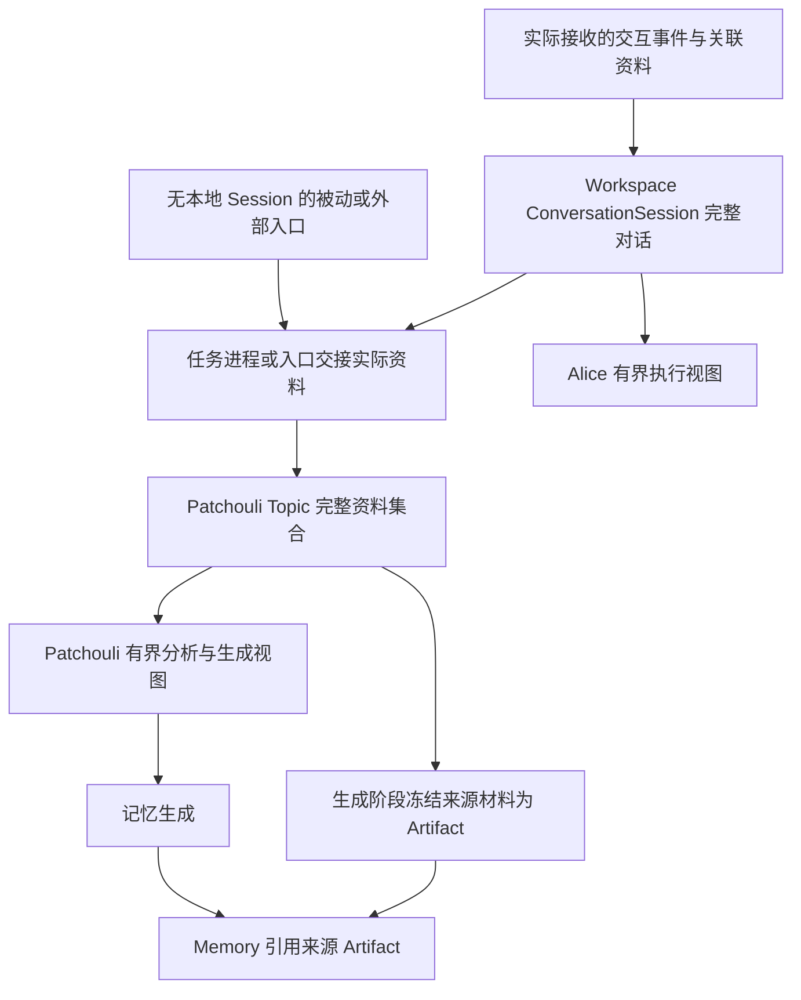

# 从 ConversationSession 到 Topic 与 Memory Artifact 的原始资料保存

本文是原始资料保存的设计：**ConversationSession 保存完整对话，Topic 保存已交接的完整资料，记忆生成阶段冻结相应来源 Artifact，再由 Memory 引用。** 从 Topic 往后的部分已经实现（第 0 节），交到 Topic 之前的环节与保存承诺是候选设计；会话原始数据是否持久化另行计划，本文不以新增独立原始记录仓库为前提。

当前能力以 [Workspace](../workspace/README.md)、[感知与短期话题](../patchouli/perception.md)、[Artifacts 与来源追踪](../patchouli/artifacts.md)和[记忆生成](../patchouli/generation.md)为准。Alice compact、Topic page folding 的算法、预算与检查点集中在[短期记忆](./short-term-memory-and-context-compaction.md)。本文维护原始资料的保存、交接与来源生命周期。正文是已定的设计，候选设计标“候选”。

## 0. Topic 之后的原始证据保存与生成材料

从 Topic 往后的链路已经实现：Topic 保存全部交互记录与折叠记录，折叠只推进工作视图；结算冻结全部记录，来源 InteractionArtifact 覆盖已折叠的轮次并带折叠记录（[感知与短期话题](../patchouli/perception.md)、[Artifacts](../patchouli/artifacts.md)）。交到 Topic 之前的环节（Session 侧的保存、进程与入口的交接、会话持久化）与第 7 节的保存承诺，是本文仍开放的范围。

### 0.1 已定的设计

- **不截断一轮交互**：一轮交互的内容不被任何一个上限数字截断，最多只限制单次工具调用的结果（`max_result_chars`）。工具输出可能是整份文件或日志，其余内容是对话与推理本身，任何一个单轮或单条的上限数字都会截掉一轮的过程。
- **价值不由入口判定**：结算不按入口的价值标记筛选材料，`worth_saving` 已移除；价值体系另行重新设计，不在现有信号上增补。
- **R-1 不分片**：完整材料超出提取模型的窗口时，不按范围分片生成。话题本来就是用来聚合同一语义的片段，再按范围分片生成，相当于人为打散这一结构；按范围分片、再由后台异步 refinement 的做法同样不采用。单个超大轮次照常接收、照常触发话题折叠；生成继续读取话题的工作视图（`state_summary` 与未折叠的 blocks），完整资料只做保存。
- **R-2 Topic 完整资料的保全**：Topic 在原始数据上按顺序保存全部接收到的交互记录，以及一份话题折叠的记录，作为之后来源 Artifact 的数据。折叠因此只推进工作视图，不丢弃原文。

现状中的一个缺口：工作视图在单轮上百次工具调用这类情况下仍可能超出提取模型的窗口，任务以 `model_context_window_exceeded` 失败，原文留在来源 InteractionArtifact 中但没有记忆引用它（[记忆生成](../patchouli/generation.md#8-当前限制)第 8 节）；这类材料怎样消费，随[长 Turn Idea](./long-running-agent-intra-turn-context-folding.md)的分段一起考虑。

## 1. 问题与范围

上下文压缩允许原文退出模型的工作视图，但摘要具有损失，不能因此让原文在资料层消失。后续用户纠正、记忆更新、高保真提取、审计和调试，都可能重新需要当时未被摘要选中的细节。未来的对话编辑、回退和分支，也需要能够区分完整记录与某次执行使用的派生视图。

保存原文、控制模型输入、生成正式记忆是三项独立决策：

- 原文保存决定哪些实际接收的资料仍可查回，以及保留期限、容量和删除规则。
- 上下文压缩决定某次模型调用需要看到哪些内容；Alice 与 Patchouli 分别维护各自视图。
- 记忆生成决定哪些内容形成或更新正式 Memory，并记录其来源。

“已退出上下文”不等于“资料可删除”，“保存了资料”也不等于“已生成 Memory”。本文所说的完整，是约定接收范围内实际取得的原始事件、工具输入输出、交互结局和关联资料，不承诺恢复外部 harness 从未交付的内容，也不包含模型未公开的内部推理。

## 2. 当前实现基线与缺口

以代码为准。

| 环节 | 当前证据 | 与全链路目标的差距 |
|:---|:---|:---|
| Session | [ConversationSessionService](../../src/hivememory/workspace/sessions/service.py)按封口顺序保存 `ConversationTurn` 与 payload 深拷贝；有容量限制，同会话只允许一个进程认领；删除不级联 Topic/Memory，关闭时清空（[会话资源](../workspace/sessions.md)） | 进程内记录，没有编辑、回退、分支或会话持久化；保存范围受 payload 与生产者实际输出约束 |
| 主动交接 | [交互封口](../../src/hivememory/core/protocol/sealing.py)组装 `InteractionPayload`；任务进程对有输出的 completed/cancelled/failed 封口、写入会话并提交交互 | 只在轮次封口时交接；Session 写入与 Patchouli 应用不是跨系统原子事务 |
| Topic | [PerceptionFamiliar](../../src/hivememory/patchouli/services/perception.py)按顺序保存全部交互记录与折叠记录，工作视图由二者派生，折叠只推进工作视图 | 话题是进程内状态，异常退出可能丢失未结算的交互记录；结算前保存全部记录，没有容量上限或背压（[感知与短期话题](../patchouli/perception.md)） |
| 结算与生成 | [TopicMaterializeTask](../../src/hivememory/engines/perception/models.py)冻结全部记录，不按入口价值标记筛选；[生成协调器](../../src/hivememory/patchouli/control/memory_generation/coordinator.py)构建模型视图与 `InteractionArtifactInput`；主动写入取话题的状态摘要与最近几个 block | 生成读取工作视图，不读取已折叠的原文；模型选择不能证明全部资料已保存 |
| 来源 Artifact | [InteractionArtifactBuilder](../../src/hivememory/engines/artifacts/interaction.py)冻结交到它的全部记录，覆盖已折叠的轮次；来源 InteractionArtifact 在生成之前捕获 | 捕获是 best-effort，不能据此宣称完整证据必然保存；强制写入的 Memory version artifact 是另一项承诺 |

Session 与 Topic 都是进程内资源；Artifact 已有文件保存能力，这不等于前面两层具备重启恢复。

## 3. 候选资料链与所有权（候选）

图中的 Session → Topic 表达事实交接，不要求 Patchouli 反向查询 workspace 的会话服务。Session 继续由 workspace 管理，Topic 和来源 Artifact 继续由 Patchouli 管理；任务进程、Import Bus 或外部 adapter 在各自提交边界交付实际内容及来源。Patchouli 持有已接收资料的正文或可独立管理寿命的稳定引用，不把 Session 的可变历史当作运行时读取依赖。

| 位置 | 候选保存责任 | 生命周期边界 |
|:---|:---|:---|
| ConversationSession | 实际接收的完整对话、顺序、交互结局及来源关联，服务于会话连续性与未来编辑能力 | workspace 管理会话资源，compact 不修改原记录；会话删除与关闭不自动删除已交接资料 |
| Topic 完整资料集合 | 归入该 Topic 的原始交互与相关资料，正文或稳定引用均可；按话题组织，不复制整个 Session | Patchouli 管理接收、保留、冻结与释放；完整资料不随 page folding 的工作窗口裁剪而消失 |
| Artifact | 冻结生成时关联的来源材料与覆盖范围，作为稳定证据 | Patchouli 管理不可变快照及引用；可复用既有 Interaction/Document Artifact，不在本文新增固定类型 |
| Memory | 可提炼、合并、修订的知识结果，通过来源引用关联证据 | Memory 变化不回写原始记录；Memory 是否保留与证据是否保留分别决定 |

同一 Session 可以涉及多个 Topic，同一 Topic 也可以汇集多个 Session、多个 Agent 和被动入口的材料。Topic 的完整资料是本话题实际接收的集合，不代表任一 Session 的完整副本。来源、Workspace 归属与读取授权继续分别表达，provenance 不能授予访问权。

不要求每层再建一份独立物理副本。共享正文、快照或引用的取舍，以各自生命周期内可兑现的读取保障为准；引用若依赖 Session 不被删除，就还没有完成向 Topic 的独立资料交接。

## 4. 完整资料与有界工作视图

Topic 完整资料保存“有哪些来源材料”；`state_summary + recent_blocks` 等派生视图回答“当前分析或生成看什么”。两者独立演进：page folding 只推进后者，既不决定原文是否值得保存，也不自动宣告该段材料已被物化为正式记忆。

这不要求 active blocks 始终保留全部历史：把所有正文留在同一个活跃输入中，Perception 就要同时管理模型窗口和资料保全，settlement extractor 仍可能超出上下文窗口。在 Topic 所有权下分开完整资料与工作窗口已经实现：Topic 按顺序保存全部交互记录与折叠记录，工作视图由它们派生（[感知与短期话题](../patchouli/perception.md)）。

Alice compact 和 Topic folding 可以复用 token 计算、分段与摘要校验等机制，但拥有独立覆盖范围、检查点和保留策略。Alice 已压缩的进度不能证明 Patchouli 已接收资料，Topic 已折叠也不能证明 Memory 已生成。详细设计由[压缩 Idea](./short-term-memory-and-context-compaction.md)维护。

外部 harness 交付的 summary/checkpoint 应标明来源、覆盖范围与已知损失，作为辅助资料保存，不能冒充未提供的原始事件，也不能直接覆盖 Topic 的既有摘要。对于未知事件、多模态引用或无法形成完整 action 的片段，保存原事件与报告投影缺口优先于静默丢弃。

## 5. 交接、冻结与来源引用

### 5.1 从接收记录到 Topic 资料（候选）

进程或入口交付实际发生的事实与已冻结来源，Patchouli 在领域内产生 block 等工作投影。接收、接纳、应用和保存完成需要有可区分的含义，不能用 best-effort 运行时事件证明资料已可靠交接；跨入口的共同提交与路由边界由[外部会话与 Topic 投影 Idea](./external-session-and-topic-projection.md)维护。

封口交互身份、事件关联和顺序必须在重试时稳定。相同提交不重复追加正文，内容冲突不当作普通重试；乱序、迟到和不完整工具结果保留其真实状态。资料是否可用于生成、是否有记忆价值，与资料是否已被保存分别表达，价值判断不能自动授权删除唯一原文。

对于未结束轮次的增量交接，需区分可继续追加的资料与已封口内容，并明确取消、失败、断连后覆盖范围。这里只保留完整性目标，不提前决定一个新开放轮次模型；接收、封口和生成时点见[长时间运行 Agent Idea](./long-running-agent-intra-turn-context-folding.md)。

### 5.2 从 Topic 资料到 Artifact

生成接纳或执行时绑定稳定的来源范围，避免任务重试读取已变化的 Topic 或 Session 而悄悄切换证据。话题结算的这一部分已经实现：结算冻结全部交互记录与折叠记录，来源 InteractionArtifact 覆盖已折叠的轮次（[Artifacts](../patchouli/artifacts.md)）。冻结资料集可以比该次模型真正读取的片段更广，但不能声称未读部分已经影响生成结论。

生成来源至少要能解释三件事：原始资料来自哪里、这份快照覆盖哪些交互与事件、某次提取实际消费哪些范围。记忆的版本记录已经引用到段（轮次标识加事件序号区间，[记忆生成](../patchouli/generation.md#22-段标签与记忆引用)）；其余粒度与引用结构需结合既有 Artifact 模型评估，不在本文冻结字段或新增类型。工具结果若只保存短标识、附件若只留下随时可能失效的临时 ref，也不能声称已经保存了其完整正文。

候选生命周期要求：Topic 结束或被驱逐之前，仍有保留责任的资料应已由生成任务接管、形成独立来源快照，或按明确保留规则继续可用；不能因为模型只消费了摘要，就删除尚无其他承接方的完整资料。冻结任务接纳不等于 Artifact 已写入：二者之间由结算任务携带冻结的全部记录；Artifact 捕获失败时这次结算的原文不再保存在任何地方，是否允许这一缺口随第 7 节的保存承诺决定。

### 5.3 Memory 的来源关联

Memory 关联来源 Artifact，不把原始对话嵌入每条知识正文。一份来源可以支撑多条 Memory，也可以在后续修订中被再次读取；生成任务的身份与原始交互身份不互相替代。

没有产生 Memory 的资料，也需要明确释放规则。TOUCH、DISCARD、生成失败或取消，不应隐含地决定是否保留证据。话题结算中这一点已经实现：来源 InteractionArtifact 在生成之前捕获，提取失败、没有产出或结果为 TOUCH 时原文仍保存在其中，只是没有记忆引用它（[记忆生成](../patchouli/generation.md)第 5 节）。不同结果的挂载行为见 [Artifacts](../patchouli/artifacts.md)；后续计划要明确完整资料链在这些结果下的承诺。

## 6. 材料消费

保存完整资料不意味着一次生成请求读完全部历史。分析与生成使用有界视图，不分片、不做后台的异步 refinement（第 0.1 节）。

同一份原文可能被主动 WRITE/UPDATE 与结算重复消费。Perception 管理资料及话题生命周期，不负责追踪“每一块是否已经生成过一条记忆”；生成侧管理重复与来源关系，不为了保存完整资料再引入一套与 Memory 结算竞争的状态机。

前台响应的延迟目标保持不变。来源保存可以与生成分开安排，但不能先释放唯一资料副本，再期待后台补回。

## 7. 保留、容量、删除与失败（候选）

### 7.1 进程内完整性与持久化分别承诺

本文先讨论运行周期和明确保留范围内的完整资料链，不承诺进程崩溃后的会话恢复。会话正文的持久化、恢复、分页和跨进程存储可以另行计划；既有 Artifact 存储能力可以继续复用，不要求为全链路先建设统一持久化服务。

即使暂不持久化，也必须给出进程内资料的容量与释放边界。容量用尽、接收拒绝、资料过期和来源不可回查应当可区分，不能以“短期”作为静默淘汰唯一原文的理由。普通 Session 删除不能意外使已被 Topic 或生成任务接管的资料失效。

### 7.2 保存承诺决定失败处理

“保存失败后只记 warning、继续裁剪”只适用于明确允许证据缺失的可选增强，无法同时兑现完整保全目标。后续计划先选择每条交接的保障，再定义失败处理：

- 承诺完整保全的范围，在确认其他持有者已接管之前不能丢弃唯一副本。可探索保留原状、暂缓裁剪或显式背压，具体方式需与延迟和容量共同设计。
- 若提供允许有损运行的模式，需要明确对外说明覆盖缺口；保存失败、来源读取失败和原始资料本就未提供不能混为一类，也不能仅凭 warning 宣称链路完整。

来源 Artifact 的 best-effort 行为是需评估的基线，不能被本文直接改写为新的强制提交契约。Artifact 写入成功、Memory 内容提交成功与资料释放之间的次序及补偿，待独立计划确定。

### 7.3 引用、隐私与删除

保留策略需要覆盖 Session、Topic 资料、生成任务持有内容和 Artifact。普通会话删除、Topic 生命周期结束、Memory 删除与用户要求删除来源资料是不同操作；是否级联、如何处理共享来源、引用失效和孤立 Artifact，需要明确规则。

来源读取仍执行 Workspace 硬边界和资源 policy。多 Agent、多入口和跨会话聚合不能使原本不可见的资料因一个来源引用而变得可见。容量统计、保留期限、敏感内容处理、授权读取与垃圾回收均需在实施前给出可验证的范围。

## 8. 与编辑、回退和分支的关系

完整会话记录是这些能力的前提，但不会自动带来版本化能力。要区分“当前选中的会话历史”与“当时已经交接并用于生成的来源”。修改或回退 Session，不原地改写已有 Artifact，也不无条件撤回独立提交的写入或删除正式 Memory。

候选方向：资料交接、压缩检查点和来源引用绑定具体历史范围；引入修订或分支后，再绑定对应版本。受影响的 Alice/Topic 派生视图可以失效并重建，既有 Artifact 保留当时事实；已生成的 Memory 怎样纠正，由显式的更新、失效或回档规则决定。

不提前引入完整分支图、统一事件日志或修订字段。只需避免把“某个 Session 当前内容”作为长期稳定证据，并为旧版资料保留、分支共享、删除和重算留下清晰边界。

## 9. 已知缺口与待设计范围

### 9.1 范围的划分

本文维护原文保存、跨入口 provenance、生成与删除的生命周期。token/block 联合预算、摘要增长、超大 block 与 summary-only Topic 等压缩问题由[短期记忆 Idea](./short-term-memory-and-context-compaction.md)维护；前台的跨入口上下文缺口由[长时间运行 Agent Idea](./long-running-agent-intra-turn-context-folding.md)第 14 节维护。Alice 的对话历史来自 Session，Topic folding 面向 Patchouli 的分析与生成。

### 9.2 保留的资料链问题

| 工作域 | 尚需回答的问题 |
|:---|:---|
| 完整范围与跨入口 | 哪些事件、工具结果、多模态与附件内容被承诺保存；来源未提供与投影丢失如何区分；混合来源 Topic 如何保留可靠 provenance |
| 交接与引用 | 封口及增量资料何时算保存成功；正文复制与稳定引用如何取舍；Session 删除、Topic 结束或接纳结果未知时由谁继续持有 |
| 冻结与生成 | 来源范围在结算时绑定，冻结全部交互记录与折叠记录，已经实现；来源 Artifact 捕获失败与取消后的资料如何处置，随第 7 节的保存承诺决定 |
| 容量与生命周期 | 进程内完整性的容量、保留期限、背压和释放条件；Artifact 引用共享、孤立资料、敏感内容删除及 shutdown 的承诺范围 |
| 后续编辑能力 | 未来修订/分支如何寻址来源、使派生视图失效并处理既有记忆；与会话持久化的范围如何分别安排 |

### 9.3 升级为 Plan 的门槛

进入实施计划之前，需要明确一个可独立验收的切片，而不是要求同时完成 compact、增量交接、持久化和高级会话功能：

1. 通过实际案例明确要保全的资料范围、质量收益与当前丢失点，并决定接收和交接成功的含义。
2. 确定 Session、Topic、任务持有材料与 Artifact 的生命周期和稳定引用保障，覆盖跨入口、失败、重试、取消与关闭。
3. 明确保留、容量、隐私和删除规则；证明完整保全承诺与延迟目标、失败处理相容。
4. 绑定版本或里程碑，确定相关契约、迁移与验证归属；实现、验收和代码审查完成后，再按最终代码更新 Workspace、Perception、Generation、Artifacts 与 Import Bus 的当前事实文档。

会话原始数据持久化可以独立立项，不是开始梳理和贯通进程内完整资料链的前置条件。
