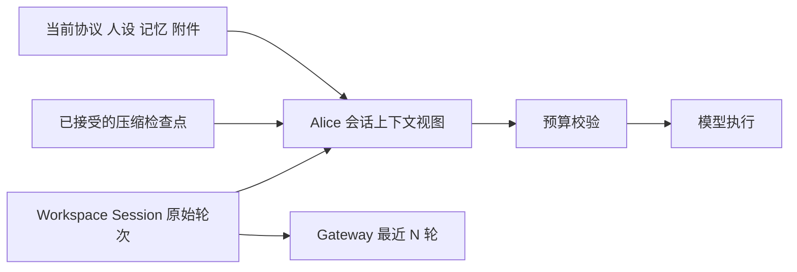

# Agent Harness 会话压缩技术调研

Alice 的 v0.7.0 会话压缩可以建立在已经广泛采用的工程模式上：**保留原始会话，从历史前缀生成接力摘要，保留近期执行材料，再按当前模型预算重建上下文。** 真正需要设计的部分是覆盖边界、预算、失败提交和运行状态恢复；摘要提示词只是其中一环。

从与 HiveMemory 的适配程度判断，建议优先阅读 **pi 的日志与上下文投影、Hermes 的模型无关压缩、Codex 的检查点替换与恢复**，再参考 Claude Code 的上下文恢复策略和 OpenCode V2 的预算与终态管理。Provider 原生压缩值得保留扩展位置，但会引入不同于普通文本摘要的兼容条件。

本文是为后续 Plan 提供依据的调研快照。外部实现事实与对 Alice 的候选建议分别叙述；没有据此确定 AC-1、AC-2，也没有把任何候选能力晋升为 HiveMemory 当前事实。

## 1. 范围与证据基线

调研日期为 **2026-10-16**，覆盖 Claude Code、OpenAI Codex、NousResearch Hermes Agent、pi coding agent 与 OpenCode。各项目均先通过 Context7 定位资料，再核对官方原文；开源项目进一步读取固定提交的源码。代码基线如下，均为当日取得的开发主线快照，**不代表同名发行版本已经交付其中全部功能**。

| 对象 | 实现与证据范围 | 固定代码基线 |
|:---|:---|:---|
| Claude Code | 官方产品文档；核心压缩实现未在本次取得的公开源码中核验 | 滚动文档，访问于 2026-10-16 |
| Codex | Rust；客户端摘要、Provider 专有压缩、历史替换、恢复测试 | [`0e67502123b4`](https://github.com/openai/codex/commit/0e67502123b4c6952b9fa5d672d2907fe4059f56) |
| Hermes Agent | Python；客户端压缩器、辅助模型调用、执行与会话存储 | [`e7e839a5f429`](https://github.com/NousResearch/hermes-agent/commit/e7e839a5f4298bf98f086dde1ac49fc8de5ecad3) |
| pi coding agent | TypeScript；压缩算法、JSONL 会话树、模型投影与恢复 | [`8efd314fa3d3`](https://github.com/earendil-works/pi/commit/8efd314fa3d3232ce197d8d7a6a5660530b9d83e) |
| OpenCode V2 | TypeScript；检查点、事件投影、本地摘要与原生压缩 | [`180fd9d622c6`](https://github.com/anomalyco/opencode/commit/180fd9d622c6855ef6ea36fd81314de6406af054) |

源码可以验证客户端决策与数据流，不能揭示闭源模型内部如何压缩信息。官方产品文档可以确认支持的行为，不能证明内部 prompt、阈值公式或事务实现。本文没有运行这些项目的测试或真实长会话对比实验，不提供压缩质量排名。

## 2. 先区分四类机制

| 机制 | 改变什么 | 解决的问题 | 代价与限制 |
|:---|:---|:---|:---|
| 工具结果减重 | 删除或缩短旧工具输出，保留必要调用信息 | 大日志、网页、文件内容反复占据窗口 | 需要原文寻址与重读能力；不能丢掉仍在执行的调用关联 |
| 历史前缀摘要 | 用接力摘要覆盖较早内容，近期材料另行保留 | 多轮上下文累计增长 | 有损；需避免旧摘要与保留后缀重复覆盖 |
| Provider 原生压缩 | 保存平台返回的压缩 block 或 replacement window | 利用模型平台提供的压缩能力 | 格式、可读性、签名和兼容性由平台决定 |
| 原始记录与上下文投影分离 | 原文继续存储，改变下一次实际送给模型的视图 | 恢复、审计、重新压缩和模型切换 | 需要检查点边界、版本校验和清理生命周期 |

这些机制可以组合。Claude Code 官方说明先清理旧工具输出，再在需要时摘要；pi 将压缩结果追加为记录并重建模型投影；OpenCode V2 同时提供摘要与原生压缩模式。它们不能被合并成一个固定的“保留最后 N 条消息”算法。[Claude Code 运行机制][claude-how]、[pi 会话投影][pi-session]、[OpenCode V2 文档][oc-doc]

还要区分**跨用户轮次压缩**与**同一轮工具循环中的压缩**。后者需要处理尚未结束的执行跨度、工具关联和恢复点。HiveMemory 当前候选范围仅覆盖根 frame 的历史轮次，不能由此推出任意长单轮任务都不会溢出。[现有候选范围](./short-term-memory-and-context-compaction.md#5-alice-会话-compact-候选机制)、[Turn 内折叠方向](./long-running-agent-intra-turn-context-folding.md)

## 3. Claude Code

### 3.1 官方能够确认的机制

Claude Code 在上下文趋满时先清除较早的工具输出，必要时摘要会话；用户可以通过 `/compact` 并附加关注重点主动压缩，也可以在项目指令中指定摘要应保留什么。官方提醒，早期细节可能在压缩后丢失。自动触发与模型窗口相关，当前文档提供压缩窗口设置；不宜把某个版本流传的固定百分比视为通用算法。[运行机制][claude-how]、[模型窗口与自动压缩][claude-model]

压缩包含独立的摘要请求。官方缓存文档说明，该请求复用相同的 system prompt、工具和历史，只在尾部追加摘要指令，以利用已有前缀缓存。压缩之后，会话历史缓存需要重新建立。因此成本评估应同时考虑摘要请求与后续缓存重建，不能只比较压缩前后的 token 数。[Prompt caching][claude-cache]

### 3.2 连续性来自重新加载运行状态

当前官方文档说明，压缩后会重新加载根项目指令、auto memory 和 plan，恢复相关技能与运行任务提醒，并从读过或编辑过的文件中，按最近修改顺序选取一定数量重读。这里值得借鉴的是：**必须继续生效的运行状态由程序重新提供**，无需全部寄希望于摘要模型记住。文件数量和预算属于其产品策略，Alice 没有必要照搬。[压缩后保留的上下文][claude-survive]

扩展点中，`PreCompact` 区分手动与自动触发，可以阻止压缩；`PostCompact` 在完成后提供摘要用于观测，不能改写已完成结果。产品还对连续压缩却无法释放有效空间的 thrashing 显式报错，避免反复付费摘要。[Hooks][claude-hooks]、[压缩震荡处理][claude-thrash]

会话消息、工具调用和结果保存到本地会话文件，并支持恢复。本文没有取得其压缩提交、并发输入与取消处理的完整源码，不能确认这些内部细节。[会话保存与恢复][claude-how]

### 3.3 Anthropic API 能力需要单独看待

Messages API 的 context editing 可以按规则清除旧工具结果，并配置近期保留和工具排除；这是平台能力，不能作为 Claude Code 内部实现的证明。[Context editing][anthropic-edit]

当前 on-demand compaction 文档提供带签名的压缩 block：调用方需要原样保留该 block 的 `content` 与 `signature`，未完成工具调用、残缺或空摘要等情况需要按其契约处理。threshold compaction 又有自己的触发和暂停语义。因此，即使内容可读，也不能把一个平台 block 简化成普通摘要字符串。[On-demand compaction][anthropic-demand]、[Threshold compaction][anthropic-threshold]

**对 Alice 的启示**：先定义哪些信息由程序恢复、哪些允许摘要化；权限、MTP ACK 与任务结局从现有权威对象取得。Claude Code 适合参考产品行为和恢复策略，其公开资料不足以作为可直接移植的完整压缩实现。

## 4. OpenAI Codex

### 4.1 压缩入口与实现分派

固定快照的 `CompactTask::run` 按 Provider capability 分派：支持 remote V2 的路径使用专有压缩；其他路径使用客户端控制的文本摘要。这里的 local 指由客户端组织摘要调用，仍然需要模型推理。另有受 `Feature::TokenBudget` 控制的重建上下文窗口支路，它不调用摘要模型，不能将其与常规摘要路径混写。[任务入口][codex-task]、[Token budget 支路][codex-budget]

常规运行在采样前、运行中和可配置的轮末检查压缩条件。切换到更小窗口的模型、压缩兼容 hash 变化，也会影响处理方式。预算同时检查自动压缩限额和模型有效窗口硬上限，不能只看一个配置阈值。[运行与模型切换][codex-turn]、[窗口预算][codex-window]

### 4.2 客户端文本摘要路径

`compact.rs` 克隆历史、追加接力摘要指令，完成模型调用后重建历史。其摘要模板要求保留进展与决定、约束和偏好、剩余步骤及关键引用。这里的目标是让下一次推理接着工作。[本地摘要实现][codex-local]、[接力摘要模板][codex-prompt]

固定版本的该路径会从新到旧保留预算内的用户消息，预算常量为 20,000 tokens，再加入摘要并重新注入初始上下文。**这与保留最近若干完整会话轮次并不等价**；不能直接把这个保留策略搬到 Alice 的 `ConversationTurn`。摘要请求自身超窗时，代码会缩减临时请求中的旧历史后重试；普通流错误有重试上限，中断和特定终态错误直接退出。[历史重建与错误分支][codex-local]

### 4.3 Remote V2 与公开 Responses API 需要区分

本次源码快照的 remote V2 将 `CompactionTrigger` 放入 Responses 输入，并要求完整流终态与恰好一个 compaction item；客户端再按策略保留部分消息、加入该 item、恢复当前运行上下文。它不是普通的“返回一段 summary text”。具体保留规则还受 feature flag 影响。[Remote V2 请求][codex-v2-attempt]、[返回校验与保留规则][codex-v2]

OpenAI 官方公开 API 则同时提供 server-side `context_management` 与独立 `/responses/compact`。独立接口返回的是完整的下一窗口，可能包含保留项和不透明的压缩项，应原样用于后续请求，不能只提取其中一个字段。**API 产品契约和特定 Codex 提交的传输实现需分别核验**。[官方 OpenAI compaction 文档][openai-compaction]

### 4.4 值得参考的是检查点安装与恢复

固定源码已有受 feature gate 控制的异步压缩：截取一个历史前缀在后台计算，采用结果前核对历史版本、模型与压缩兼容信息；安装时保留之后产生的后缀。合并后仍超预算时允许一次前台压缩。后台任务由 session 管理并在关闭时收束，这不是无成本的并发优化。[后台任务生命周期][codex-async]、[检查点安装][codex-install]

仓库有压缩后 resume/fork、多次压缩恢复等测试；恢复代码根据持久化检查点重建模型历史视图。这些代码比单独复制摘要 prompt 更适合作为 Alice 检查点语义的参考。[恢复实现][codex-reconstruct]、[恢复与 fork 测试][codex-recovery-tests]

**对 Alice 的启示**：将“生成摘要”和“接受新检查点”拆开；模型切换后重新验证预算。首版可以同步完成压缩；后台压缩还需要版本、前缀合并和关闭协议，应作为独立复杂度评估。

## 5. NousResearch Hermes Agent

本节以固定源码为准。Hermes 的压缩器已经拆为预算、摘要调用、尾部清理和观测等多个模块；一些旧说明仍使用固定头尾消息数量，不能据此描述当前默认策略。[压缩器入口][hermes-compressor]

### 5.1 触发和保留预算

当前默认 `lean` 尾部策略按 token 预算保留近期材料，预算随主模型窗口调整，并设上下界；不是永久保留最后固定数量消息。小窗口的触发比例也有调整，同时考虑输出预留、绝对上限和摘要模型输入可行性。首次压缩前保护的早期非 system 消息，在后续压缩中会衰减，避免开头内容永久占据窗口。[预算与保护范围][hermes-compressor]

以主模型窗口 `W` 表示，固定版本默认 lean 的尾部预算为 `min(0.20W, max(10000, min(25000, 0.025W)))`。配置基础阈值虽为 0.50，但 `W < 512000` 时比例至少提高到 0.75，再经过其他约束调整；“50% 触发、头 3 尾 20 永久保留”不能准确概括其当前行为。[预算函数与默认值][hermes-compressor]

这说明触发阈值、压缩后目标大小、近期保留预算和摘要输出预算应分开配置。把它们全部简化成一个窗口百分比，无法处理小模型或单条超长输出。

### 5.2 摘要、工具结果和重复压缩

Hermes 可以通过辅助摘要模型生成接力材料，已有摘要参与下一轮更新；压缩器还会将过时的工具输出降为带恢复线索的短记录。后者的前提是会话原文可以再查询，只有一句“内容已省略”不能恢复所需证据。[摘要更新][hermes-summary-build]、[辅助调用协调][hermes-summary]、[尾部工具输出处理][hermes-tail]

摘要模板覆盖历史任务快照、目标、约束、实际动作及结果、当前状态、阻塞、决策与关键细节；精确标识与用户原文还有程序化保留。其摘要目标预算写在 prompt 中，调用时没有用硬 `max_tokens` 限制正文，输出仍需检查截断、拒绝和空内容。目标长度和可接受结果必须分开理解；Alice 若要求严格有界摘要，还需定义超限后的处理。[摘要构造与校验][hermes-summary-build]、[截断与拒绝测试][hermes-summary-tests]

它的工程价值在于展示了通用模型接口之上的客户端压缩，不需要把会话核心状态定义为某一家 Provider 的专有 block。但可配置摘要模型也带来额外预算问题：辅助模型可能比主模型窗口小，主模型能接受的待压缩材料不一定能直接交给它。

### 5.3 提交、取消与原文恢复

Hermes 对 live transcript 制作深快照，在候选压缩之外设置提交栅栏：提交前取消可以阻止接受结果，提交获准后等待其完成；尝试代次防止过期 worker 覆盖新状态。显式取消继续传播，不变成普通摘要失败。辅助模型失败可以有主模型重试，部分连续失败允许受控 fallback，因此它也不是所有错误都采用同一种恢复策略。[压缩执行与提交栅栏][hermes-facade]、[会话压缩协调][hermes-conversation]

默认 in-place 模式维持同一个 durable session ID，在事务内将旧消息软归档，并保存新的活跃模型上下文。`watermark` / `covered_ids` 保证摘要期间新到达、未被摘要读取的消息继续留在后缀；恢复默认加载 active 压缩集，检索可以包含归档原文。未读取的新消息不能被压缩结果顺手覆盖，是值得单独守护的不变量。[归档与恢复][hermes-state]、[watermark 与提交测试][hermes-watermark-tests]

### 5.4 借鉴边界

Hermes 的压缩器含较多兼容、恢复和防止无效重复压缩的分支。Alice 应提取预算与失败处理原则，避免将整套策略参数一次性引入。特别是任何通过丢弃中间材料求生的路径，都应与 HiveMemory 当前候选的“超窗时结构化失败、不静默截断”逐项比较，不能当作无条件 fallback。[压缩器入口][hermes-compressor]、[Alice 候选失败策略](./short-term-memory-and-context-compaction.md#5-alice-会话-compact-候选机制)

Hermes 另有默认关闭的轮后微压缩：周期性吸收最旧完整工具 exchange。它会改变缓存前缀，也必须同步持久化投影。Alice 当前没有必要同时引入轮前压缩、轮后微压缩与后台压缩三套触发机制。[微压缩实现][hermes-micro]

## 6. pi coding agent

### 6.1 原始日志与模型投影分离

pi 将 `CompactionEntry` 追加到会话树，保存摘要、`firstKeptEntryId`、压缩前 token、usage 和附加信息。原始 entries 仍在 JSONL 中；后续通过最新检查点和保留边界生成模型上下文，再应用 context edits。旧摘要不会每轮重复堆叠到新摘要之前。[会话管理与投影][pi-session]

`prepareCompaction` 基于实际投影从尾部逆向计算保留边界。默认预留 16,384 tokens、近期保留预算 20,000 tokens，支持配置；禁止直接在 tool result 处切开。若一个用户请求跨度本身很长，可以在 assistant 边界分割，分别摘要历史与该跨度前缀。[算法与预算][pi-compact]

### 6.2 摘要输入与保留后缀采用不同策略

摘要输入序列化时省略 thinking，工具输出限制为 2,000 字符；保留下来的 tail 仍使用原始 entries。这一区分很有价值：摘要模型无需读取全部冗长观测，但近期执行链仍保有原始结构。文件读写清单由代码累计到 `details`，不完全依赖模型总结。[序列化与文件清单][pi-utils]

重复压缩时，将旧摘要与新进入覆盖范围的内容一起更新，而非重新拼接所有旧摘要。结构化接力格式包含目标、约束、进展、决定和下一步，可作为 Alice 摘要内容的起点。[摘要算法与模板][pi-compact]

### 6.3 失败与取消

pi 检查摘要的结束原因，拒绝 `length` 截断与意外工具调用；提交 `CompactionEntry` 前再次检查取消。溢出恢复只做一次 compact-and-retry。恢复还可能先通过 omission edit 将失败尝试移出模型投影，原始日志仍保留；因此“未提交摘要”不等于“所有投影都完全没变”。[摘要校验][pi-compact]、[恢复与取消流程][pi-agent]

**对 Alice 的启示**：这是最适合优先阅读的数据模型样本。Alice 首版只处理完整历史轮次时，可以借鉴检查点与覆盖边界，无需同时实现分支会话和超长单轮分割。

## 7. OpenCode V2

### 7.1 注意版本边界与 recent 的真实含义

固定快照已经采用 V2：当前配置围绕 `auto`、`keep.tokens` 和 `buffer`，默认 recent 约 15,000 tokens。V1 的 tail-turn/pruning 策略不能作为 V2 配置依据。源码区分输入/总窗口额度与输出预留；默认 buffer 在窗口至少 32k 时有 16k 的预留下限，显式配置 buffer 会覆盖默认公式。[V2 文档与迁移说明][oc-doc]、[预算实现][oc-compact]

`splitConversation` 按完整 exchange 对齐边界，避免切断工具调用与结果。但它保留的 recent 是**文本转录**：长工具结果最多保留 1,250 个 Unicode code points，附件转为描述。它不能被描述为近期消息无损保留，这一点与 pi 明显不同。[分割与转录实现][oc-compact]

### 7.2 摘要请求本身也有预算

摘要强调目标、约束、决定、工作状态、下一步和相关路径。请求过大时会 flatten、移除媒体、缩短工具结果，必要时按完整 exchange 舍弃旧内容；Provider 拒绝后还有有限次数的缩减重试。残缺的 `length` 摘要不能成为成功检查点。模板标题检查较弱，不能将它等同于 schema 或事实校验。[摘要生成与缩减路径][oc-compact]

只有 completed 检查点参与历史读取边界，开始、完成、失败通过事件落地到投影。手动请求在下一安全点处理，重复请求可以合并。这里的事件是 OpenCode 自身存储架构的一部分，不能对应为 HiveMemory 的 best-effort RuntimeEvent。[历史读取边界][oc-history]、[事件投影][oc-projector]、[手动请求语义][oc-doc]

### 7.3 Native checkpoint 有来源兼容约束

OpenCode 将摘要模式与 native 模式分开，原生检查点记录 Provider、model、route、endpoint 等来源。兼容条件不满足时跳过该 native 检查点，从最近可用的本地摘要边界或原始消息重建，不能假设不透明检查点可跨模型消费。[Provider context][oc-provider]、[历史边界选择][oc-history]

**对 Alice 的启示**：参考预算、完成状态和有限恢复；近期历史继续采用 HiveMemory 自己的类型化轮次重放。若未来支持 native 模式，需保存来源和原文恢复路径。

## 8. 横向比较

下表概括上述固定证据。保留策略按实际数据形态比较，不将“recent”一词视为统一语义。

| 维度 | Claude Code | Codex | Hermes | pi | OpenCode V2 |
|:---|:---|:---|:---|:---|:---|
| 主要控制方式 | 产品内置分层压缩 | 客户端摘要 / remote V2，另有受控支路 | 客户端压缩器 | 客户端摘要与投影 | 摘要 / native |
| 近期材料 | 产品文档描述保留与重注入；内部选择算法未核验 | 本地路径保留预算内用户消息；V2 另有筛选 | 默认 lean token 预算与工具减重 | 保留原始 tail entries | 保留经过短化的 recent 文本 |
| 原文与活跃窗口 | 本地会话保存与压缩上下文分开 | rollout 与检查点恢复 | 会话记录与活跃上下文分开 | JSONL 树与模型投影分开 | 存储消息与 checkpoint 分开 |
| 连续压缩 | 公开行为与震荡保护 | 替换窗口、重注入上下文 | 更新摘要并管理保留区 | 更新摘要和 kept boundary | 更新 checkpoint |
| Provider 依赖 | Claude 产品；API 能力另列 | 文本路径与专有路径不同 | 通用模型调用与辅助路由 | 通用摘要调用 | summary 可读；native 检查来源兼容性 |
| 优先借鉴 | 状态重注入、缓存与交互反馈 | 检查点安装、模型切换、恢复 | 预算拆分、工具减重与防震荡 | 覆盖边界、原文与投影分离 | 成功终态、预算和有限重试 |

这些实现的共同点支持“工程模式成熟”的判断；其阈值、保留单位、摘要输入和失败降级仍有明显差异，尚不能据此选出通用最佳参数。

## 9. 对 Alice v0.7.0 的候选建议

本节是调研后的适配建议，具体设计由[短期记忆与上下文压缩 Idea](./short-term-memory-and-context-compaction.md)收敛并形成唯一 Plan。

### 9.1 保持现有所有权，增加可复用的派生检查点

当前 `AgentPromptAssembler.build_main_agent_messages` 重放全量 `session_history`；`FrameFactory` 复制为本次 frame 的 `working_history`。`ConversationSessionService` 属于 workspace，当前 CPU 端口只有执行入口。源码与[当前 Agent Runtime](../alice/agent-runtime.md)都未提供跨 run 的压缩检查点。[提示词组装](../../src/hivememory/prompts/assembler.py)、[frame 创建](../../src/hivememory/alice/orchestration/frame_factory.py)、[会话服务](../../src/hivememory/workspace/sessions/service.py)、[CPU 契约](../../src/hivememory/workspace/contracts/cpu.py)

建议以“摘要 + 明确覆盖边界 + 未覆盖近期轮次”构造 Alice 视图，Session 原文、Gateway 的最近 N 轮和 Topic 材料保持各自数据流。检查点不进入 `InteractionPayload`，避免摘要被当成用户或 Agent 新产生的事实再交给 Patchouli。



检查点的最小语义应包括覆盖到的轮次、产生方/格式版本和摘要；模型来源与预算信息用于判断是否需要重算。已有 `interaction_id` 可以作为覆盖游标候选，但接受时应校验它确实属于该会话的稳定前缀，不能只比较两个字符串大小。

### 9.2 分别核算运行请求和摘要请求

候选预算模型如下，所有量统一为 tokens：

```text
运行输入预算 = 当前模型总窗口 − 本次输出预留 − 估算安全余量
历史可用预算 = 运行输入预算 − 固定上下文 − 当前用户输入
压缩后历史   = 有界摘要 + 保留的近期完整轮次

摘要输入 + 摘要输出预留 + 摘要请求固定开销
    ≤ 摘要模型的窗口预算
```

固定上下文包括协议/工具说明、人设、检索记忆和附件；不要只对 Session 文本计数。若模型定义区分总窗口与最大输入额度，还应分别取约束，避免对“已经扣除输出”的输入额度再次减去输出。切换模型或覆盖 `max_tokens` 后必须重新计算。

当前 `TokenEstimator.estimate_messages` 只累计 content 的字符估算，没有计入消息封装开销，不能独立提供严格不溢出的保证。可以先复用估算工具并留余量；若未来采用 Provider usage，需补计最后一次计量之后新增的内容，并在上下文被替换后使旧计量失效。[现有估算器](../../src/hivememory/utils/token_estimator.py)、[模型解析端口](../../src/hivememory/agent_runtime/model_resolution.py)、[pi 的投影估算][pi-compact]

当人设、附件或当前输入本身已经放不下时，继续压缩旧历史也不能解决。应返回可区分的结构化失败；针对单个巨大工具结果和 Turn 内增长的处理，留在相应方向中设计。

### 9.3 接力摘要应更新任务状态

建议摘要内容覆盖以下并列信息：

- 当前目标、用户约束与明确偏好；
- 已确认决定与必要理由，已完成工作及可核验结果；
- 正在处理和未完成事项、下一步；
- 需要精确保留的标识、引用与上下文关系；
- 历史输出的 Agent 来源，以及 cancelled/failed 轮次的未完成性质。

下一次摘要由旧摘要和新进入覆盖范围的轮次生成，删除已经解决或失效的事项，保持摘要本身有界。需要逐字准确的 alias、文件引用和业务状态尽量由确定性代码交接；摘要不能变成权限、执行成功或写入持久化的依据。pi 的文件操作清单提供了将这类信息移出自由摘要的参考。[pi 文件清单][pi-utils]、[Codex 接力模板][codex-prompt]

现有候选把摘要放入 system prompt，能够避开历史中间插入 system 消息的适配问题，但需要明确其“历史资料”性质，避免摘要中的工具原文或历史指令被提升为当前协议。位置选择、跨 Agent 展示和格式应在 Plan 中一起核对。

### 9.4 把接受检查点作为明确提交点

可采用以下顺序：读取稳定历史快照 → 选择覆盖前缀 → 生成候选摘要 → 校验完成状态和预算 → 校验会话及覆盖边界 → 接受检查点 → 重建消息。

提交前失败或取消保留上一有效检查点；不可把空响应、拒绝、超时或截断摘要接受为成功。恢复重试需要上限，并检查压缩是否确实释放空间。检查点已经接受之后，后续生成取消不应悄悄回退其覆盖范围；具体提交时点应与 CPU 结果交回协议共同定义。

压缩进度可以沿现有交互输出向前端交付，耗时、token 和覆盖数量进入观测。**RuntimeEvent 投递成功不能作为检查点提交条件**，观测也不默认携带摘要正文。

### 9.5 AC-1 与 AC-2 的调研结论

| 待决项 | 外部证据带来的约束 | 对下一份 Plan 的建议 |
|:---|:---|:---|
| AC-1：检查点存放位置 | pi、Codex、OpenCode 都将检查点绑定会话历史；harness 自持会话的项目同时拥有清理生命周期 | 在 HiveMemory 现有边界下，可优先评估由会话携带 CPU 中立检查点、Alice 负责生成和消费的方案；若选择 Alice 自持，必须补会话标识、删除/关闭清理和一致性协议 |
| AC-2：手动 `/compact` 范围 | 手动/自动入口可以共享算法，但命令接受、安全执行点与最终完成分开 | 先确定命令执行归属与 CPU 能力契约，再决定是否同批交付；不要为手动压缩复制一套算法 |

这两项仍由 owner 决定。外部实现只能说明需要哪些语义，不能替代 HiveMemory 的所有权选择。详细选项继续由[短期记忆 Idea 的 AC-1/AC-2](./short-term-memory-and-context-compaction.md#8-alice-会话压缩计划的决定owner2026-10-16)和[命令 Todo](../todo/conversation-compact-command.md)维护。（2026-10-16 补注：owner 已决定 AC-1 存入会话资源、AC-2 只做自动压缩，见链接处。）

## 10. 形成 Plan 前的验证重点

先建立小型、可重复的会话样本：多轮需求变更、工具输出密集、取消/失败历史、多 Agent 发言、中文夹代码，以及当前输入本身过大。对比无压缩与候选压缩结果，再决定比例和保留预算；不要直接采用外部项目的默认值。

| 验证维度 | 可观察结果 | 主要归属 |
|:---|:---|:---|
| 覆盖正确性 | 摘要覆盖前缀与原文后缀无遗漏、无重复；连续压缩游标只前进 | Alice 边界选择与上下文组装 |
| 任务连续性 | 目标和关键约束仍生效，能准确继续下一步；已完成或失败工作不会被误判 | 固定会话样本的质量评估 |
| 协议完整性 | 保留轮次中的 MTP 调用/结果及 Agent 来源完整，ACK 含义不改变 | 历史重放与执行层 |
| 预算有效性 | 切换较小窗口、改变输出上限、加入大附件后重新校验 | 模型解析与 Alice 预算 |
| 失败与取消 | 超时、拒绝、空/截断摘要、取消不产生无效检查点；重试有界 | 摘要调用与检查点提交 |
| 会话隔离与清理 | 不同 Workspace/Session 不复用状态，删除会话和系统关闭后无残留 | 最终选定的状态所有者 |
| 成本与体验 | 压缩前后 token、压缩耗时、调用费用、缓存重建及触发频率可比较 | 观测与真实模型实验 |

质量评估需要检查事实和后续行为，标题齐全不能证明摘要正确。工程不变量应在作出判断的最低归属层验证，上层保留代表性链路即可；无需为每个 harness 的实现差异复制一套测试矩阵。

推荐源码阅读顺序：**pi 的 `prepareCompaction` 与会话投影 → Hermes 的预算和摘要调用 → Codex 的检查点安装与恢复 → OpenCode V2 的完成边界**。这条路径能够先理解最小数据模型，再按 Alice 的实际范围补失败和扩展机制。

[claude-how]: https://code.claude.com/docs/en/how-claude-code-works
[claude-model]: https://code.claude.com/docs/en/model-config#context-window-and-auto-compaction
[claude-cache]: https://code.claude.com/docs/en/prompt-caching#compacting-the-conversation
[claude-survive]: https://code.claude.com/docs/en/context-window#what-survives-compaction
[claude-hooks]: https://code.claude.com/docs/en/hooks#precompact
[claude-thrash]: https://code.claude.com/docs/en/troubleshooting#auto-compaction-stops-with-a-thrashing-error
[anthropic-edit]: https://platform.claude.com/docs/en/build-with-claude/context-editing
[anthropic-demand]: https://platform.claude.com/docs/en/build-with-claude/compaction-on-demand
[anthropic-threshold]: https://platform.claude.com/docs/en/build-with-claude/compaction-threshold
[codex-task]: https://github.com/openai/codex/blob/0e67502123b4c6952b9fa5d672d2907fe4059f56/codex-rs/core/src/tasks/compact.rs
[codex-budget]: https://github.com/openai/codex/blob/0e67502123b4c6952b9fa5d672d2907fe4059f56/codex-rs/core/src/compact_token_budget.rs
[codex-local]: https://github.com/openai/codex/blob/0e67502123b4c6952b9fa5d672d2907fe4059f56/codex-rs/core/src/compact.rs
[codex-prompt]: https://github.com/openai/codex/blob/0e67502123b4c6952b9fa5d672d2907fe4059f56/codex-rs/prompts/templates/compact/prompt.md
[codex-turn]: https://github.com/openai/codex/blob/0e67502123b4c6952b9fa5d672d2907fe4059f56/codex-rs/core/src/session/turn.rs
[codex-window]: https://github.com/openai/codex/blob/0e67502123b4c6952b9fa5d672d2907fe4059f56/codex-rs/core/src/session/context_window.rs
[codex-v2-attempt]: https://github.com/openai/codex/blob/0e67502123b4c6952b9fa5d672d2907fe4059f56/codex-rs/core/src/compact_remote_v2_attempt.rs
[codex-v2]: https://github.com/openai/codex/blob/0e67502123b4c6952b9fa5d672d2907fe4059f56/codex-rs/core/src/compact_remote_v2.rs
[codex-async]: https://github.com/openai/codex/blob/0e67502123b4c6952b9fa5d672d2907fe4059f56/codex-rs/core/src/session/async_compaction.rs
[codex-install]: https://github.com/openai/codex/blob/0e67502123b4c6952b9fa5d672d2907fe4059f56/codex-rs/core/src/compact_remote_v2_installation.rs
[codex-reconstruct]: https://github.com/openai/codex/blob/0e67502123b4c6952b9fa5d672d2907fe4059f56/codex-rs/core/src/session/rollout_reconstruction.rs
[codex-recovery-tests]: https://github.com/openai/codex/blob/0e67502123b4c6952b9fa5d672d2907fe4059f56/codex-rs/core/tests/suite/compact_resume_fork.rs
[openai-compaction]: https://developers.openai.com/api/docs/guides/compaction
[hermes-compressor]: https://github.com/NousResearch/hermes-agent/blob/e7e839a5f4298bf98f086dde1ac49fc8de5ecad3/agent/context_compressor.py
[hermes-summary]: https://github.com/NousResearch/hermes-agent/blob/e7e839a5f4298bf98f086dde1ac49fc8de5ecad3/agent/context_compressor_summary.py
[hermes-summary-build]: https://github.com/NousResearch/hermes-agent/blob/e7e839a5f4298bf98f086dde1ac49fc8de5ecad3/agent/context_compressor.py#L3878
[hermes-summary-tests]: https://github.com/NousResearch/hermes-agent/blob/e7e839a5f4298bf98f086dde1ac49fc8de5ecad3/tests/agent/test_compressor_truncated_summary_guard.py
[hermes-tail]: https://github.com/NousResearch/hermes-agent/blob/e7e839a5f4298bf98f086dde1ac49fc8de5ecad3/agent/context_compressor_tail.py
[hermes-facade]: https://github.com/NousResearch/hermes-agent/blob/e7e839a5f4298bf98f086dde1ac49fc8de5ecad3/agent/compression_facade.py
[hermes-conversation]: https://github.com/NousResearch/hermes-agent/blob/e7e839a5f4298bf98f086dde1ac49fc8de5ecad3/agent/conversation_compression.py
[hermes-state]: https://github.com/NousResearch/hermes-agent/blob/e7e839a5f4298bf98f086dde1ac49fc8de5ecad3/hermes_state_messages.py#L989
[hermes-watermark-tests]: https://github.com/NousResearch/hermes-agent/blob/e7e839a5f4298bf98f086dde1ac49fc8de5ecad3/tests/hermes_state/test_compression_watermark_commit.py
[hermes-micro]: https://github.com/NousResearch/hermes-agent/blob/e7e839a5f4298bf98f086dde1ac49fc8de5ecad3/agent/micro_compaction.py
[pi-compact]: https://github.com/earendil-works/pi/blob/8efd314fa3d3232ce197d8d7a6a5660530b9d83e/packages/coding-agent/src/core/compaction/compaction.ts
[pi-utils]: https://github.com/earendil-works/pi/blob/8efd314fa3d3232ce197d8d7a6a5660530b9d83e/packages/coding-agent/src/core/compaction/utils.ts
[pi-session]: https://github.com/earendil-works/pi/blob/8efd314fa3d3232ce197d8d7a6a5660530b9d83e/packages/coding-agent/src/core/session-manager.ts
[pi-agent]: https://github.com/earendil-works/pi/blob/8efd314fa3d3232ce197d8d7a6a5660530b9d83e/packages/coding-agent/src/core/agent-session.ts
[oc-doc]: https://github.com/anomalyco/opencode/blob/180fd9d622c6855ef6ea36fd81314de6406af054/services/www/src/docs/content/compaction.mdx
[oc-compact]: https://github.com/anomalyco/opencode/blob/180fd9d622c6855ef6ea36fd81314de6406af054/packages/core/src/session/compaction.ts
[oc-history]: https://github.com/anomalyco/opencode/blob/180fd9d622c6855ef6ea36fd81314de6406af054/packages/core/src/session/history.ts
[oc-projector]: https://github.com/anomalyco/opencode/blob/180fd9d622c6855ef6ea36fd81314de6406af054/packages/core/src/session/projector.ts
[oc-provider]: https://github.com/anomalyco/opencode/blob/180fd9d622c6855ef6ea36fd81314de6406af054/packages/core/src/session/provider-context.ts
