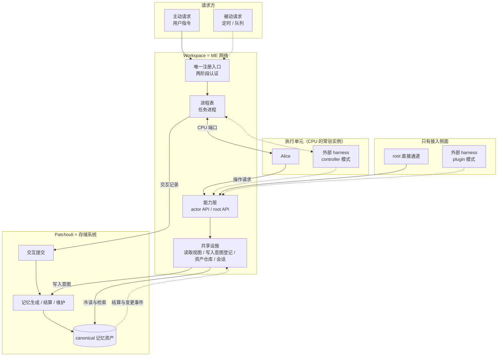

# 第五代架构：Workspace 网络

## 0. 文档性质

本文是第五代架构的核心理念 Idea：说明第五代由哪些概念构成、每条理念为什么成立，以及新的架构与功能设计如何判断自己是否违背它。它指导 v0.7.x 及以后版本的设计，有效期到需要下一代架构时为止。本文不代表路线图承诺，版本安排见 [ROADMAP](../ROADMAP.md)。

| 文档 | 负责 |
|:---|:---|
| [VISION](../VISION.md) | 项目为什么存在、产品定位与评估 |
| 本文 | 第五代的概念模型、理念、约束与演进方向 |
| 事实文档（[Workspace](../workspace/README.md)、[系统边界](../architecture/boundaries.md)、[子系统公共契约](../contracts/subsystem-contracts.md)等） | 理念现在如何落地 |
| [ADR](../architecture/decisions/README.md) | 已经作出的决定及其理由 |
| 子 Idea（第 6 节） | 具体方向的设计讨论与 owner 决定 |

维护规则：

- 每条理念写五项：理念、为什么、约束、检验问题、落地入口；
- 不记录实施进度、决定流水或代码细节，理念的落地情况只经“落地入口”链接到事实文档；
- 现状与理念不一致时视为需要处理的偏差：修正实现，或经 owner 决定修订理念；改变理念的决定直接修改对应条目并注明日期，具体方向的决定记录在子 Idea。

本文由 2026-09-26 起的《Workspace 网络与任务进程架构》Idea 于 2026-10-13 重写而成；原文的决定记录与实施状态见 commit `6add90f` 中的 `docs/ideas/workspace-network-task-process-architecture.md`。

## 1. 代际定位

前几代架构的总纲保存在 [Legacy Architecture](../archive/legacy-architecture/README.md)（历史文档）：v2.0 是早期 Patchouli 三位一体与冷热路径重构，v3.0 是 Patchouli OS、MTP 与内核运行时草案，v4.0 确立了 System、Patchouli、Alice 三个平面。

第四代的三个平面之间，协作仍按“Alice 是唯一执行者”组织。2026-09 的工作区核对暴露出这种组织的代价：

- 读取记忆有多条互不相通的路径：管理面直读记忆库，Chat 在 Patchouli prepare 内读取，Alice 的 MTP 与 CALL 各有自己的解析器与缓存，进程内同时存在两套原子缓存与 Profile 缓存；
- 统一认证网关已经装配，生产路径却走不带访问上下文的兼容分支，逐次行为授权实际没有执行；
- Patchouli 的 prepare/finalize 承担了 Alice 会话的编排（Profile、话题、检索与编译、附件、交互提交与物化派发），记忆库因此认识执行者的类型；
- 包依赖与声明方向相反：下层大量导入 system，workspace 与 system 互相导入。

第五代的命题：把 HiveMemory 从“为 Alice 服务的记忆系统”变为“任何执行者都能接入的记忆网络”。Alice 是网络中的一种执行单元，外部 harness 经同一套入口接入；VISION 中兼容轨与原生轨共享同一事实核心（[VISION](../VISION.md)第 8.3 节），由此有了可以落地的结构。

**演进方式**（owner，2026-09-27）：按流程纵切迁移，一次把一条完整链路迁到新架构，不按组件横切、靠委托与兼容入口维持中间态。横切容易脱离实际运行情况而做理想设计；纵切更容易得到实际成果。演进期间的兼容范围不设统一规则，由各计划按自身情况决定（owner，2026-10-13）。

## 2. 核心模型：网络隐喻

第五代借用 Applied Energistics 2（AE2）的 ME 网络作为审查所有权与边界的语言，隐喻本身的展开见 [AE2 Idea](./ae2-hivememory-architecture-analogy.md)：

| AE2 | 第五代 | 说明 |
|:---|:---|:---|
| ME 网络 | Workspace | 资源归属与访问的边界，承载认证、能力层、读取视图、写入意图登记与进程表等网络设施 |
| 存储系统 | Patchouli | 只持有已接收的记忆资产，负责它们的生成、检索与维护 |
| 合成 CPU | 执行单元 | CPU 的常驻实例，如 Alice、外部 harness；与任务的生命周期无关，任务进程把打包好的任务交给它，中间工作状态只在其内部；一个执行单元内可以有多个执行线程（actor） |
| 合成任务 | 任务进程 | 网络一侧的一次任务：从注册到结束的打包、分配、权限、取消与结果接收；执行单元内部的工作状态不在其中 |
| 玩家在合成终端下单 | 主动请求 | 用户的指令即时驱动任务进程 |
| 合成卡、请求器等自动下单方 | 被动请求 | 条件满足时创建任务进程，如定时任务、队列任务 |
| 玩家在 ME 终端直接存取 | root 直接通道 | 管理操作经 root API 直接执行，不建进程 |
| 安全终端 | 认证网关与操作授权 | 准入与逐次授权 |
| Import Bus | Import Bus | 只向网络输入，不在核心拓扑上（[Import Bus Idea](./import-bus.md)） |

两个维度要分开：**请求方**回答谁让网络做事（主动请求、被动请求），**执行者**回答谁来做（执行单元）。同一个外部 harness 可以有两个侧面：**执行侧面**是被进程经 CPU 端口驱动的执行单元，**接入侧面**是经操作适配器调用能力层的调用方。管理员与 plugin 模式的 harness 只有接入侧面，Alice 两个侧面都有。

执行一侧的用语（owner，2026-10-06，2026-10-20 修订）：

| 用语 | 含义 |
|:---|:---|
| CPU | 执行者的抽象：任务进程只经 CPU 端口与它交互，不依赖任何具体实现 |
| CPU 端口 | 任务进程调用 CPU 的统一接口，由 workspace 定义 |
| 执行单元 | CPU 的常驻实例，内含实际的 backend：常驻在网络中，与任务的生命周期无关；任务进程在 Actor 阶段把打包好的任务交给它，最后取回终态结果，中间的工作状态只存在于其内部。面向用户称**执行环境**，与 agent 分别选择。Alice（`AliceCPU`）是当前唯一的执行单元 |
| 驱动 | 实现执行单元的代码，按协议或产品编写：把输入清单与控制翻译为 backend 的协议，把输出翻译回事件流与终态结果；同一份驱动可以配出多个执行单元，例如一个 ACP 驱动对应多个支持 ACP 的 harness |
| 执行线程（actor） | 执行单元内的执行者：发起任务的 agent 是主线程，CALL 派生的子 agent 是子线程；一个线程对应一个 `ActorIdentity`，也是它所发起操作的发起者 |
| 操作适配器 | 把外部协议的请求归一化为能力层的一次调用；执行单元内的适配器只产出操作请求，由执行单元附上线程 context 提交；属于接入侧面，不在驱动之内 |
| 请求入口 | 任务请求进入唯一注册入口的传输入口，例如 HTTP 的 `POST /chat` |

2026-10-20 修订（owner）：执行单元原与 CPU 同义，现改指 CPU 的常驻实例，对应 AE2 中常驻在网络里的合成单元；原“执行单元内部的 backend（harness 实例）”并入执行单元；原“CPU 驱动”指 CPU 端口的实现，现在这个对象称执行单元，驱动只指实现它的代码。事实文档与代码中“CPU 驱动（`AliceCPU`）”的说法指的就是执行单元，命名随首份计划的实施修订。相应地，任务进程是网络一侧的一次任务：打包输入、分配、签发线程权限、取消与接收结果；“CPU 分配”在接入外部执行单元后同时包括选择执行单元。执行单元内部的任何状态（例如外部 harness 自己的会话）都只是缓存：会话原文由网络持有，是唯一的事实来源。AE2 中一个合成单元同时只处理一个任务；HiveMemory 的执行单元可以同时承担多个任务进程，各任务的工作状态在其内部隔离，容量是否设限另行考虑，容量不等于授权（[AE2 Idea](./ae2-hivememory-architecture-analogy.md) 6.4）。

“kernel”是早期架构遗留的命名，不再作为概念使用。

虚线是第 4 节的演进方向，以及只传递通知的事件。

## 3. 核心理念

### 3.1 Workspace 是唯一的能力提供者

**理念**：凡涉及 Workspace 资源的能力，只经 workspace 提供：actor 经 actor API，管理员经 root API，任务进程经阶段调用；server 与各执行单元都只是消费者。与 Workspace 资源无关的 System 层面 API（模型、Provider、配置、运行时事件与日志）不在此列。

**为什么**：第四代有多条互不相通的读取路径，各有缓存与授权口径，一处修改无法保证所有路径一致。能力收敛到一个提供者，授权、缓存与失效才只有一个执行点。

**约束**：

- 能力按“谁在做这件事”分为三个调用面：actor 操作、root 能力与阶段调用，彼此不借用；actor 操作与执行者的协议动词一一对应，root 能力不能登记给任何 actor；
- 能力层与共享设施不依赖进程：不建进程的调用（root 直接通道、plugin 模式的接入）同样要能使用它们；
- 操作适配器只做归一化，把外部协议的请求转成能力层已有方法的调用；缺少能力时扩展能力层，不在适配器里实现领域语义。

**检验问题**：新功能是否让某个入口绕过能力层直接触达资源 owner？是否为某种执行者另开了一条能力路径？新的 actor 操作是否与协议动词对齐、能否由白名单表达？

**落地入口**：[能力层](../workspace/capability.md#1-三个调用面)第 1 节；[AGENTS.md](../../AGENTS.md) 第 3 节；操作适配器的定义见[外部 Actor Idea](./external-actor-registration-and-runtime-access.md#34-操作适配器的定义与边界) 3.4。

### 3.2 一切任务都是进程

**理念**：任何任务请求，主动或被动，都从唯一注册入口登记为一个任务进程，直到任务结束才关闭。进程持有阶段之间的工作状态，统一负责取消与清理。未通过两阶段认证的请求不建进程；root 直接通道与不建进程的接入不是任务。

**为什么**：第四代的任务状态散落在 chat 编排、Patchouli 与 Alice 之中，取消与清理靠各处补偿。四个阶段的顺序是任务的自然顺序，不需要改变；需要改变的是阶段之间的状态由谁持有、每个交界处传递什么。

**约束**：

- 进程持有工作集与访问 context，资源租借与线程 context 都随进程关闭释放或撤销；
- 进程只负责生命周期与阶段编排，领域判断留在各子系统；
- 进程的结局不改写已经交给其他所有者的事实，例如已被接纳的写入意图。

**检验问题**：

- 取消与清理是否都经过进程容器，而不是在某个子系统里补偿？
- 命令、主动请求与被动请求是否经同一入口注册？
- 新的任务类型是否复用四阶段骨架，而不是另写一套编排？

**落地入口**：[任务进程](../workspace/task-process.md)；[任务进程 Idea](./task-process-table-and-registration-entry.md)。

### 3.3 执行者可以替换

**理念**：执行单元经 workspace 定义的 CPU 端口被进程驱动，Patchouli 与 Gateway 不认识任何执行者的类型。agent（Profile）与执行环境相互独立；执行单元内的执行线程各有自己的访问 context，CALL 派生的子线程以被调用方的身份运行。

**为什么**：第四代 Patchouli 的公开路由产出和接收 Alice 专属类型，记忆库随之依赖执行者。执行者可以替换，外部 harness 才能以与 Alice 相同的地位接入，兼容轨与原生轨才共享同一事实核心。

**约束**：

- 端口由 workspace 定义、执行者实现，workspace 不导入任何执行者；
- 一个任务进程只对应一个执行单元：CALL 只能派生本执行单元能够运行的 actor（owner，2026-10-13，[外部 Actor Idea](./external-actor-registration-and-runtime-access.md) E-6b）；
- 执行者只拿到输入清单与绑定了线程 context 的提交函数，读不出 context，也不持有进程 context；
- 观测标签只用于观测与提示词，不参与授权。

**检验问题**：

- Patchouli 的公开路由是否产出或接收某个执行者专属的类型？
- 换一个执行单元（测试替身即可），能否跑完整个任务进程而不改动进程与入口的代码？
- 新能力是否假设了 Alice 的 MTP 或 frame 结构？

**落地入口**：[子系统公共契约](../contracts/subsystem-contracts.md)第 4 节；[执行线程](../workspace/execution-threads.md)；[执行线程 Idea](../archive/ideas/execution-thread-definition.md)（已归档）；[执行环境 Idea](./execution-environment.md)。

### 3.4 库内与库外

**理念**：Patchouli 只持有已经接收的记忆资产及其生成、检索与维护；尚未被接收的工作产物与为执行者服务的派生状态（会话、写入意图、读取缓存、资产仓库）都在库外，由 workspace 的共享设施持有。两侧只经过线契约协作：库外向库提交与读取，库向库外发布事件。

**为什么**：归属判据见 [ADR-0006](../architecture/decisions/0006-memory-library-custody-criteria-and-independence-contract.md)，已接收的资产才归记忆库管护。库外状态放进记忆库，记忆库就要认识执行者与会话；库内语义搬到库外，就会出现第二个记忆库。

**约束**：

- **过线契约**：库外到库只有提交（交互记录、写入意图）与读取（冷读、检索、Profile 解析），库到库外只有事件（结算、canonical 变更），双向都不出现旁路；
- **不出现第二个记忆库**：库外的读取视图只做引用定位、交付授权与缓存，不做检索排序、去重或内容解释，也没有写路径；
- **库外独立工作义务**：记忆库不可达时，库外设施照常运作并显式降级。认证与能力层照常接纳 actor，已登记的意图与缓存命中照常可读；冷读与写入派发显式失败，不以过期内容伪装成功。

**检验问题**：

- 注入记忆库不可达，库外各项是否按义务降级存活？
- 新增的状态属于已接收的资产，还是执行者的工作产物？它放在了对应的一侧吗？
- 新的读取能力是否开始在库外解释记忆语义？

**落地入口**：ADR-0006；[读取视图与写入意图](../workspace/read-view-and-write-intents.md)；[公开路由与事件](../contracts/routes-and-events.md)第 3 节。

### 3.5 两阶段认证与两阶段授权

**理念**：actor 进入 Workspace 时完成两阶段认证（Principal 认证、Workspace 准入），每次操作时完成两阶段授权（能力层的操作授权、资源 owner 的资源授权）。actor 的权限只由 workspace 访问登记的操作白名单表达。

**为什么**：四个阶段由不同的所有者负责：接入登记属于 System，准入与白名单属于 workspace，资源可见性属于资源 owner。资源会在运行时移动位置、被缓存，资源授权只能在资源 owner 处进行；权限若放在 Profile 等资源里，持有资源管理权就能改写授权。

**约束**：

- 每次请求重新校验身份，不以注册时的认证结果代替；
- 行为许可与资源许可必须同时满足，任何一方都不能替代另一方；
- root 只有保留的 `system` 一个，只在 root API 生效；授权不按 actor 类型分支；
- 阶段调用是系统替 actor 做的操作，不检查 actor 操作，但仍按 actor 的身份过滤可见性。

**检验问题**：新功能的授权点在哪一阶段、由谁负责？是否把权限写进了资源或身份类型？跨 Workspace 的操作是否同时满足驻留一侧与目标一侧的授予？

**落地入口**：[身份与授权](../workspace/identity-and-authorization.md#2-访问边界两阶段认证与两阶段授权)第 2 节；[MTP 契约](../contracts/mtp.md)第 4 节；[身份与访问体系 Idea](./identity-and-access-model.md)。

### 3.6 身份数据按形态区分

**理念**：一次操作中的身份数据按寿命与用途分为不同形态，彼此不能代替。访问 context 表示 actor 驻留在哪里、属于哪次运行；`IdentityScope` 表示一次操作由谁发起、作用于哪个 Workspace；资源归属与发起者在资源 owner 的公共边界拆开后分别保存；观测标签只用于观测与提示词。

**为什么**：同一个 scope 同时表示发起者、操作目标与资源归属，又随记录、后台任务与缓存保存时，后台任务与缓存就会沿用一份寿命已经结束的身份，重新推断出错误的归属或授权。

**约束**：

- 访问 context 只由运行持有者与授权点持有；`IdentityScope` 只在一次操作的调用链内存在，不写入记录、事件或后台任务；
- 资源创建时，归属取自操作目标，来源取自发起者，此后两者独立；来源字段不参与授权；
- 后台任务从自己的 payload 恢复归属与发起者，不读取进程当前的 Workspace。

**检验问题**：新模型或新事件里的身份字段是哪种形态？它的寿命是否超出了这种形态允许的范围？

**落地入口**：[身份与授权](../workspace/identity-and-authorization.md)第 1、3 节；[AGENTS.md](../../AGENTS.md) 第 3 节；[身份与访问体系 Idea](./identity-and-access-model.md)。

### 3.7 调用与事件

**理念**：需要确定返回值、失败传播或完成确认的交互用 RPC，发布者不依赖结果的通知用 Pub/Sub；RuntimeEvent 只用于 best-effort 观测，不能决定业务成功。跨子系统只经公共 route、公共模型与全局事件。

**为什么**：事件可能丢失、乱序或被禁用。让事件承担业务提交，系统的正确性就取决于订阅者是否在线、是否成功。

**约束**：

- 承担正确性的功能事件（canonical 变更、结算）内联发布；订阅者先完成不会失败的失效，再做其他工作，只失效、不回放事件携带的值；
- 依赖事件到达的状态必须能从权威结果核对（写入意图的结算对账见[写入意图后续方向 Idea](./pending-intent-migration.md)第 2 节）；
- 不持有其他子系统的 Runtime、Service、存储客户端或本地总线。

**检验问题**：新事件的订阅者没有收到或执行失败时，业务终态会不会错？发布者是否真正拥有它声明的事实？

**落地入口**：[公开路由与事件](../contracts/routes-and-events.md)第 1、3、4 节；[系统边界](../architecture/boundaries.md)第 2 节。

### 3.8 显式写入即时提交

**理念**：actor 明确提出的写入在操作内登记并提交给记忆生成，生成队列接纳后才确认。交互记录与写入意图是两条独立的路，写入不取决于任务的终态。

**为什么**：长时间运行的执行者需要及时保存阶段成果。写入若要等一轮任务完成才派发，执行失败或取消会让用户明确要求保存的内容消失，交互记录也会被迫承载物化任务。

**约束**：

- 确认只表示已登记并被接纳，不表示已经持久化；
- 已接纳的写入不因执行失败、取消、进程关闭或子线程失败而撤回；
- 确认之前的错误交还执行者自行处理，不静默重试。

**检验问题**：新的写入路径是否把“已确认”说成“已持久化”？是否让写入依赖进程完成？

**落地入口**：[读取视图与写入意图](../workspace/read-view-and-write-intents.md)；[Patchouli 生成](../patchouli/generation.md)第 7 节；[写入意图后续方向 Idea](./pending-intent-migration.md)。

### 3.9 上下文与记忆材料分离

**理念**：执行者使用的对话上下文由会话（ConversationSession）提供，原样积累；Topic 只为记忆生成服务，是记忆的历史材料来源。会话不是记忆的材料来源。

**为什么**：第四代的 Topic 同时承担对话上下文与记忆材料。前台对话需要连续、原样、可压缩，后台生成需要按主题聚合、可折叠、可结算，两种需要在同一个对象上互相牵制。

**约束**：

- Gateway 的话题路由只服务于后台的 Topic 落位；
- 会话压缩由执行单元负责，不改写记忆材料；
- 生成材料取自 Topic 及同步到 Patchouli 的交互，不读取会话。

**检验问题**：新功能读取的上下文来自会话还是 Topic？它是否让两者中的一方承担另一方的职责？

**落地入口**：设计讨论见[外部会话与 Topic 投影 Idea](./external-session-and-topic-projection.md)；流式同步的方向见[长时间运行 Agent 的 Turn 内上下文折叠 Idea](./long-running-agent-intra-turn-context-folding.md)。

### 3.10 包分层

**理念**：包按 L0–L5 分层，依赖只能指向同层或更低层；L3 子系统之间只能导入对方的 `contracts` 子包；system 是依赖图的顶点，除入口外不被任何包导入。下层需要上层的能力时以端口声明，由组合根实现并注入。

**为什么**：第四代下层大量导入 system，workspace 与 system 互相导入，任何子系统都无法脱离组合根单独理解或测试。分层让依赖方向成为可以测试的事实。

**约束**：

- core 承载依赖中立的模型、契约原语、错误与端口协议，收录标准见第 5 节 C；
- 组件只接收并导入自己的配置段，不持有根配置；
- 已知例外只登记、不新增（[engines 对上层的既有导入](../todo/engines-upward-imports.md)）。

**检验问题**：新模块属于哪一层？新增的导入是否需要改成端口？放进 core 的内容是否只是“因为要共用”？

**落地入口**：[AGENTS.md](../../AGENTS.md) 第 3 节；[系统架构概览](../architecture/overview.md)第 3 节；[分层测试](../../tests/unit/architecture/test_package_layers.py)。

## 4. 演进方向

各方向的设计讨论在对应子 Idea 中进行，版本安排以 [ROADMAP](../ROADMAP.md) 为准。

- **外部会话与 Topic 投影**（3.9）：会话模型、workspace 共享的 Topic 池、前端回归会话模型，见[外部会话 Idea](./external-session-and-topic-projection.md)。
- **外部 Actor 接入**（3.1、3.3）：controller 模式下外部 harness 是进程中的执行单元；plugin 模式下 HiveMemory 挂载在外部 harness 中，只有接入侧面，对话经 Import Bus 回流。见[外部 Actor Idea](./external-actor-registration-and-runtime-access.md)与 [Import Bus Idea](./import-bus.md)。
- **执行基座与执行环境**（3.3）：用户在对话开始前分别选择 agent 与执行环境，见[执行环境 Idea](./execution-environment.md)。
- **被动请求**（3.2）：定时与队列触发创建任务进程，见[任务进程 Idea](./task-process-table-and-registration-entry.md)与第 5 节 P-5。
- **流式同步与 turn 内上下文折叠**（3.8、3.9）：交互以更原子的结构流式同步到 Patchouli，生成材料包含当前轮已接收的消息，见[长时间运行 Agent Idea](./long-running-agent-intra-turn-context-folding.md)。
- **写入意图的后续**（3.7、3.8）：结算对账、句柄寿命、意图 policy 与外部提交契约，见[写入意图后续方向 Idea](./pending-intent-migration.md)。
- **子网与跨 Workspace**（3.5）：受限穿透访问、Mount、Bridge 与能力子网，见 [AE2 Idea](./ae2-hivememory-architecture-analogy.md)与[身份与访问体系 Idea](./identity-and-access-model.md)。
- **持久化与恢复**（3.4、3.7）：会话、意图、任务与登记的耐久性等级，见[耐久性与故障恢复治理](../governance/reliability/durability-and-recovery.md)。
- **运行时登记与配置热更新**（3.5）：接入登记与操作白名单的运行时编辑，见[外部 Actor Idea](./external-actor-registration-and-runtime-access.md#e-1-接入登记的来源与生效时点) E-1。

## 5. 架构级开放问题

只收跨子系统、没有归属到某个子 Idea 的问题。每个问题只列出选项及其影响，选项顺序不代表倾向；编号沿用原文，便于追溯。

### P-1 经网络接入的执行者如何证明身份

Principal 认证目前只检查声称的 principal 是否已登记、adapter 是否匹配，HTTP 入口的身份取自请求头（[认证与访问登记](../workspace/authentication.md#8-已知限制)第 8 节）。

- **P-1b 请求与进程的归属校验**：请求的 principal 必须与进程注册时一致 / 其他规则；
- **P-1c 身份证明的实现位置**：owner 决定（2026-10-29）由统一认证网关证明，每个外部 principal 一份本地共享密钥作为接入证据，一个 harness 对应一个 principal；决定与复核记录在[外部 Actor Idea](./external-actor-registration-and-runtime-access.md#p-1c-与-p-9c-身份证明与不建进程的访问-context)。

### P-3 能力层是否覆盖执行本身

RUN 与 CALL 已是 actor 操作，授权进入能力层；系统工具暂不设权限。剩下的是执行本身是否经能力层。

| 选项 | 内容 | 影响 |
|:---|:---|:---|
| A | 覆盖：RUN、CALL、系统工具的执行也经能力层 | 能力层承担执行入口，与执行基座的边界需要一并确定 |
| B | 不覆盖：能力层只负责授权与资源，执行留在执行单元的执行环境 | 3.1 的“唯一能力提供者”限定为资源操作与授权 |
| C | 部分覆盖 | 需要划分标准 |

### P-4a 进程能否持有白名单的子集

- 支持：注册时声明所需操作集合，入口校验它是白名单子集，能力层按进程的集合授权；访问 context 需要携带本次运行的操作上限；
- 不支持：进程一律继承 actor 在该 Workspace 的白名单。

### P-5 被动请求的认证

被动请求只存在于 controller 模式（[外部 Actor Idea](./external-actor-registration-and-runtime-access.md#11-两种接入模式owner2026-09-27) 1.1）。

- **P-5b 触发器的 principal**：触发器的登记者 / 系统内置 principal / 其他。owner 倾向（2026-09-27）由登记的 Agent 反推 principal；
- **P-5c 触发器的准入检查时点**：登记触发器时 / 每次触发时 / 两者都查。

### P-7 进程控制操作的授权主体

取消由持有进程句柄的入口与进程控制授权处理；状态查询等其余控制操作的授权主体尚未决定。

选项：仅进程的注册 principal / 注册 principal 与管理员 / Workspace 内任何获准者 / 其他。

### P-8 资源边界是否增加修改与执行授权

`MemoryAccessPolicy` 只表达读取。

| 选项 | 内容 | 影响 |
|:---|:---|:---|
| A | 资源策略扩展到修改与执行 | 需要扩展 `MemoryAccessPolicy` 或新增策略模型，并确定默认值与存量迁移 |
| B | 不增加 | 修改权限只由操作白名单与读取可见性共同约束 |
| C | 只对部分资源类型增加 | 需要划分资源类型 |

### P-9 不建进程的访问

- **P-9c 不建进程的 actor 访问如何进入 actor API**：owner 决定（2026-10-29）与 root 的直接通道相同，每次操作对应一份请求级访问 context；决定、现状核对与候选设计记录在[外部 Actor Idea](./external-actor-registration-and-runtime-access.md#p-1c-与-p-9c-身份证明与不建进程的访问-context)；
- **P-9d 进程的定义**：是否把“进程是由执行单元执行的一个任务”确立为定义，3.2 中“root 直接通道与不建进程的接入不是任务”依此成立。
  - 分析（2026-10-20）：按第 2 节修订后的用语，Gateway、prepare 与 finalize 在网络一侧完成，只有 Actor 阶段交给执行单元；作为定义时宜表述为“进程的 Actor 阶段由一个执行单元执行”。

### P-10a 外部执行环境应用 Profile 的结果

同一个 Agent Profile 可以在不同执行环境中运行，persona、模型、采样参数与语言在外部 harness 上只能尽力应用。

- 需要承载：由执行单元报告应用结果（已应用、部分支持、拒绝），随执行结果交回进程，或在 CPU 分配时预先判定（[执行环境 Idea](./execution-environment.md) T-7）；
- 不需要承载：用户无法得知所选 agent 的 persona 或模型是否真正生效。

### C core 的内容整理

core 不应成为“因为要共用就往里塞”的地方（owner，2026-09-26）。它目前包含数据模型、契约原语、MTP 的模型与解析器、交互归约器、授权谓词、错误与端口协议等，`protocol/`、`contracts/`、`mtp/` 三组都承载跨边界定义，分工没有明确区分。

- **C-1 收录标准**：只收依赖中立的数据模型、常量、错误与端口协议，行为性代码迁出 / 也允许无状态的纯函数与解析器（MTP 解析、归约器、授权谓词） / 其他；
- **C-2 子包划分**：按内容性质（模型 / 契约与协议 / 端口 / 错误） / 按所属领域（memory、workspace、interaction、mtp 等） / 其他。两种划分都会改动大量导入路径；
- **C-3 只被少数包使用的内容**（如 `access.py`、`ports/`）：留在 core / 移到提供方子系统的 `contracts` 子包 / 其他。

C 与 [engines 对上层的既有导入](../todo/engines-upward-imports.md)相互约束：下移被导入的模型会把更多内容放进低层。

### 读取视图的负缓存

是否启用负缓存，以及它的容量、TTL 与关闭时在途请求的行为。读取视图把缺失与不可见合并为同一结果，不能据此写共享的负缓存；启用负缓存需要先区分两者，且仍不能缓存授权结论。

## 6. 子 Idea 与相关文档

| 文档 | 承担的理念与方向 |
|:---|:---|
| [任务进程 Idea](./task-process-table-and-registration-entry.md) | 3.2：请求方分类、进程结构、阶段与取消、被动请求 |
| [执行线程](../workspace/execution-threads.md)（已归档的[执行线程 Idea](../archive/ideas/execution-thread-definition.md)） | 3.3 与第 2 节用语中的执行线程：定义、生命周期与观测（当前事实） |
| [执行环境 Idea](./execution-environment.md) | 3.3：agent 与执行环境的分别选择、不同执行环境的输出词汇 |
| [身份与访问体系 Idea](./identity-and-access-model.md) | 3.5、3.6：身份数据的形态与流向 |
| [外部会话与 Topic 投影 Idea](./external-session-and-topic-projection.md) | 3.9：会话模型与 Topic 池 |
| [外部 Actor Idea](./external-actor-registration-and-runtime-access.md) | 3.1、3.3：接入侧面、操作适配器与两种接入模式 |
| [写入意图后续方向 Idea](./pending-intent-migration.md) | 3.7、3.8：结算对账、句柄寿命与外部契约 |
| [Import Bus Idea](./import-bus.md) | 只向网络输入的记忆来源 |
| [长时间运行 Agent Idea](./long-running-agent-intra-turn-context-folding.md) | 3.9：流式同步与 turn 内折叠 |
| [AE2 Idea](./ae2-hivememory-architecture-analogy.md) | 第 2 节的网络隐喻与子网 |
| [ADR-0006](../architecture/decisions/0006-memory-library-custody-criteria-and-independence-contract.md) | 3.4：记忆库一侧的归属判据与独立工作契约 |
