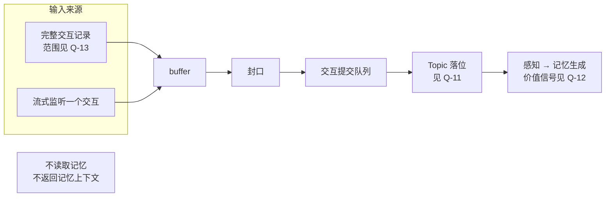

# Import Bus：只向网络输入的记忆来源

## 0. 文档性质

本文为 Import Bus 的重新设计收集前提与开放问题，不描述当前行为，也不代表排期。现有的被动摄入链路见[被动对话摄入](../system/passive-ingress.md)。

**版本归属**（owner，2026-10-20）：v0.7.1 的版本目标为 plugin 模式接入 Claude Code，对话经 Import Bus 回流（[外部 Actor Idea](./external-actor-registration-and-runtime-access.md#11-两种接入模式owner2026-09-27) 1.1）。首份计划的方向为本文的重设计（owner，2026-10-20），以 Claude Code 的对话回流作为第一条真实路径，让记忆在真实使用中积累；Q-11、Q-12、Q-15 与 D-8a 是它的阻塞问题（步骤汇总见[外部 Actor Idea](./external-actor-registration-and-runtime-access.md#v071-的步骤与各步的阻塞问题)第 4 节）。Q-13 在只接收实时或刚结束的交互时两个选项行为相同，不阻塞（分析）；历史导入见 [ROADMAP](../ROADMAP.md) 第 4.5 节。horizon 随之由 `candidate` 改为 `current`。

**术语**（owner，2026-09-27）：“被动（Passive）”一词留给被动请求体系，即由条件触发创建任务进程的请求。原先称为“被动输入”的输入链路称 **Import Bus**，最终名称未定，功能可能逐步倾向对话导入。代码与事实文档中的现有名称（Passive Ingress、`PassiveIngressService`、Gateway `PASSIVE_MEMORY`）描述现状，保持不变。

## 1. 问题背景

现有 Passive Ingress 名为被动，却在用户输入后主动提供记忆：user 事件经 Gateway `PASSIVE_MEMORY` 分析后检索记忆，并把记忆上下文返回给调用方，本质上是主动读取的一种触发方式，边界不清。

它对 Gateway 的依赖也不止于检索（流程见[被动对话摄入](../system/passive-ingress.md)第 2、3 节）：

- **Topic 落位**：[turn buffer](../../src/hivememory/system/services/passive/turn_buffer.py) 保存 Gateway 决策，提交时以决策的目标话题作为请求话题；Gateway 路由时会读取 Patchouli 的候选话题；
- **价值信号**：`rewritten_query` 与 `worth_saving` 取自 Gateway 决策，感知冻结生成材料时排除 `worth_saving=False` 的 block（[`engines/perception/models.py`](../../src/hivememory/engines/perception/models.py)）。

此外，`/ingest` 不经统一认证网关，在认证前为当前用户组装默认 Workspace 的 `IdentityScope`，是 Workspace 访问模型的已知例外（[身份与授权](../workspace/identity-and-authorization.md#12-默认入口和内部-seam)第 1.2 节）。

## 2. owner 的前提

1. （2026-09-26）执行者可以任意替换之后，Import Bus 退化为只向网络输入：接收信息并转为记忆资产，与记忆系统零主动交互，不读取记忆，也不返回记忆上下文。
2. （2026-09-26）两种接收方式：直接接收一份完整的交互记录；流式监听一个交互。两者经同一个 buffer 与提交路径进入记忆生成。
3. （2026-09-27、2026-09-28）Import Bus 不在核心全局拓扑上，作为独立功能演进；重新设计落地之前，不考虑它在现有系统中带来的任何效果。
4. （2026-09-27）外部 Actor 的 plugin 模式很像一直以来的 Passive Ingress：HiveMemory 以插件形式挂载在外部 harness 中，对话经 Import Bus 回流，不接管对话（[外部 Actor Idea](./external-actor-registration-and-runtime-access.md#11-两种接入模式owner2026-09-27) 1.1；[ROADMAP](../ROADMAP.md) 的 plugin 模式条目）。

## 3. 目标流程草图

只画出前提已经确定的部分；落位与价值信号取决于第 4 节的问题。

## 4. 开放问题

每个问题只列出选项及其影响，选项顺序不代表倾向。

### Q-11 Topic 落位

| 选项 | 内容 | 影响 |
|:---|:---|:---|
| A | 记忆库在接收时自行落位 | 需要在记忆库侧提供落位能力；`PASSIVE_MEMORY` 模式可以移除 |
| B | 仍经 Gateway 路由 | 输入链仍会读取候选话题，与“零主动交互”的前提需要重新界定 |
| C | 由输入方显式指定或提示，记忆库校验 | 外部来源需要掌握 Topic 信息 |

### Q-12 价值信号（worth_saving）

[ROADMAP](../ROADMAP.md) 的“记忆价值策略重设计”要求入口信号不能替代 Patchouli 的最终决定。

| 选项 | 内容 | 影响 |
|:---|:---|:---|
| A | 不提供该信号，按现有语义视为保留 | 进入生成的材料可能增加 |
| B | 记忆库在接收或感知阶段自行评估 | 需要记忆库侧的评估能力及其成本 |
| C | 输入方可选提供提示，记忆库决定是否采纳 | 需要定义提示的来源与可信度 |

### Q-13 “完整交互记录”接收方式的范围

[ROADMAP](../ROADMAP.md) 的历史对话导入有独立语义：历史发生时间、批次、去重，不重放进当前活跃话题。

| 选项 | 内容 | 影响 |
|:---|:---|:---|
| A | 只接收实时或刚结束的交互，历史导入另设通道 | 两条通道语义分开 |
| B | 同时作为历史导入入口 | 需要在该接收方式中承载历史时间、批次、去重与不重放等语义 |

### Q-15 回流内容的范围

**背景**（2026-10-20）：编码类 harness 的一轮交互通常包含大量工具调用与工具结果（读取的文件、命令的输出）。现有 Passive Ingress 接收 user、assistant、tool_call、tool_result 四种事件（[被动对话摄入](../system/passive-ingress.md)第 1 节），材料的多少直接影响感知与生成的成本和噪声。

| 选项 | 内容 | 影响 |
|:---|:---|:---|
| A | 只回流用户消息与 assistant 的回复正文 | 材料最少；丢失工具过程中的事实，例如命令的报错与修复经过 |
| B | 回流完整轨迹，包括工具调用与结果 | 生成材料量大幅增加，感知与生成的成本和噪声上升；与 Q-12 的价值信号相关 |
| C | 回流正文，工具事件按类型筛选或只保留调用摘要 | 需要定义筛选规则，以及由连接器还是记忆库执行 |
| D | 其他 | —— |

### D-8a 接入认证与目标 Workspace

讨论中提到的“来源 → 目标 Workspace”登记表会改变 ingest 的行为，空配置下会使现有接入失效，需要同时决定配置形态与缺省行为。按前提 4，plugin 模式的对话回流也经 Import Bus，两者的接入身份需要一并考虑。

| 选项 | 内容 | 影响 |
|:---|:---|:---|
| A | 经统一认证网关 | 输入来源需要作为 principal 登记，并确定 Workspace 准入；Import Bus 不调用 actor 操作，还要决定它以何种授权提交交互 |
| B | 使用独立的来源登记（来源 → 目标 Workspace） | 需要决定配置形态，以及空配置时的缺省行为 |
| C | 其他 | —— |
