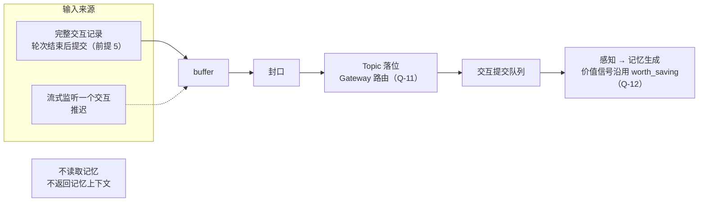

# Import Bus：只向网络输入的记忆来源

## 0. 文档性质

本文为 Import Bus 的重新设计收集前提与开放问题，不描述当前行为，也不代表排期。现有的被动摄入链路见[被动对话摄入](../system/passive-ingress.md)。

**版本归属**（owner，2026-10-20）：v0.7.1 的版本目标为 plugin 模式接入 Claude Code，对话经 Import Bus 回流（[外部 Actor Idea](./external-actor-registration-and-runtime-access.md#11-两种接入模式owner2026-09-27) 1.1）。首份计划的方向为本文的重设计（owner，2026-10-20），以 Claude Code 的对话回流作为第一条真实路径，让记忆在真实使用中积累。接收方式与第 4 节的全部问题已于同日决定（前提 5，第 4 节），首份计划不再有阻塞问题，已建立为 [Import Bus 重设计](../plans/v0.7.1-import-bus-redesign.md)（步骤汇总见[外部 Actor Idea](./external-actor-registration-and-runtime-access.md#v071-的步骤与各步的阻塞问题)第 4 节）。horizon 随之由 `candidate` 改为 `current`。

**术语**（owner，2026-09-27）：“被动（Passive）”一词留给被动请求体系，即由条件触发创建任务进程的请求。原先称为“被动输入”的输入链路称 **Import Bus**，最终名称未定，功能可能逐步倾向对话导入。代码与事实文档中的现有名称（Passive Ingress、`PassiveIngressService`、Gateway `PASSIVE_MEMORY`）描述现状，保持不变。

## 1. 问题背景

现有 Passive Ingress 名为被动，却在用户输入后主动提供记忆：user 事件经 Gateway `PASSIVE_MEMORY` 分析后检索记忆，并把记忆上下文返回给调用方，本质上是主动读取的一种触发方式，边界不清。

它对 Gateway 的依赖也不止于检索（流程见[被动对话摄入](../system/passive-ingress.md)第 2、3 节）：

- **Topic 落位**：turn buffer（v0.7.0 的 `system/services/passive/turn_buffer.py`，已在 Import Bus 重设计中删除） 保存 Gateway 决策，提交时以决策的目标话题作为请求话题；Gateway 路由时会读取 Patchouli 的候选话题；
- **价值信号**：`rewritten_query` 与 `worth_saving` 取自 Gateway 决策，感知冻结生成材料时排除 `worth_saving=False` 的 block（[`engines/perception/models.py`](../../src/hivememory/engines/perception/models.py)）。

此外，`/ingest` 不经统一认证网关，在认证前为当前用户组装默认 Workspace 的 `IdentityScope`，是 Workspace 访问模型的已知例外（[身份与授权](../workspace/identity-and-authorization.md#12-默认入口和内部-seam)第 1.2 节）。

## 2. owner 的前提

1. （2026-09-26）执行者可以任意替换之后，Import Bus 退化为只向网络输入：接收信息并转为记忆资产，与记忆系统零主动交互，不读取记忆，也不返回记忆上下文。
2. （2026-09-26）两种接收方式：直接接收一份完整的交互记录；流式监听一个交互。两者经同一个 buffer 与提交路径进入记忆生成。
3. （2026-09-27、2026-09-28）Import Bus 不在核心全局拓扑上，作为独立功能演进；重新设计落地之前，不考虑它在现有系统中带来的任何效果。
4. （2026-09-27）外部 Actor 的 plugin 模式很像一直以来的 Passive Ingress：HiveMemory 以插件形式挂载在外部 harness 中，对话经 Import Bus 回流，不接管对话（[外部 Actor Idea](./external-actor-registration-and-runtime-access.md#11-两种接入模式owner2026-09-27) 1.1；[ROADMAP](../ROADMAP.md) 的 plugin 模式条目）。
5. （2026-10-20）首份计划只实现第一种接收方式：harness 的一轮交互结束后，由连接器把该轮的完整记录交给 Import Bus。流式监听推迟，与 controller 模式下 Patchouli 的流式接收（[外部会话 Idea](./external-session-and-topic-projection.md)的流式同步）一并设计。
   - 理由（owner）：流式接入时，需要经 hook 先取得用户消息送入 Gateway 路由；harness 响应很快时，模型的首条消息可能在路由完成之前到达，产生时序问题，流式模式要完善还有许多问题。在轮次结束处拦截完整消息，路由可以照常进行。
   - 分析：现有 `/ingest` 在 user 事件到达时就做 Gateway 分析与检索，是为了在模型回答之前返回记忆上下文；前提 1 去掉这一步后，提前路由没有收益，只剩时序成本。harness 的 hook 一般只在用户提交、工具调用、轮次结束等节点触发，不逐 token 推送回复正文，回复正文本来就要在轮末从会话记录读取；同步 hook 会让每条消息多一次 Gateway 的模型调用，异步 hook 的请求到达顺序没有保证。

## 3. 目标流程草图

只画出前提与已决定的部分；连接器见第 5 节。

## 4. 开放问题

每个问题只列出选项及其影响，选项顺序不代表倾向。

### Q-11 Topic 落位

| 选项 | 内容 | 影响 |
|:---|:---|:---|
| A | 记忆库在接收时自行落位 | 需要在记忆库侧提供落位能力；`PASSIVE_MEMORY` 模式可以移除 |
| B | 仍经 Gateway 路由 | 输入链仍会读取候选话题，与“零主动交互”的前提需要重新界定 |
| C | 由输入方显式指定或提示，记忆库校验 | 外部来源需要掌握 Topic 信息 |

**owner 决定（2026-10-20）**：选 B，仍经 Gateway 路由，在收到完整记录后执行（前提 5）。前提 1 的“零主动交互”界定为不检索记忆、不返回记忆上下文；为落位读取候选话题不在此列。影响（分析）：Gateway 的 `PASSIVE_MEMORY` 模式保留路由，去掉检索；价值信号见 Q-12。

### Q-12 价值信号（worth_saving）

[ROADMAP](../ROADMAP.md) 的“记忆价值策略重设计”要求入口信号不能替代 Patchouli 的最终决定。

| 选项 | 内容 | 影响 |
|:---|:---|:---|
| A | 不提供该信号，按现有语义视为保留 | 进入生成的材料可能增加 |
| B | 记忆库在接收或感知阶段自行评估 | 需要记忆库侧的评估能力及其成本 |
| C | 输入方可选提供提示，记忆库决定是否采纳 | 需要定义提示的来源与可信度 |

**owner 决定（2026-10-20）**：暂时沿用 Gateway 现有的 `worth_saving`，随 Q-11 的路由一并产出，不接受输入方的提示。理由（owner）：这个信号极为宽松，除了确实的废话基本拦不下其他内容，对当前没有影响；现阶段本来就需要积累原始数据。入口信号仍不替代 Patchouli 的最终决定，价值策略的重设计见 [ROADMAP](../ROADMAP.md) 第 4.8 节。影响（分析）：Q-11 与本问题合起来使 `PASSIVE_MEMORY` 模式保留路由与价值信号、去掉检索，[任务进程 Idea](./task-process-table-and-registration-entry.md) 的 Q-5b 随之收口。

### Q-13 “完整交互记录”接收方式的范围

[ROADMAP](../ROADMAP.md) 的历史对话导入有独立语义：历史发生时间、批次、去重，不重放进当前活跃话题。

| 选项 | 内容 | 影响 |
|:---|:---|:---|
| A | 只接收实时或刚结束的交互，历史导入另设通道 | 两条通道语义分开 |
| B | 同时作为历史导入入口 | 需要在该接收方式中承载历史时间、批次、去重与不重放等语义 |

**owner 决定（2026-10-20）**：选 A，只接收实时或刚结束的交互，历史导入另设通道（[ROADMAP](../ROADMAP.md) 第 4.5 节）。连接器不回填接入之前已经存在的会话内容（第 5 节）。

### Q-15 回流内容的范围

**背景**（2026-10-20）：编码类 harness 的一轮交互通常包含大量工具调用与工具结果（读取的文件、命令的输出）。现有 Passive Ingress 接收 user、assistant、tool_call、tool_result 四种事件（[被动对话摄入](../system/passive-ingress.md)第 1 节），材料的多少直接影响感知与生成的成本和噪声。

| 选项 | 内容 | 影响 |
|:---|:---|:---|
| A | 只回流用户消息与 assistant 的回复正文 | 材料最少；丢失工具过程中的事实，例如命令的报错与修复经过 |
| B | 回流完整轨迹，包括工具调用与结果 | 生成材料量大幅增加，感知与生成的成本和噪声上升；与 Q-12 的价值信号相关 |
| C | 回流正文，工具事件按类型筛选或只保留调用摘要 | 需要定义筛选规则，以及由连接器还是记忆库执行 |
| D | 其他 | —— |

**owner 决定（2026-10-20）**：Import Bus 接收的内容与 controller 模式下任务进程封口的交互记录保持相同：同一份 `InteractionPayload`，轮次事件使用相同的 `TurnEvent` 词汇（用户消息、助手消息、思考、工具调用、工具结果），带本轮结局；连接器不做筛选。影响（分析）：相当于选项 B，感知与生成对两条链路的材料一视同仁；harness 的会话记录到 `TurnEvent` 的映射属于读取器（第 5 节）；工具结果带来的成本与噪声在真实使用中观察，样本供价值策略校准。`TurnEvent` 本来就为主动与被动两种链路提供相同的事件语义。

**owner 决定（2026-10-21，生成视图）**：记忆生成的转写纳入思考与外部工具的三元组：两条链路都渲染思考；非 MTP 工具按思考、工具名、参数摘要与截断后的结果渲染，报错优先保留；MTP 动作维持现有的一行摘要；新增的渲染内容计入轮次的 token 统计。这项改动并入首份计划。背景（分析）：上一决定之后核对发现，感知以 `AgentAction` 保存思考、工具调用与结果的三元组并随交互 Artifact 持久化，但生成视图只渲染 SEARCH、READ、RUN 轨迹的一行摘要（[生成](../patchouli/generation.md)第 2 节）；外部工具不产生 MTP 轨迹，导入的轮次在生成时只剩用户消息与最终回复。截断上限、排序与提示词的细节见计划。

### D-8a 接入认证与目标 Workspace

讨论中提到的“来源 → 目标 Workspace”登记表会改变 ingest 的行为，空配置下会使现有接入失效，需要同时决定配置形态与缺省行为。按前提 4，plugin 模式的对话回流也经 Import Bus，两者的接入身份需要一并考虑。

| 选项 | 内容 | 影响 |
|:---|:---|:---|
| A | 经统一认证网关 | 输入来源需要作为 principal 登记，并确定 Workspace 准入；Import Bus 不调用 actor 操作，还要决定它以何种授权提交交互 |
| B | 使用独立的来源登记（来源 → 目标 Workspace） | 需要决定配置形态，以及空配置时的缺省行为 |
| C | 其他 | —— |

**owner 决定（2026-10-20）**：选 A，经统一认证网关。能以保留的 `system` 进入 root API 的只有用户经 HTTP 入口的管理访问（[身份与访问体系 Idea](./identity-and-access-model.md#4-已登记的暂缓与例外)第 4 节），Import Bus 的接入不声明 `system`。

候选设计（分析，不是 owner 决定，计划评审时可调整）：

- Import Bus 的 HTTP 路由与其他 HTTP 路由一样，由 server 以自身 principal 与 `http` adapter 经网关认证，不为连接器另行登记 principal，因此也不需要额外的身份证明；请求头中的用户身份不做证明，沿用本地单用户部署的信任假设。
- 认证声明使用具体的 Agent：连接器给出它所代表的 Agent（例如为 Claude Code 登记的 Agent），Workspace 准入按 `workspace_actors.yaml` 的访问登记判定；Import Bus 不调用 actor 操作，这条登记不需要任何 operation。
- 提交沿用现有被动链路：归属取目标 Workspace，发起者取认证通过的 (user, agent)。
- `/ingest` 在认证前组装 `IdentityScope` 的例外随之消除。

## 5. 连接器的分层与游标（分析，2026-10-20）

plugin 模式要面对多个 harness，Import Bus 不能依赖其中某一个。接入按是否通用分为三层：

| 层 | 内容 | 是否通用 |
|:---|:---|:---|
| 接收契约（HiveMemory 一侧） | 接收完整的一轮交互，内容与任务进程封口的交互记录相同（Q-15）；每轮带该轮在 harness 中的外部标识，重发时不变，服务端据此与 principal、来源、外部会话推导 `interaction_id`（[任务进程 Idea](./task-process-table-and-registration-entry.md#plugin-模式与进程模型的交界)）；同一外部会话内按顺序提交；标明该轮正常结束还是被中断 | 必须与 harness 无关，不出现某个 harness 特有的字段 |
| 连接器的公共骨架 | 游标、只在确认后前进、重发由幂等键去重、首次见到的旧会话不回填 | 通用，只要求 harness 把会话写进可读、只追加、条目有序的存储 |
| 每个 harness 的读取器 | 会话记录的位置与格式、轮次的切分与中断的识别、唤醒连接器的方式 | 每个 harness 各写一份 |

**游标**是连接器为每份会话记录保存的位置，表示已经被 Import Bus 确认接收到哪一条。连接器被唤醒时，读取游标之后所有已经结束的轮次，按顺序提交，确认之后才前进。规则：

1. 一轮结束的判定：其后已出现下一条用户消息，或者 harness 刚为它发出轮次结束的通知，或者会话已经关闭；
2. 游标只在确认之后前进：提交失败或确认丢失时不动，下次重发，由幂等键去重；
3. 首次见到的会话：接入之后新建的会话从开头读；接入之前已经存在的会话（例如恢复的旧会话）把游标放在当前末尾，不回填（Q-13）。

例：第 1 轮正常结束，提交并确认后游标移到第 1 轮末尾；第 2 轮被用户中断，harness 没有发出结束通知，连接器未被唤醒；第 3 轮结束时，连接器从游标处读到第 2、3 两轮，依次提交，第 2 轮标为被中断；第 4 轮提交时 HiveMemory 不可用，游标不动，第 5 轮结束时补发第 4、5 两轮。

由于游标读的是会话记录，harness 的通知只用于唤醒；没有 hook 的 harness 可以改为监视会话目录或定时扫描，代价是延迟。harness 之间结束信号的差异（例如是否为被中断的轮次发出通知）也由游标抹平。

**确认时点**：接收请求先以推导出的 `interaction_id` 查重，已接纳的直接返回重复，不再路由；未接纳的在请求内同步完成 Gateway 路由与提交队列的接纳，确认表示已被队列接纳，不另建待处理存储；路由需要一次模型调用，连接器以不阻塞 harness 的方式调用，调用被中止时由游标在下次补发。（2026-10-21 实施中改为应用完成后才确认：等待感知应用完成，应用失败或等待超时都不确认，重发时失败的重新路由并再次提交，见[计划](../plans/v0.7.1-import-bus-redesign.md)第 4.4 节。）

候选 harness 的现状（核对日期 2026-10-20）：

| | Claude Code | Codex | pi |
|:---|:---|:---|:---|
| 会话记录 | `~/.claude/projects/<cwd>/` 下的 JSONL | `~/.codex/sessions`，可由 `CODEX_HOME` 隔离 | `~/.pi/agent/sessions/` 下的 JSONL 会话树 |
| 唤醒方式 | hooks：`Stop`（用户中断时不触发）、`SessionStart`、`SessionEnd`，输入带会话记录路径（[文档](https://code.claude.com/docs/en/hooks)） | 主线源码已有同形的 hooks，含 `Stop`、`SessionStart`、`SessionEnd`、`Interrupt`，输入带 `transcript_path` 与 `turn_id`；旧的 `notify` 在每轮结束时调用外部程序（[openai/codex](https://github.com/openai/codex) 主线，发行版支持情况未核对） | 没有命令式的外部 hook，有进程内的 TypeScript 扩展，可订阅的事件未核对 |

会话记录的位置见[接口调研快照](../research/harness-interface-survey-snapshot.md) B1。三家的会话记录格式都不是公开承诺的接口，读取器需要容忍不认识的条目，并固定测试过的版本。

不适用的情况：只在云端运行、本地没有会话记录的 harness；关闭持久化的模式（例如 Codex 的 ephemeral、pi 的 no-session）；无法解析的存储。这些情况需要其他来源，例如 harness 自己推送事件（推迟的流式监听）或导出接口；接收契约不变，只更换连接器。
