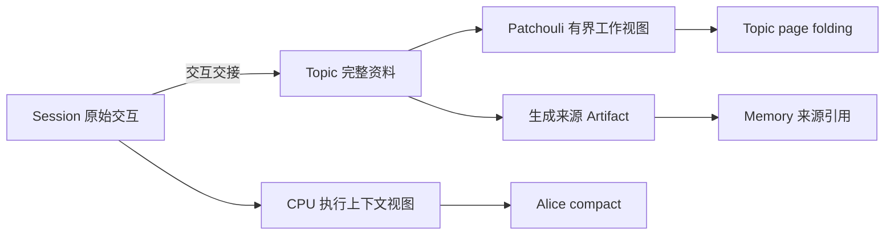

# 短期记忆与上下文压缩

Alice compact 管理 Agent 继续执行所需的工作记忆；Patchouli page folding 管理话题理解与记忆生成所需的工作集。两者基于交互事实产生各自的有界视图，可以共享预算与摘要机制，但分别维护摘要、覆盖边界和生命周期。完整原始资料的保存由[全链路 Raw Evidence Idea](./PatchouliPageFoldingRawEvidenceDesign.md)维护。

Alice 自动压缩已于 2026-10-17 完成，当前事实见 [Agent Runtime](../alice/agent-runtime.md#31-会话上下文视图)，实施与校准记录见[归档计划](../archive/plans/v0.7.0-alice-session-compaction.md)。本文剩余的 Topic folding 优化、质量评估与共享机制属于未排期候选，不因此成为已实现能力；原始资料链与长 Turn 分属各自专项。

## 1. 两种短期记忆的意义

“短期”描述材料正在参与什么工作，不直接决定是否落盘、保存期限或是否已经形成正式记忆。

| 维度 | Agent 执行工作记忆 | Patchouli 记忆形成工作集 |
|:---|:---|:---|
| 回答的问题 | 下一次推理需要知道什么，才能继续当前任务 | 后续话题理解与记忆生成需要保留哪些材料 |
| 组织范围 | 会话与执行环境；本次执行中再区分 frame | Workspace 内的 Topic，可以汇集多个会话和 Agent 的相关交互 |
| 主要内容 | 当前目标、约束、进展、未完成事项与执行引用 | 事实、来源、纠正关系、发生顺序、结果与可复用经验 |
| 消费者 | Alice 或外部 harness 的执行模型 | Gateway 辅助话题分析、Patchouli 主动生成背景与 settlement |
| 容量依据 | 当前执行模型的完整请求预算 | 各次话题分析、摘要和生成请求的预算 |
| 生命周期 | 执行视图与检查点推进，跨 run 的检查点存于会话资源（AC-1） | Topic 摄入、折叠、结算与驱逐 |

Agent 工作记忆还包含程序持有的执行状态。compact 只改变模型可见材料，不能让自由文本摘要接管运行中的工具、线程 context、意图登记、ACK 含义或任务终态。检索得到的正式 Memory 可以进入当前工作上下文，其 canonical 所有权仍在 Patchouli。

Topic 也不等于“尚未写入 Memory 的队列”：主动 WRITE 可能已物化，相关交互仍留在 Topic 中。资料退出某个模型视图、原文是否继续保存、是否生成正式 Memory，是三个独立判断。

## 2. 已确认的方向与范围

| 来源 | 已确认的方向 |
|:---|:---|
| owner，2026-09-28 | 会话提供完整、原样积累的对话历史；CPU 自行压缩派生上下文，Session 记录保持原样。Topic 独立组织记忆生成资料，不承担前台会话上下文控制 |
| owner，2026-09-28 | 保留新建、恢复与会话内 compact；不设“新会话接续旧会话”的交接摘要。把旧会话完整历史带入新会话等同恢复；Topic 的 title、展示 summary 与 state_summary 均不作为会话交接摘要 |
| owner，2026-10-01 | 用户 `/compact` 对外部 Actor 触发其 harness 的压缩，对 Alice 使用 Alice 自己的实现；后台 Topic page folding 独立运行 |
| owner，2026-10-15 | Alice 会话压缩从约 v0.7.1 提前到 v0.7.0，在已完成的会话迁移之后单独形成计划；结果属于会话与执行环境，不属于 Agent |
| owner，2026-10-13 | 对话未来以更原子的结构流式同步到 Patchouli，生成材料包含之前的交互与当前轮已接收消息；输入/封口专项见[长 Turn Idea](./long-running-agent-intra-turn-context-folding.md) |
| owner，2026-10-16 | 原始资料沿 ConversationSession → Topic 完整资料 → 生成来源 Artifact 保全；原始会话持久化另行计划，具体来源与保留语义见 [Raw Evidence](./PatchouliPageFoldingRawEvidenceDesign.md) |
| owner，2026-10-16 | 工具结果减重与轮内预算守卫随 Alice 会话压缩一起实现；v0.7.0 的目标随之调整，实现记录见第 5 节 |
| owner，2026-10-16 | 压缩检查点存入会话资源（AC-1）；首个计划只做自动压缩，`/compact` 随命令系统接回实施（AC-2），见第 8 节 |

会话和 Topic 的关联、外部输入与路由交接继续由[外部会话 Idea](./external-session-and-topic-projection.md)维护；本文不建立第二套交互提交协议。

## 3. 当前基础与缺口

Alice 基线于 2026-10-17 更新；Patchouli 缺口沿用 2026-10-16 的核对，作为剩余候选设计的起点。

### 3.1 Alice

工具结果减重、增量接力摘要、会话检查点、逐帧输入守卫与失败原因已落地，原文保持完整；职责、接受与取消规则分别由 [Agent Runtime](../alice/agent-runtime.md)、[会话资源](../workspace/sessions.md)和[子系统契约](../contracts/subsystem-contracts.md#421-会话压缩检查点)维护。固定样本与 HTTP 链路使用提供商替身，真实 LLM 的摘要事实保留、继续执行质量和成本仍待评估。

命令当前只解析不执行，没有 `/compact` 入口；后续手动触发由[命令 Todo](../todo/conversation-compact-command.md)承接，轮内压缩由[长 Turn Idea](./long-running-agent-intra-turn-context-folding.md)承接。

### 3.2 Patchouli

- page folding 按 token 软水位触发，再按固定 block 数保留后缀；blocks 不足时无法继续折叠，单个超大 block 也不能据此得到严格预算保证。[感知引擎](../../src/hivememory/engines/perception/memory_perception_engine.py)
- 写回 `total_tokens` 只累计保留 blocks，不包含 `state_summary`。默认 SimpleRelay 追加旧摘要与本批统计，没有摘要自身的有界重写。[折叠写回](../../src/hivememory/patchouli/services/perception.py)、[Relay](../../src/hivememory/engines/perception/relay_controller.py)、[默认配置](../../src/hivememory/config/patchouli.py)
- SimpleRelay 主要记录请求数、工具名、token 数与最近问题片段；LLMRelay 在缺少模型、提供商失败或摘要超时时回退为规则摘要，自 2026-10-27 起接在 previous summary 之后。现有字符串返回也未完整表达空、截断或拒绝等摘要终态。[Relay 实现](../../src/hivememory/engines/perception/relay_controller.py)
- Generation 视图保留用户文本、最终回复和动作摘要，默认不消费工具结果全文；READ 仅渲染目标，RUN 仅渲染工具与状态。需要区分可去掉的日志和决定事实含义的关键证据。[生成投影](../../src/hivememory/prompts/transcript/generation.py)
- 已折叠前缀未由 folding 自动保存为原文。原文交接、Topic 完整资料与生成来源 Artifact 的缺口归 [Raw Evidence](./PatchouliPageFoldingRawEvidenceDesign.md)，不由摘要算法解决。

## 4. 两边的关系与不变量

建议关系如下。图中完整资料保存是目标方向，尚未全部贯通；持久化不属于本文范围。

外部输入沿其接入协议交给 Patchouli；图中的 Session 路径不要求所有被动来源都建立本地 Session。Topic 是记忆材料组织方，Patchouli 不在生成时反向读取 workspace 的 Session 内部存储或 CPU prompt。

- 两份摘要根据共同交互事实分别生成；Alice 接力摘要不写入 Topic、不进入 `InteractionPayload`，不作为记忆生成材料。
- 两边独立触发。Alice compact 不缩减 Topic 的完整资料；Topic folding 不替 Alice 减少会话历史；外部 harness 的 compact 同样不能替代 Patchouli 内部 folding。
- CPU checkpoint coverage、Patchouli 实际摄入位置和记忆任务终态分别推进。CPU 已压缩某段内容，不证明 Patchouli 已收到或已生成对应记忆。
- 摘要范围与保留原文后缀不得重复覆盖；覆盖只能相对同一来源与顺序向前推进，不能用字符串大小比较 `interaction_id`。
- compact 与 folding 均不改变授权、写入接纳或持久化事实；RuntimeEvent 只观测，不决定检查点提交成功。
- 原始资料可保存、按需读取，不意味着每次模型请求无界重放全部资料。原文保留、引用有效期及删除按 Raw Evidence 的归属规则处理。

## 5. Alice 会话 compact 的已完成范围

原候选算法与实施决定已移交[归档计划](../archive/plans/v0.7.0-alice-session-compaction.md)，最终算法以 [Agent Runtime](../alice/agent-runtime.md#31-会话上下文视图)为准，本节不维护第二份设计。此次完成自动压缩与轮内守卫；Provider 原生压缩、辅助摘要模型、精确计数、后台压缩和会话持久化没有随之实现。

## 6. Patchouli Topic page folding 优化

本节为未排期的候选优化，不与第 5 节绑定同一交付范围。Topic 的完整资料集合由 Raw Evidence 定义，page folding 只生成供各消费者处理的有界视图。

| 议题 | 候选优化与需要验证的边界 |
|:---|:---|
| 预算 | 同时约束 previous summary、保留后缀和渲染开销；计数与 block 数联合使用，按实际摘要/分析/生成模型分别校验，不能把 topic 软水位当作最终请求上限 |
| 保留边界 | 优先保留完整交互/工具关联，处理单个超大 block 和最近后缀自身超限；是否支持 retain zero、summary-only Topic 的结算/Artifact 语义仍需独立定义，当前 retain 至少为 1 |
| 摘要目标 | 保留事实、来源、时间、否定与纠正、结果和可复用经验；更新仍有效的旧事实，清除过时结论，摘要自身保持有界。不要只用请求数/工具名统计代替语义材料 |
| 工具证据 | 从实际工具结果选择关键返回值、错误原因和验证结论，并保留原文定位；保留范围由生成质量样本验证，不要求将所有日志重新内联 |
| 接受与失败 | 候选摘要完整、有效且满足预算后才切换视图；失败保留上次有效摘要与尚未可靠交接的材料，重试有界并检查是否实际释放空间。原始资料保存失败的责任和阻塞/背压由 Raw Evidence 讨论，不以一条 warning 宣称已保全 |
| 生成消费 | 先取得契约所选时点的全部可用资料及覆盖信息，再按请求预算编译；普通摘要视图与按原文分块提取可采用不同策略，避免恢复全量材料后一次塞进模型 |
| 跨入口 | 根据实际 provenance 与能力处理材料；主动/被动或 connector 名称不直接决定是否跳过 folding。混合来源 Topic 仍保持相同资源归属边界 |
| 观测 | 记录资料规模、内联规模、摘要规模、损失/恢复能力、耗时及失败原因；观测不替代领域提交结果 |

原文资料、摘要视图和正式 Memory 可分别存在。一次 folding 不隐式 settle，不证明已经生成 Memory，也不改变 Topic 的驱逐含义。分块生成的去重与 canonical 更新归 Generation，Perception 不另建“每块是否已经生成记忆”的平行状态机。

## 7. 可共享的技术与专项边界

适合共享的机制包括 token 估算、完整交互边界选择、有界摘要更新、完成状态校验、覆盖范围校验和有限重试。先复用已有低层工具与端口，不预设新增一个统一压缩子系统；跨 L3 子系统仍只消费公共 contracts。

分别维护的内容包括摘要策略、模型选择、预算、数据所有者、覆盖游标、接受条件及清理生命周期。Alice 的检查点和 Patchouli 的工作集不会因为使用同一算法而成为同一状态。

外部 harness 自行维护 prompt history、压缩与厂商缓存，HiveMemory 能否触发压缩取决于驱动协议或 SDK。外部传来的 summary/checkpoint 应保留 producer、来源和覆盖信息；未知覆盖范围不能驱动裁剪，也不能直接覆盖 Patchouli 的 `state_summary`。Alice 自己的接力摘要继续不进入记忆生成输入。

一个未结束 turn 内的多次 compact、开放交互的事件接收和大对象处理见[长 Turn 专项](./long-running-agent-intra-turn-context-folding.md)。CPU 的覆盖点与 Patchouli 摄入水位分别推进，输入流不以 compact 发生作为接收或封口条件。保存与按需回读原文见 [Raw Evidence](./PatchouliPageFoldingRawEvidenceDesign.md)，不通过无限增长的活跃模型视图实现。

## 8. Alice 会话压缩计划的决定（owner，2026-10-16）

两项决定及其当时的候选设计已由[归档计划](../archive/plans/v0.7.0-alice-session-compaction.md)保存；本节仅保留引用入口。

### AC-1 压缩检查点存入会话资源

已实现，当前所有权理由与接受规则见 [会话资源](../workspace/sessions.md)。

### AC-2 本计划只做自动压缩

自动压缩已实现；手动 `/compact` 仍由[命令 Todo](../todo/conversation-compact-command.md)跟踪，等待命令系统接回。

## 9. 其他开放问题与 Plan 门槛

- 检索记忆在提示词中的位置与 KV cache：原外部会话 Idea 8.2 的议题迁入此处。现有动态记忆/附件会影响前缀稳定性；摘要位置、刷新边界和缓存成本需共同评估，不把预期命中写成既定收益。
- 摘要内容质量与预算参数需要用中文夹代码、需求纠正、工具密集、取消/失败和多 Agent 会话验证；事实保留与继续执行能力分别评估，不能只检查摘要格式。
- Topic 优化需先确定完整资料交接与工作视图边界，再明确 Relay 语义、summary-only、生成证据与失败策略；不因复用 Alice 的估算或摘要机制而改变 Topic 的资料所有权。
- 原始资料持久化、编辑/回退/分支后的来源版本与视图失效，由 Raw Evidence 及各自专项供料；不因本文引入摘要就承诺跨重启恢复。

技术调研与固定源码证据见 [Agent Harness 会话压缩技术调研](../research/agent-context-compaction-research.md)。本文维护 HiveMemory 的候选设计；调研报告中的外部项目快照不在此复制，也不替代 owner 决定。
