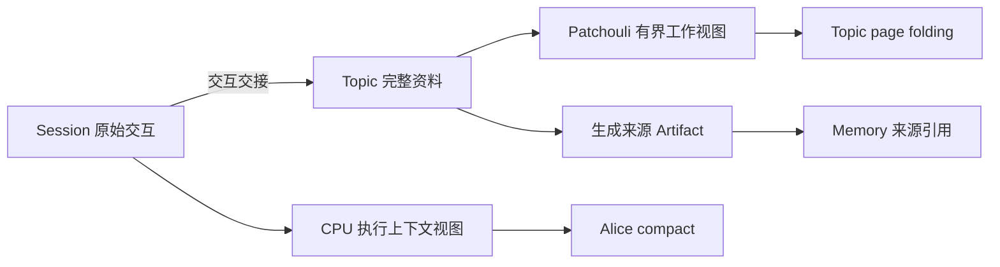

# 短期记忆与上下文压缩

Alice compact 管理 Agent 继续执行所需的工作记忆；Patchouli page folding 管理话题理解与记忆生成所需的工作集。两者基于交互事实产生各自的有界视图，可以共享预算与摘要机制，但分别维护摘要、覆盖边界和生命周期。完整原始资料的保存由[全链路 Raw Evidence Idea](./PatchouliPageFoldingRawEvidenceDesign.md)维护。

正文是已定的设计，候选设计标“候选”。Alice 的会话自动压缩已经实现，当前事实见 [Agent Runtime](../alice/agent-runtime.md#31-会话上下文视图)；本文剩余的 Topic folding 优化、质量评估与共享机制是候选，原始资料链与长 Turn 分属各自专项。

## 1. 两种短期记忆的意义

“短期”描述材料正在参与什么工作，不直接决定是否落盘、保存期限或是否已经形成正式记忆。

| 维度 | Agent 执行工作记忆 | Patchouli 记忆形成工作集 |
|:---|:---|:---|
| 回答的问题 | 下一次推理需要知道什么，才能继续当前任务 | 后续话题理解与记忆生成需要保留哪些材料 |
| 组织范围 | 会话与执行环境；本次执行中再区分 frame | Workspace 内的 Topic，可以汇集多个会话和 Agent 的相关交互 |
| 主要内容 | 当前目标、约束、进展、未完成事项与执行引用 | 事实、来源、纠正关系、发生顺序、结果与可复用经验 |
| 消费者 | Alice 或外部 harness 的执行模型 | Gateway 辅助话题分析、Patchouli 主动生成背景与 settlement |
| 容量依据 | 当前执行模型的完整请求预算 | 各次话题分析、摘要和生成请求的预算 |
| 生命周期 | 执行视图与检查点推进，跨 run 的检查点存于会话资源（AC-1） | Topic 摄入、折叠、结算与驱逐 |

Agent 工作记忆还包含程序持有的执行状态。compact 只改变模型可见材料，不能让自由文本摘要接管运行中的工具、执行线程、意图登记、ACK 含义或任务终态。检索得到的正式 Memory 可以进入当前工作上下文，其 canonical 所有权仍在 Patchouli。

短期记忆在 v0.8 新流转中的定义仍未确定，在孵化中；主动写入缺少背景的"写入即同步点"候选见 [v0.8 写入链路 Idea](./memory-flow-write-path.md)第 2.2 节。

Topic 也不等于“尚未写入 Memory 的队列”：主动 WRITE 可能已物化，相关交互仍留在 Topic 中。资料退出某个模型视图、原文是否继续保存、是否生成正式 Memory，是三个独立判断。

## 2. 已确认的方向与范围

- 会话提供完整、原样积累的对话历史；CPU 自行压缩派生上下文，Session 记录保持原样。Topic 独立组织记忆生成资料，不承担前台会话上下文的控制。
- 保留新建、恢复与会话内 compact，不设“新会话接续旧会话”的交接摘要：把旧会话完整历史带入新会话等同恢复；Topic 的 title、展示 summary 与 state_summary 都不作为会话交接摘要。
- 用户 `/compact` 对外部 Actor 触发其 harness 的压缩，对 Alice 使用 Alice 自己的实现；后台 Topic page folding 独立运行。
- 会话压缩的结果属于会话与执行环境，不属于 Agent；压缩检查点存入会话资源（AC-1，第 8 节）。
- 对话不必流式同步到 Patchouli：时间线保留为顺序与身份的骨架，流式降级为按需追平（[v0.8 写入链路 Idea](./memory-flow-write-path.md)第 2.3 节）；未结束 turn 的输入与封口见[长 Turn Idea](./long-running-agent-intra-turn-context-folding.md)。
- 原始资料沿 ConversationSession → Topic 完整资料 → 生成来源 Artifact 保全；原始会话的持久化另行计划，来源与保留语义见 [Raw Evidence](./PatchouliPageFoldingRawEvidenceDesign.md)。

会话和 Topic 的关联、外部输入与路由交接由[外部会话 Idea](./external-session-and-topic-projection.md)维护；本文不建立第二套交互提交协议。

## 3. 当前基础与缺口

以代码为准。

### 3.1 Alice

工具结果减重、增量接力摘要、会话检查点、逐帧输入守卫与失败原因已经实现，原文保持完整；职责、接受与取消规则分别由 [Agent Runtime](../alice/agent-runtime.md)、[会话资源](../workspace/sessions.md)和[子系统契约](../contracts/subsystem-contracts.md#421-会话压缩检查点)维护。固定样本与 HTTP 链路使用提供商替身，真实 LLM 下摘要的事实保留、继续执行的质量和成本还没有评估。

命令只解析不执行，没有 `/compact` 入口；手动触发由[命令 Todo](../todo/conversation-compact-command.md)跟踪，轮内压缩由[长 Turn Idea](./long-running-agent-intra-turn-context-folding.md)跟踪。

### 3.2 Patchouli

- page folding 在工作视图的 token 之和超过 `fold_token_threshold` 时触发，保留最近 `fold_retain_recent_blocks` 个 block、折叠其余部分；保留数至少为 1，blocks 不足时无法继续折叠，单个超大 block 也不能据此得到严格的预算保证（[感知引擎](../../src/hivememory/engines/perception/memory_perception_engine.py)）。
- 话题的 `total_tokens` 由工作视图派生，只是保留 blocks 的估算之和，不包含 `state_summary`（[话题模型](../../src/hivememory/core/models/topic.py)）。
- 摘要有两种：代码默认的 SimpleRelay 把旧摘要与本批的统计拼接在一起，摘要自身没有有界重写；仓库随附的 `configs/config.yaml` 选用 LLMRelay，由模型参照旧摘要写出新摘要，缺少模型、提供商失败或超时的时候回退为规则摘要，接在旧摘要之后。SimpleRelay 主要记录请求数、工具名、token 数与最近问题片段；两者都以字符串返回，没有表达空、截断或拒绝等摘要终态（[Relay](../../src/hivememory/engines/perception/relay_controller.py)、[默认配置](../../src/hivememory/config/patchouli.py)）。
- Generation 视图按出现顺序保留用户消息、助手正文、思考与子 Agent 消息；外部工具保留调用参数与结果，单条结果按 `max_result_chars`（默认 800 字符）保留首尾截断；SEARCH、READ、RUN 只有一行摘要，不渲染取回的记忆；WRITE、UPDATE、CALL 不进入材料。截断只依长度，还分不开可以去掉的日志和决定事实含义的关键证据（[材料渲染](../../src/hivememory/engines/perception/material.py)、[生成投影](../../src/hivememory/prompts/transcript/generation.py)、[Patchouli 生成](../patchouli/generation.md)）。
- 折叠不丢弃原文：被折叠的块留在 Topic 的交互记录中，结算时冻结进来源 InteractionArtifact（[感知与短期话题](../patchouli/perception.md)）。交到 Topic 之前的原文交接与保存承诺归 Raw Evidence，不由摘要算法解决。

## 4. 两边的关系与不变量（候选）

图中从 Topic 完整资料到生成来源 Artifact 的部分已经实现（[感知与短期话题](../patchouli/perception.md)），Session 到 Topic 的交接是候选方向；持久化不属于本文范围。

外部输入沿其接入协议交给 Patchouli；图中的 Session 路径不要求所有被动来源都建立本地 Session。Topic 是记忆材料组织方，Patchouli 不在生成时反向读取 workspace 的 Session 内部存储或 CPU prompt。

- 两份摘要根据共同交互事实分别生成；Alice 接力摘要不写入 Topic、不进入 `InteractionPayload`，不作为记忆生成材料。
- 两边独立触发。Alice compact 不缩减 Topic 的完整资料；Topic folding 不替 Alice 减少会话历史；外部 harness 的 compact 同样不能替代 Patchouli 内部 folding。
- CPU checkpoint coverage、Patchouli 实际摄入位置和记忆任务终态分别推进。CPU 已压缩某段内容，不证明 Patchouli 已收到或已生成对应记忆。
- 摘要范围与保留原文后缀不得重复覆盖；覆盖只能相对同一来源与顺序向前推进，不能用字符串大小比较 `interaction_id`。
- compact 与 folding 均不改变授权、写入接纳或持久化事实；RuntimeEvent 只观测，不决定检查点提交成功。
- 原始资料可保存、按需读取，不意味着每次模型请求无界重放全部资料。原文保留、引用有效期及删除按 Raw Evidence 的归属规则处理。

## 5. Alice 会话 compact 的已完成范围

已经实现自动压缩与轮内守卫，算法以 [Agent Runtime](../alice/agent-runtime.md#31-会话上下文视图)为准，本节不维护第二份设计。Provider 原生压缩、辅助摘要模型、精确计数、后台压缩和会话持久化没有实现。

## 6. Patchouli Topic page folding 优化

本节是未排期的候选优化，与第 5 节不绑定同一交付范围。Topic 的完整资料集合由 Raw Evidence 定义，page folding 只生成供各消费者处理的有界视图。

| 议题 | 候选优化与需要验证的边界 |
|:---|:---|
| 预算 | 同时约束 previous summary、保留后缀和渲染开销；计数与 block 数联合使用，按实际摘要/分析/生成模型分别校验，不能把 topic 软水位当作最终请求上限 |
| 保留边界 | 优先保留完整交互/工具关联，处理单个超大 block 和最近后缀自身超限；是否支持 retain zero、summary-only Topic 的结算/Artifact 语义仍需独立定义，当前 retain 至少为 1 |
| 摘要目标 | 保留事实、来源、时间、否定与纠正、结果和可复用经验；更新仍有效的旧事实，清除过时结论，摘要自身保持有界。不要只用请求数/工具名统计代替语义材料 |
| 工具证据 | 从实际工具结果选择关键返回值、错误原因和验证结论，并保留原文定位；保留范围由生成质量样本验证，不要求将所有日志重新内联 |
| 接受与失败 | 候选摘要完整、有效且满足预算后才切换视图；失败保留上次有效摘要与尚未可靠交接的材料，重试有界并检查是否实际释放空间。原始资料保存失败的责任和阻塞/背压由 Raw Evidence 讨论，不以一条 warning 宣称已保全 |
| 生成消费 | 先取得契约所选时点的全部可用资料及覆盖信息，再按请求预算编译；不按原文分块提取（[Raw Evidence](./PatchouliPageFoldingRawEvidenceDesign.md)第 0 节），生成继续读取话题的工作视图，避免恢复全量材料后一次塞进模型 |
| 跨入口 | 根据实际 provenance 与能力处理材料；主动/被动或 connector 名称不直接决定是否跳过 folding。混合来源 Topic 仍保持相同资源归属边界 |
| 观测 | 记录资料规模、内联规模、摘要规模、损失/恢复能力、耗时及失败原因；观测不替代领域提交结果 |

原文资料、摘要视图和正式 Memory 可分别存在。一次 folding 不隐式 settle，不证明已经生成 Memory，也不改变 Topic 的驱逐含义。生成不分块；去重与 canonical 更新归 Generation，Perception 不另建“每块是否已经生成记忆”的平行状态机。

## 7. 可共享的技术与专项边界

适合共享的机制包括 token 估算、完整交互边界选择、有界摘要更新、完成状态校验、覆盖范围校验和有限重试。先复用已有低层工具与端口，不预设新增一个统一压缩子系统；跨 L3 子系统仍只消费公共 contracts。

分别维护的内容包括摘要策略、模型选择、预算、数据所有者、覆盖游标、接受条件及清理生命周期。Alice 的检查点和 Patchouli 的工作集不会因为使用同一算法而成为同一状态。

外部 harness 自行维护 prompt history、压缩与厂商缓存，HiveMemory 能否触发压缩取决于驱动协议或 SDK。外部传来的 summary/checkpoint 应保留 producer、来源和覆盖信息；未知覆盖范围不能驱动裁剪，也不能直接覆盖 Patchouli 的 `state_summary`。Alice 自己的接力摘要继续不进入记忆生成输入。

一个未结束 turn 内的多次 compact、开放交互的事件接收和大对象处理见[长 Turn 专项](./long-running-agent-intra-turn-context-folding.md)。CPU 的覆盖点与 Patchouli 摄入水位分别推进，输入流不以 compact 发生作为接收或封口条件。保存与按需回读原文见 [Raw Evidence](./PatchouliPageFoldingRawEvidenceDesign.md)，不通过无限增长的活跃模型视图实现。

## 8. 会话压缩的两项设计

### AC-1 压缩检查点存入会话资源

压缩检查点属于会话资源，不属于 Agent 或 CPU 的进程内状态。已经实现，所有权理由与接受规则见[会话资源](../workspace/sessions.md)。

### AC-2 自动压缩先行，手动 `/compact` 随命令系统接回

自动压缩已经实现；手动 `/compact` 要等命令系统接回，由[命令 Todo](../todo/conversation-compact-command.md)跟踪。

## 9. 其他开放问题与 Plan 门槛

- 检索记忆在提示词中的位置与 KV cache：动态记忆与附件会影响前缀稳定性；摘要位置、刷新边界和缓存成本要一起评估，不把预期命中写成既定收益。
- 摘要内容质量与预算参数，要用中文夹代码、需求纠正、工具密集、取消与失败、多 Agent 的会话验证；事实保留与继续执行能力分别评估，不能只检查摘要格式。
- Topic 内完整资料与工作视图的边界已经实现（交互记录与折叠记录，工作视图由它们派生）；Topic 优化要先确定交到 Topic 之前的完整资料交接，再明确 Relay 语义、summary-only、生成证据与失败策略；不因复用 Alice 的估算或摘要机制而改变 Topic 的资料所有权。
- 原始资料持久化、编辑/回退/分支后的来源版本与视图失效，由 Raw Evidence 及各自专项跟踪；不因本文引入摘要就承诺跨重启恢复。

技术调研与固定源码证据见 [Agent Harness 会话压缩技术调研](../research/agent-context-compaction-research.md)。调研报告中的外部项目快照不在此复制，也不替代 owner 决定。
