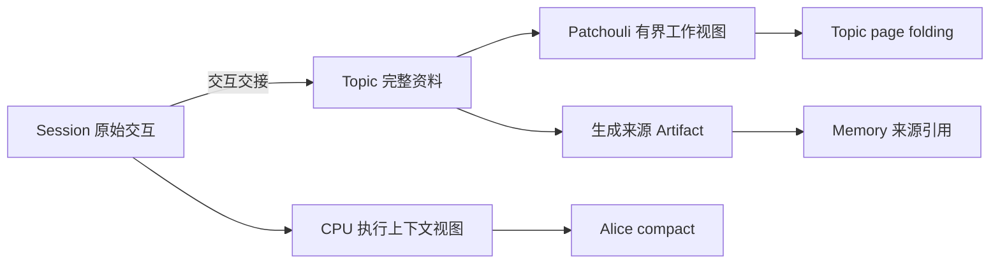

# 短期记忆与上下文压缩

Alice compact 管理 Agent 继续执行所需的工作记忆；Patchouli page folding 管理话题理解与记忆生成所需的工作集。两者基于交互事实产生各自的有界视图，可以共享预算与摘要机制，但分别维护摘要、覆盖边界和生命周期。完整原始资料的保存由[全链路 Raw Evidence Idea](./PatchouliPageFoldingRawEvidenceDesign.md)维护。

本文是开放设计，不表示这些机制已经实现。`horizon: current` 表示本文为 v0.7.0 的 Alice 会话压缩 Plan 供料；Topic folding 优化、Turn 内增长、原始资料链和外部 harness 接入不因此一并进入 v0.7.0。外部会话 Idea 原 0.3、AC-1/AC-2 及相关压缩讨论于 2026-10-16 迁入本文；已确认决定继续标注 owner，其他内容仍为候选。

## 1. 两种短期记忆的意义

“短期”描述材料正在参与什么工作，不直接决定是否落盘、保存期限或是否已经形成正式记忆。

| 维度 | Agent 执行工作记忆 | Patchouli 记忆形成工作集 |
|:---|:---|:---|
| 回答的问题 | 下一次推理需要知道什么，才能继续当前任务 | 后续话题理解与记忆生成需要保留哪些材料 |
| 组织范围 | 会话与执行环境；本次执行中再区分 frame | Workspace 内的 Topic，可以汇集多个会话和 Agent 的相关交互 |
| 主要内容 | 当前目标、约束、进展、未完成事项与执行引用 | 事实、来源、纠正关系、发生顺序、结果与可复用经验 |
| 消费者 | Alice 或外部 harness 的执行模型 | Gateway 辅助话题分析、Patchouli 主动生成背景与 settlement |
| 容量依据 | 当前执行模型的完整请求预算 | 各次话题分析、摘要和生成请求的预算 |
| 生命周期 | 执行视图与检查点推进，跨 run 的检查点存于会话资源（AC-1） | Topic 摄入、折叠、结算与驱逐 |

Agent 工作记忆还包含程序持有的执行状态。compact 只改变模型可见材料，不能让自由文本摘要接管运行中的工具、线程 context、意图登记、ACK 含义或任务终态。检索得到的正式 Memory 可以进入当前工作上下文，其 canonical 所有权仍在 Patchouli。

Topic 也不等于“尚未写入 Memory 的队列”：主动 WRITE 可能已物化，相关交互仍留在 Topic 中。资料退出某个模型视图、原文是否继续保存、是否生成正式 Memory，是三个独立判断。

## 2. 已确认的方向与范围

| 来源 | 已确认的方向 |
|:---|:---|
| owner，2026-09-28 | 会话提供完整、原样积累的对话历史；CPU 自行压缩派生上下文，Session 记录保持原样。Topic 独立组织记忆生成资料，不承担前台会话上下文控制 |
| owner，2026-09-28 | 保留新建、恢复与会话内 compact；不设“新会话接续旧会话”的交接摘要。把旧会话完整历史带入新会话等同恢复；Topic 的 title、展示 summary 与 state_summary 均不作为会话交接摘要 |
| owner，2026-10-01 | 用户 `/compact` 对外部 Actor 触发其 harness 的压缩，对 Alice 使用 Alice 自己的实现；后台 Topic page folding 独立运行 |
| owner，2026-10-15 | Alice 会话压缩从约 v0.7.1 提前到 v0.7.0，在已完成的会话迁移之后单独形成计划；结果属于会话与执行环境，不属于 Agent |
| owner，2026-10-13 | 对话未来以更原子的结构流式同步到 Patchouli，生成材料包含之前的交互与当前轮已接收消息；输入/封口专项见[长 Turn Idea](./long-running-agent-intra-turn-context-folding.md) |
| owner，2026-10-16 | 原始资料沿 ConversationSession → Topic 完整资料 → 生成来源 Artifact 保全；原始会话持久化另行计划，具体来源与保留语义见 [Raw Evidence](./PatchouliPageFoldingRawEvidenceDesign.md) |
| owner，2026-10-16 | 工具结果减重与轮内预算守卫随 Alice 会话压缩一起实现；v0.7.0 的目标随之调整，见第 5 节开头 |
| owner，2026-10-16 | 压缩检查点存入会话资源（AC-1）；首个计划只做自动压缩，`/compact` 随命令系统接回实施（AC-2），见第 8 节 |

会话和 Topic 的关联、外部输入与路由交接继续由[外部会话 Idea](./external-session-and-topic-projection.md)维护；本文不建立第二套交互提交协议。

## 3. 当前基础与缺口

以下根据 2026-10-16 的代码核对，仅作为候选设计的起点。

### 3.1 Alice

- 进程把全量会话轮次放入 `CPUInputManifest.session_history`，Alice 转为 `AgentRunContext.session_history`。`HistoryTranscriptBuilder` 重放各轮 `turn_events`，包括 MTP 调用和工具结果全文，增长速度可能远快于界面中的对话文本。[CPU 分配](../../src/hivememory/workspace/process/runner.py)、[历史重放](../../src/hivememory/prompts/transcript/history.py)
- `AgentPromptAssembler` 不估算消息长度；`ModelDefinition` 只有生成上限 `max_tokens`，没有上下文窗口字段。`TokenEstimator` 可用于字符比率估算，但 Alice 尚未用它做完整请求预算。[提示词组装](../../src/hivememory/prompts/assembler.py)、[模型定义](../../src/hivememory/core/models/model_definition.py)、[估算器](../../src/hivememory/utils/token_estimator.py)
- 模型超窗沿生成错误形成 FAILED。首次生成即失败时只有初始用户事件，`has_output` 为假，不写入会话、不提交；已有会话过长时，后续轮次也可能持续失败。[执行循环](../../src/hivememory/agent_runtime/execution/loop.py)、[CPU 结果](../../src/hivememory/workspace/contracts/cpu.py)
- CPU 自报的失败没有原因：`CPUExecutionResult` 只有状态、回复文本、事件与模型名，进程投影 done 时原因固定为 `agent_run_failed`，`chat.run.failed` 也不带原因。用户无法区分超窗与其他失败。[输出投影](../../src/hivememory/workspace/process/outputs.py)
- 单轮增长没有上限：每次 MTP 迭代都把工具结果全文追加到 `working_history`，默认最多 10 次迭代（`alice.runtime.max_loop_iterations`），单次读文件上限 100KB（`alice.koakuma.file_read_max_bytes`）；按 `TokenEstimator` 的英文 4 字符/token 估算，一轮满额读文件约 25 万 token。[执行循环](../../src/hivememory/agent_runtime/execution/loop.py)、[Alice 配置](../../src/hivememory/config/alice.py)
- 工具结果事件带有 `tool_kind`、`target`、`tool_args` 与状态，可以按动词区分处理；READ 的目标是 canonical 别名，后续 run 可以经 workspace 的 `AliasResolver` 重新读取。生成结果 `GenerationResult` 已携带 `finish_reason`，可以识别被长度截断的摘要。[执行循环](../../src/hivememory/agent_runtime/execution/loop.py)、[别名解析](../../src/hivememory/workspace/resolution/alias.py)、[执行模型](../../src/hivememory/agent_runtime/models.py)
- Alice 每次从输入清单重新构造 run，不保存跨 run 的会话压缩状态；清单不携带 `session_id`。CALL 子 frame 只接收任务与 shared context，不接收会话全历史。[运行服务](../../src/hivememory/alice/application/agent_run_service.py)、[输入清单](../../src/hivememory/workspace/contracts/process.py)
- 命令只解析不执行，没有 `/compact` 定义；命令运行位置 Q-5a 尚未决定。[命令现状](../gateway/commands.md)、[任务进程问题](./task-process-table-and-registration-entry.md)

### 3.2 Patchouli

- page folding 按 token 软水位触发，再按固定 block 数保留后缀；blocks 不足时无法继续折叠，单个超大 block 也不能据此得到严格预算保证。[感知引擎](../../src/hivememory/engines/perception/memory_perception_engine.py)
- 写回 `total_tokens` 只累计保留 blocks，不包含 `state_summary`。默认 SimpleRelay 追加旧摘要与本批统计，没有摘要自身的有界重写。[折叠写回](../../src/hivememory/patchouli/services/perception.py)、[Relay](../../src/hivememory/engines/perception/relay_controller.py)、[默认配置](../../src/hivememory/config/patchouli.py)
- SimpleRelay 主要记录请求数、工具名、token 数与最近问题片段；LLMRelay 异常或缺少模型时的简单回退未合并 previous summary。现有字符串返回也未完整表达空、截断或拒绝等摘要终态。[Relay 实现](../../src/hivememory/engines/perception/relay_controller.py)
- Generation 视图保留用户文本、最终回复和动作摘要，默认不消费工具结果全文；READ 仅渲染目标，RUN 仅渲染工具与状态。需要区分可去掉的日志和决定事实含义的关键证据。[生成投影](../../src/hivememory/prompts/transcript/generation.py)
- 已折叠前缀未由 folding 自动保存为原文。原文交接、Topic 完整资料与生成来源 Artifact 的缺口归 [Raw Evidence](./PatchouliPageFoldingRawEvidenceDesign.md)，不由摘要算法解决。

## 4. 两边的关系与不变量

建议关系如下。图中完整资料保存是目标方向，尚未全部贯通；持久化不属于本文范围。

外部输入沿其接入协议交给 Patchouli；图中的 Session 路径不要求所有被动来源都建立本地 Session。Topic 是记忆材料组织方，Patchouli 不在生成时反向读取 workspace 的 Session 内部存储或 CPU prompt。

- 两份摘要根据共同交互事实分别生成；Alice 接力摘要不写入 Topic、不进入 `InteractionPayload`，不作为记忆生成材料。
- 两边独立触发。Alice compact 不缩减 Topic 的完整资料；Topic folding 不替 Alice 减少会话历史；外部 harness 的 compact 同样不能替代 Patchouli 内部 folding。
- CPU checkpoint coverage、Patchouli 实际摄入位置和记忆任务终态分别推进。CPU 已压缩某段内容，不证明 Patchouli 已收到或已生成对应记忆。
- 摘要范围与保留原文后缀不得重复覆盖；覆盖只能相对同一来源与顺序向前推进，不能用字符串大小比较 `interaction_id`。
- compact 与 folding 均不改变授权、写入接纳或持久化事实；RuntimeEvent 只观测，不决定检查点提交成功。
- 原始资料可保存、按需读取，不意味着每次模型请求无界重放全部资料。原文保留、引用有效期及删除按 Raw Evidence 的归属规则处理。

## 5. Alice 会话 compact 候选机制

本节承接外部会话 Idea 原 0.3。以下是为 Plan 供料的候选设计，owner 已确认的边界见第 2 节；据此形成的计划见 [v0.7.0 Alice 会话压缩](../plans/v0.7.0-alice-session-compaction.md)。

**v0.7.0 目标**（2026-10-16 随第 2 节 owner 决定调整）：会话历史的增长不再让 Alice 的请求超出模型窗口。组装根 frame 时，较早轮次先去掉可以重新取得的工具结果，仍超过阈值时再由接力摘要覆盖；当前输入或单轮执行本身超出预算时，以可区分的结构化错误结束，而不是表现为模型调用失败。

**范围**：工具结果减重、接力摘要与检查点、轮内预算守卫，以及区分失败原因所需的 CPU 结果字段、进度与观测。不在范围：轮内压缩（单轮增长只由守卫拦截，压缩仍属[长 Turn 专项](./long-running-agent-intra-turn-context-folding.md)）、CALL 子 frame 的历史压缩（子 frame 不接收会话历史）、Provider 原生压缩、后台或轮后压缩、单独配置的辅助摘要模型、精确 token 计数、外部 harness 驱动、Topic folding 改造与会话持久化。`/compact` 不在本计划（AC-2）。

| 事项 | 候选设计 |
|:---|:---|
| 触发时点 | 每次 run 创建根 frame 前，先解析本次实际模型与生成参数，估算协议/工具说明、人设、检索记忆、附件、会话历史与当前用户消息；超过触发阈值才压缩并重组。压缩在 Actor 阶段内同步完成，用户在本轮开始时等待；不在 run 结束后另开后台任务或推迟 done |
| 预算 | 模型窗口、输出 `max_tokens`、消息开销和安全余量分别核算；若提供的是总窗口，扣除输出预留，若另有最大输入额度则同时取约束，避免重复扣减。触发阈值与压缩后的目标大小分开设定（例如触发 0.75、目标 0.5），两者的差距使压缩后若干轮内不再触发；比例仍需样本验证。模型注册表可增加窗口元数据，经 `ModelResolver` 交付；未配置时使用保守默认值。沿用 `TokenEstimator` 的估算，精确计数不作为首版前提 |
| 第一层：工具结果减重 | 先改写较早轮次的工具结果，不调用模型。按 `tool_kind` 处理：READ 的结果可经 canonical 别名重新读取、SEARCH 可以重新检索，替换为目标或查询、状态与可重新取得的提示；RUN 保留工具名、参数、状态与有界摘录；WRITE/UPDATE 的 ACK、错误原因与 CALL 响应保留原文，过长时有界保留。用户消息、助手回复与工具调用不改。减重边界随检查点推进：一次压缩把边界之前的轮次一并减重，两次压缩之间渲染结果不变，不按“最近 K 轮”逐轮滑动，以免每轮都改写前缀；边界之后的近期轮次保留原文。只靠减重就降到目标以下时，检查点只推进减重边界、不生成摘要 |
| 第二层：接力摘要 | 减重后仍高于目标时，以完整 `ConversationTurn` 为单位逆向选择预算内的近期后缀，更早前缀进入摘要；不拆同轮工具调用与结果。覆盖游标候选为最后被覆盖轮次的 `interaction_id`，接受时校验其确属该会话前缀 |
| 增量与有界 | 新摘要由上一份摘要和新进入覆盖范围的轮次生成，替换旧摘要；摘要自身设长度预算，超限时有界重写，不无限拼接 |
| 摘要请求的预算 | 摘要请求自身也要放进模型窗口：被覆盖轮次以减重后的形式序列化，工具输出再截到固定长度（参考 pi 的 2,000 字符）；仍放不下时按轮次分几次折叠，每次以上一份摘要加上放得下的若干轮生成新摘要。上一轮读过大文件、或会话中途换成更小窗口的模型时，首次压缩不会因摘要请求超窗而失败 |
| 摘要内容 | 当前目标与约束、已作出的决定、实际完成工作、未完成事项、结果与关键引用；以第三人称保留不同 Agent 的来源及 cancelled/failed 的未完成性质。结果属于会话与执行环境，不属于 Agent；不进入 Topic、InteractionPayload 或记忆生成 |
| 引用交接 | 需要逐字准确的引用由程序交接：从被覆盖轮次的事件中提取 READ 目标、WRITE/UPDATE 的 ACK 别名与 RUN 的文件参数，作为结构化清单随检查点保存并与摘要一同渲染，不依赖摘要模型记住（参考 pi 的文件清单）。清单只是线索，不作为权限、执行成功或写入已持久化的依据 |
| 摘要模型 | 候选使用本次 run 解析出的模型与 Alice 自己的提示词，语言随本次 run 的提示词语言；不复用面向记忆材料的 Patchouli 摘要 |
| 提示词位置 | 候选放在 system prompt 的 persona 之后、检索记忆之前；被覆盖轮次不重放，近期轮次继续由 `HistoryTranscriptBuilder` 重放。需标明摘要是历史资料，避免将其中历史命令提升为当前协议。位置与 Provider 适配、缓存需一起验证 |
| 接受校验 | 候选摘要先校验再接受：空内容、被长度截断（`finish_reason=length`）、拒答或其中出现 MTP 调用都不接受为有效检查点；校验失败按下面的失败规则处理 |
| 失败 | 摘要失败且未压缩请求仍在输入预算内时继续运行，后续再试；已超预算则以可区分的结构化错误结束，不静默截断。压缩后仍放不下当前输入或固定内容时返回不同原因 |
| 防震荡 | 一次压缩后仍高于目标大小时：仍在输入上限内则照常运行，但在新的轮次进入会话之前不再以相同输入重复摘要；已超出输入上限则以可区分的错误结束，不反复付费摘要（参考 Claude Code 的 thrashing 处理） |
| 轮内预算守卫 | agent 循环每次生成之前，按该 frame 解析出的模型估算 `working_history`，超出输入上限即以可区分的结构化错误结束该 frame，不再发出必然失败的模型调用。守卫适用于根 frame 与 CALL 子 frame，子 frame 被拦截时按现有 CALL 失败语义回到父 frame。守卫只拦截，不在轮内压缩。根 frame 被拦截时本轮已有输出，照现有规则以 failed 封口并写入会话；下一轮的减重会收缩这一轮的工具结果 |
| 失败原因 | `CPUExecutionResult` 增加 CPU 中立的失败原因码，用来区分压缩失败、当前输入过大、轮内超出预算与一般失败；进程原样投影到 done 与 `chat.run.failed`，只携带稳定的原因码，不携带异常正文。外部 CPU 可以不填，按一般失败处理 |
| 取消 | 压缩期间原生 `CancelledError` 继续传播；未完成的候选不替换上次有效检查点。通过校验的候选写入结果，取消时随结果槽交回，由进程在会话写回步骤接受（AC-1）；没有用户输出不能被当作检查点保存成功或失败的依据 |
| 交付与观测 | 流式开始/结束事件沿现有交互输出交付，进程原样转交；RuntimeEvent 记录减重与摘要前后的估算 token、覆盖轮数与耗时，以及守卫拦截。压缩进度不进入 CPUExecutionResult.turn_events、不令 has_output 为真，也不单独触发交互封口。会话读取接口随会话返回检查点，前端据覆盖范围标记，仍展示 Session 原文（AC-1） |
| 配置 | Alice 配置段可增加开关、默认窗口、触发比例、目标比例、近期保留预算、工具结果摘录长度与摘要上限；名称和缺省值尚未冻结 |
| 不变量 | Session 原文不被改写，减重与摘要只改变 Alice 的派生视图；Gateway 最近 N 轮、Topic 与 Patchouli 不受影响。会话内切换 Agent 沿用同一会话/执行环境的检查点，并按当前模型重新校验预算 |

轮前的减重与摘要管理跨轮历史的增长；单轮执行的增长由轮内守卫拦截为显式失败，不承诺任意长单轮执行能够完成，轮内压缩仍属长 Turn 专项。

## 6. Patchouli Topic page folding 优化

本节为未排期的候选优化，不与第 5 节绑定同一交付范围。Topic 的完整资料集合由 Raw Evidence 定义，page folding 只生成供各消费者处理的有界视图。

| 议题 | 候选优化与需要验证的边界 |
|:---|:---|
| 预算 | 同时约束 previous summary、保留后缀和渲染开销；计数与 block 数联合使用，按实际摘要/分析/生成模型分别校验，不能把 topic 软水位当作最终请求上限 |
| 保留边界 | 优先保留完整交互/工具关联，处理单个超大 block 和最近后缀自身超限；是否支持 retain zero、summary-only Topic 的结算/Artifact 语义仍需独立定义，当前 retain 至少为 1 |
| 摘要目标 | 保留事实、来源、时间、否定与纠正、结果和可复用经验；更新仍有效的旧事实，清除过时结论，摘要自身保持有界。不要只用请求数/工具名统计代替语义材料 |
| 工具证据 | 从实际工具结果选择关键返回值、错误原因和验证结论，并保留原文定位；保留范围由生成质量样本验证，不要求将所有日志重新内联 |
| 接受与失败 | 候选摘要完整、有效且满足预算后才切换视图；失败保留上次有效摘要与尚未可靠交接的材料，重试有界并检查是否实际释放空间。原始资料保存失败的责任和阻塞/背压由 Raw Evidence 讨论，不以一条 warning 宣称已保全 |
| 生成消费 | 先取得契约所选时点的全部可用资料及覆盖信息，再按请求预算编译；普通摘要视图与按原文分块提取可采用不同策略，避免恢复全量材料后一次塞进模型 |
| 跨入口 | 根据实际 provenance 与能力处理材料；主动/被动或 connector 名称不直接决定是否跳过 folding。混合来源 Topic 仍保持相同资源归属边界 |
| 观测 | 记录资料规模、内联规模、摘要规模、损失/恢复能力、耗时及失败原因；观测不替代领域提交结果 |

原文资料、摘要视图和正式 Memory 可分别存在。一次 folding 不隐式 settle，不证明已经生成 Memory，也不改变 Topic 的驱逐含义。分块生成的去重与 canonical 更新归 Generation，Perception 不另建“每块是否已经生成记忆”的平行状态机。

## 7. 可共享的技术与专项边界

适合共享的机制包括 token 估算、完整交互边界选择、有界摘要更新、完成状态校验、覆盖范围校验和有限重试。先复用已有低层工具与端口，不预设新增一个统一压缩子系统；跨 L3 子系统仍只消费公共 contracts。

分别维护的内容包括摘要策略、模型选择、预算、数据所有者、覆盖游标、接受条件及清理生命周期。Alice 的检查点和 Patchouli 的工作集不会因为使用同一算法而成为同一状态。

外部 harness 自行维护 prompt history、压缩与厂商缓存，HiveMemory 能否触发压缩取决于驱动协议或 SDK。外部传来的 summary/checkpoint 应保留 producer、来源和覆盖信息；未知覆盖范围不能驱动裁剪，也不能直接覆盖 Patchouli 的 `state_summary`。Alice 自己的接力摘要继续不进入记忆生成输入。

一个未结束 turn 内的多次 compact、开放交互的事件接收和大对象处理见[长 Turn 专项](./long-running-agent-intra-turn-context-folding.md)。CPU 的覆盖点与 Patchouli 摄入水位分别推进，输入流不以 compact 发生作为接收或封口条件。保存与按需回读原文见 [Raw Evidence](./PatchouliPageFoldingRawEvidenceDesign.md)，不通过无限增长的活跃模型视图实现。

## 8. Alice 会话压缩计划的决定（owner，2026-10-16）

AC 编号沿用迁入时的编号。两项均已决定，不再是开放问题；各项之后的“随之确定的候选设计”不是 owner 决定，可在计划评审时调整。

### AC-1 压缩检查点存入会话资源

**决定**：会话资源持有 CPU 中立的压缩检查点（原选项 A）。

**依据**（分析）：Alice 继续不保存跨 run 状态，AGENTS.md 中 Alice 只拥有本次 run 状态的规则不变；会话删除、关闭清理与将来的会话持久化随会话一并覆盖检查点；将来引入编辑或回退时，派生视图的失效由会话所有者统一处理（[Raw Evidence](./PatchouliPageFoldingRawEvidenceDesign.md) 第 8 节）；pi、Codex、OpenCode 也都把检查点绑定在会话历史上（[调研](./agent-context-compaction-research.md)第 9.5 节）。未选的原选项 B 需要在输入清单中携带 `session_id`，并为 Alice 新增跨 run 状态与清理通知。

**随之确定的候选设计**：

- 检查点模型与 `ConversationTurn` 同置 `core.protocol.models`，字段为产生方与格式版本、减重边界与摘要覆盖（各为最后一个被覆盖轮次的 `interaction_id`，可以为空）、摘要正文、引用清单与生成时间；每个会话至多一份。
- 输入清单携带当前检查点；`CPUExecutionResult` 增加可选的新检查点，正常终态与取消时的结果槽都可以带上它。
- 进程拿到 CPU 结果后，在封口与追加会话的同一同步步骤中交给会话服务接受，不跨越 await。接受不看 `has_output`：本轮没有输出、或交付方断开而丢弃本轮时也接受，因为检查点只覆盖已封口的旧轮次；进程异常而拿不到结果时没有检查点。
- 会话服务的接受规则：调用方持有该会话的认领；两个游标都指向本会话已有的轮次，减重边界不早于摘要覆盖；与已有检查点相比只能前进。不满足时拒绝，进程记录告警并照常收尾本轮，下一轮由 CPU 重新计算。
- 外部 CPU 不填检查点、也不读取它；产生方或格式版本不符的检查点由 CPU 忽略并重新计算。
- 会话读取接口随会话返回检查点，前端据覆盖位置标记较早的上下文已压缩；会话列表不包含它。

### AC-2 本计划只做自动压缩

**决定**：首个计划只做自动压缩；`/compact` 留在[命令 Todo](../todo/conversation-compact-command.md)，随命令系统接回实施（原选项 A）。

**随之确定的候选设计**：压缩入口保留“强制压缩”参数，将来 `/compact` 复用同一算法，不另写一套；CPU 端口不在本计划新增压缩操作。

## 9. 其他开放问题与 Plan 门槛

- 检索记忆在提示词中的位置与 KV cache：原外部会话 Idea 8.2 的议题迁入此处。现有动态记忆/附件会影响前缀稳定性；摘要位置、刷新边界和缓存成本需共同评估，不把预期命中写成既定收益。
- 摘要内容质量与预算参数需要用中文夹代码、需求纠正、工具密集、取消/失败和多 Agent 会话验证；事实保留与继续执行能力分别评估，不能只检查摘要格式。
- 首个 Alice Plan 需明确模型窗口语义、减重的保留规则、失败原因码与过大输入的结构化错误、检查点的接受规则与取消交回。验证放在预算/边界/提交实际归属层，上层只保留代表性链路。
- Topic 优化需先确定完整资料交接与工作视图边界，再明确 Relay 语义、summary-only、生成证据与失败策略；不与 Alice Plan 形成互相变化的详细设计依赖。
- 原始资料持久化、编辑/回退/分支后的来源版本与视图失效，由 Raw Evidence 及各自专项供料；不因本文引入摘要就承诺跨重启恢复。

技术调研与固定源码证据见 [Agent Harness 会话压缩技术调研](./agent-context-compaction-research.md)。本文维护 HiveMemory 的候选设计；调研报告中的外部项目快照不在此复制，也不替代 owner 决定。
