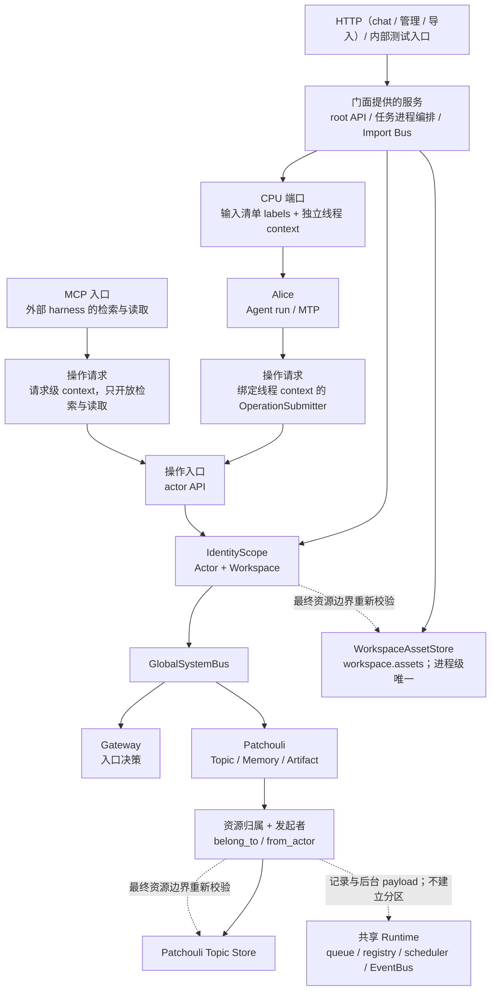

# Workspace

本目录是 workspace 子系统当前设计的入口。workspace 是与 Gateway、Patchouli、Alice 同层的包，回答三件事：谁能以什么身份进入一个 Workspace、在其中能做什么，以及进入之后的任务怎样作为进程运行。具体路由、事件字段和错误类型以[跨子系统契约](../contracts/subsystem-contracts.md)、[公开路由与事件](../contracts/routes-and-events.md)和[错误模型](../contracts/error-model.md)为准。

Workspace 在 W0 中是资源归属和访问硬边界，不是一组按 Workspace 复制的 Runtime。代码上 `workspace` 承载认证入口、访问检查、能力层（只供 root 的 root API 与供任意 actor 的 actor API）、任务进程表与 chat 任务进程编排、会话资源、读取视图、写入意图登记与 WorkspaceAsset 设施；它没有独立的生命周期宿主，由 System 组合根装配。System 进程只装配一套 Gateway、Patchouli、Alice、队列、注册表、调度器和 EventBus；需要隔离的资源在其最终寻址和授权处检查 WorkspaceIdentity。

## 1. 为什么建立 Workspace：初步的“ME 网络”边界

HiveMemory 引入 Workspace，不是为了给现有对象再增加一个筛选字段，而是为了回答同一个问题的三个部分：谁在执行、资源归属于哪个稳定边界、一次后台或重试操作应当沿用哪一份身份事实。操作、记录与后台任务分别携带符合其寿命的身份数据，Topic、Memory、Artifact、WorkspaceAsset 以及它们的 binding/ref 生命周期才能在共享进程运行时中保持稳定归属。

Workspace 的架构意义是一个稳定的资源归属与访问边界，而不是 Agent 的永久身份。Agent、一次 Chat Run、子 Frame 和后台任务都只是暂时进入 Workspace 的执行者；资源所有权、访问硬边界和结算后的长期归属仍由 Workspace 及其领域 Store 负责。与此同时，Workspace 不会把所有基础设施复制成多套实例：queue、registry、scheduler、runtime 和 EventBus 继续共享——它们是不拥有领域状态的处理管道，谈不上按 Workspace 分区。缓存按所有权分两类：跨子系统事实源（WorkspaceAssetStore）属于 workspace，由组合根装配、关闭时最后清理，并在最终寻址处校验；完整原子与主进程、CALL 目标 Profile 的派生视图由 workspace 读取视图持有；Alice 不维护资源读取缓存。已经裁定为 Workspace-owned 的资源在最终寻址和授权处使用 WorkspaceIdentity。

在这个意义上，当前 Workspace 已经形成一个初步的“ME 网络”概念。这里的“ME 网络”是借用 AE2 的架构隐喻，不是代码中的独立类、网络进程或完整运行时；它指的是一片能够被稳定寻址、由同一资源归属边界约束、并通过明确交接承载执行结果的最小资源网络：

1. `WorkspaceIdentity` 与 `IdentityScope` 提供网络入口和资源归属坐标；
2. Topic、Memory、Artifact、WorkspaceAsset 是当前已落地的 Workspace-owned 资源节点，各自 Store 在最终读写处执行 hard boundary；
3. settle、generation、artifact 和后台 retry 是跨节点交接，领域载体独立保留资源归属与需要的发起者，不从进程当前 Workspace 重新推断；
4. 共享 System runtime 是网络的公共骨架，但不因此变成某个 Workspace 的私有命名域。

这与[《AE2 与 HiveMemory 的架构同构性》](../ideas/ae2-hivememory-architecture-analogy.md)形成正式的“当前事实—高阶设想”联系：Idea 文档解释 AE2 的网络、接口和子网为何能成为审查 HiveMemory 所有权、能力和执行边界的语言；本目录只承接其中已经落地的 Workspace 资源边界，并把它标记为未来主网/子网体系的最小基础。完整的主网/子网拓扑、具有独立能力边界的子 Workspace、显式 Mount/Bridge、Capability Contract、独立工具与执行环境、配额/队列以及可恢复的子网生命周期尚未形成当前实现，仍以该 Idea 及后续独立 Plan 为准。

| 高阶架构维度 | 当前 Workspace 已形成的基础 | 完整主/子网系统尚缺的部分 |
|:---|:---|:---|
| 网络身份与资源寻址 | `IdentityScope`、Workspace 复合资源键、`main_workspace` 与内部隔离 seam | 用户可见的 Workspace 创建、切换和发现协议 |
| 网络存储与事实 | Topic、Memory、Artifact、WorkspaceAsset 的所有权和生命周期边界 | 跨 Workspace 的 Mount、Bridge、导入/导出及版本一致性 |
| 执行与结果回流 | 任务进程表与唯一注册入口；Interaction、settlement、generation task 独立携带资源归属与需要的发起者，结果回到 Patchouli 边界 | 可持久化 Job Graph、子网内部执行器、恢复和 backpressure |
| 能力封装 | 能力层的 root API 与 actor API、MTP、公开 Route 和窄 Asset port 提供现有交接基础 | 面向主网稳定暴露的 Capability Subnet 与版本化能力契约 |

因此，Workspace 当前应被理解为“初步 ME 网络边界”。后续若扩展 Workspace，必须先在 Idea/Plan 中明确所有权、Mount、能力和失败语义，再根据实际落地结果更新本目录。

## 2. 在总体架构中的位置

`SystemAssembler` 是组合根。它创建全局运行时和注册表，再装配 Gateway、Patchouli、Alice、workspace 设施（认证网关、认证一侧与操作授权者、能力层、读取视图、AssetStore、任务进程表与 chat 任务进程编排）以及其余应用服务；`HiveMemorySystem` 只持有这张组件图、作为入口使用的门面并负责启停。Workspace 语义横跨这些边界，但不取得任何子系统的领域所有权。

Workspace 只在资源所有者需要它的地方生效。Patchouli 在公共边界把 `IdentityScope` 拆为 `belong_to: WorkspaceIdentity` 与 `from_actor: ActorIdentity`，内部不再传递或重新组装 scope。全局总线的公开 route 参数仍可携带操作 scope；共享队列运输的记录与后台 payload 使用独立身份字段，两者都不因此自动产生 Workspace 命名域、缓存副本或独立调度分区。

依赖方向为 `system → workspace → core`：workspace 不导入 System；Patchouli 与 Gateway 不注入、也不导入 workspace 的认证与授权实现。

## 3. 职责与非职责

workspace 负责：

- **认证入口与访问检查**：两阶段认证的编排与 Workspace 准入、逐次的操作授权（[认证与访问登记](./authentication.md)、[身份与授权](./identity-and-authorization.md)）；
- **能力层**：只供保留 `system` 的 root API 与只经操作入口供 actor 使用的 actor API；操作入口服务执行线程的线程提交与 MCP 入口的请求级提交（[能力层](./capability.md)）；
- **任务进程**：唯一注册入口、进程表与 chat 任务进程的四阶段编排，含 CPU 分配与交互记录封口（[任务进程](./task-process.md)），以及 Actor 阶段内的执行线程（[执行线程](./execution-threads.md)）；
- **会话资源**：ConversationSession 与 CPU 中立的压缩检查点（[会话资源](./sessions.md)）；
- **读取视图与写入意图**：完整原子与 Profile 的派生缓存、引用解析、写入意图登记与实时派发（[读取视图与写入意图](./read-view-and-write-intents.md)）；
- **WorkspaceAsset**：进程内资产 working set、上传与解析交接（[WorkspaceAsset](./assets.md)）。

workspace 不负责：

- 记忆算法与 canonical 存储：Topic、Memory、Artifact、Interaction 与记忆任务属于 Patchouli，资源授权的第 4 阶段由资源 owner 执行；
- 调用来源的接入登记与 Principal authentication：属于 System，经 `core.access.PrincipalAuthenticator` 端口注入；
- Agent loop、MTP 解释与 CALL 编排：属于 Alice，workspace 只经 CPU 端口调用执行者；
- 入口分析：Gateway 只产生 `GatewayDecision`；
- 外部交互的导入：属于 System 的 Import Bus 服务（[Import Bus](../system/import-bus.md)）；workspace 只提供它调用的导入授权（[身份与授权](./identity-and-authorization.md#4-操作授权)），不为导入创建任务进程。

## 4. 包结构与依赖规则

| 位置 | 内容 |
|:---|:---|
| `authentication.py`、`authorization.py`、`registry.py` | 认证网关与 `WorkspaceAuthenticator`、无状态的 `WorkspaceOperationAuthorizer`、Workspace Actor 访问注册表 |
| `capability/root/`、`capability/actor/`、`capability/operations.py`、`capability/backing.py` | root API、actor API、操作入口 `WorkspaceOperationEntry`、两个 API 面共享的读取 backing |
| `process/`、`thread_ports.py` | 注册入口与进程表、进程状态容器、执行器、CPU 分配、线程表与线程管理、交付与事件投影；能力层使用的线程端口 |
| `contracts/` | 其他子系统可导入的唯一入口：CPU 输入与结果、CPU 端口、线程描述与执行线程、操作请求、入口与线程句柄协议、会话与写入意图的错误 |
| `sessions/` | 会话服务 |
| `read_view.py`、`cache/`、`resolution/`、`intents/` | 读取视图、派生缓存与失效代次、记忆与 Profile 读取器、写入意图登记 |
| `assets/` | WorkspaceAssetStore、解析交接与上传接收 |

`contracts` 子包是其他 L3 子系统可以导入的唯一入口（分层规则只允许 L3 子系统之间导入对方的 `contracts`），只依赖 `core` 与本包公共契约，由 `tests/unit/architecture/test_workspace_boundaries.py` 守护。workspace 中 `process` 以外的模块不得导入 `process`：root API 的请求不建进程，能力层与共享设施必须在没有进程时同样可用，因此不能依赖进程；能力层需要的线程解析经组合根注入的线程端口完成。

## 5. 生命周期

### 5.1 启动

System 的启动顺序为 `Gateway -> Patchouli -> Alice -> Scheduler`；Import Bus 没有启动步骤，也不向调度器登记维护任务。workspace 没有单独的启动步骤：认证网关、能力层、读取视图、会话服务、进程表与 WorkspaceAssetStore 都在装配阶段创建，不按 Workspace 复制或启动，可用性由 System 生命周期承载。

### 5.2 停止

停止顺序的逐步列表只由 [System 组合根](../system/composition.md#3-停止顺序)维护；本节说明其中与 workspace 相关的约束。

认证网关最先关闭，此后不再签发新的访问 context，已签发的 context 照常可用，使在途请求与任务进程能完成各自的授权；全部已签发 context 在最后一步撤销。网关关闭后新的导入请求即以 503 拒绝；随后先停调度器，再等待在途导入结束（含其等待应用的时间，不排空提交队列，队列由 Patchouli 停止时排空），避免 shutdown 期间继续接纳新的维护或导入；任务进程全部关闭后才清空会话，会话认领随进程关闭释放（[任务进程](./task-process.md#13-关闭与系统停止)）。Alice 卸载运行入口、Patchouli 完成已接纳工作的 drain 后，先解除 workspace 的 canonical 变更与意图结算订阅、关闭读取视图（停止新读、清理派生缓存，不触碰 canonical 数据），再清空 WorkspaceAssetStore（[WorkspaceAsset](./assets.md#5-关闭与失败边界)）。`close_and_clear()` 幂等，重复 stop 不会重新打开或恢复任何状态。Patchouli 内部的 drain 顺序见[System 组合根与生命周期](../system/composition.md)。

## 6. 当前设计文档

- [身份与授权](./identity-and-authorization.md)：身份坐标、四阶段访问模型、身份数据的形态与流向、操作授权、资源归属与后台交接、拒绝语义；
- [认证与访问登记](./authentication.md)：两类访问登记、密封的访问 context、进程与线程 context 的签发与派生、认证网关与装配；
- [能力层](./capability.md)：三个调用面、actor 操作目录、root API、两种读取视角、操作入口与引用记录；
- [任务进程](./task-process.md)：唯一注册入口、进程表与句柄、执行流与输出通道、四阶段骨架、CPU 分配、封口、交付、取消与关闭；
- [执行线程](./execution-threads.md)：线程表、唯一的存活判定、主线程与 CALL 子线程的派生与结束；
- [会话资源](./sessions.md)：ConversationSession、历史所有权与压缩检查点；
- [读取视图与写入意图](./read-view-and-write-intents.md)：派生缓存的键控与失效、写入意图的所有权、引用解析与结算；
- [WorkspaceAsset](./assets.md)：AssetStore 的所有权、两级状态、TopicAssetBinding 交接与关闭。

跨子系统契约：CPU 端口、操作请求与线程 context 见[子系统公共契约](../contracts/subsystem-contracts.md)第 4 节；Chat SSE 与会话管理见[公开路由与事件](../contracts/routes-and-events.md)第 6 节；访问与线程结束错误见[错误模型](../contracts/error-model.md)第 4.4 节。附件从上传到编译的完整链路见[Chat 附件链路](../system/attachments.md)。

## 7. 当前边界与限制

- W0 只支持默认 `main_workspace` 的公开入口和内部 `isolation_workspace` 测试 seam，不提供用户可见的 Workspace 创建、切换、Mount、Bridge、Grant 或跨 Workspace sharing；
- 会话、进程表、读取视图、写入意图登记与 WorkspaceAssetStore 都是进程内状态，不提供跨重启恢复；已持久化的 Memory/Artifact 按各自存储契约存在；
- WorkspaceIdentity 的传播不意味着所有组件都参与隔离。任何新增资源都必须先明确其所有者，再决定是否使用 Workspace 复合键；新增派生缓存时按派生源坐标键控，不能从 scope 的存在自动推导隔离。

各主题的具体限制见对应文档的“已知限制”一节。

## 8. 代码与测试入口

- 组合根：[`SystemAssembler`](../../src/hivememory/system/assembler.py)、[`HiveMemorySystem`](../../src/hivememory/system/system.py)；
- 身份模型：[`identity.py`](../../src/hivememory/core/models/identity.py)、[`workspace.py`](../../src/hivememory/core/models/workspace.py)、[`core/access.py`](../../src/hivememory/core/access.py)；
- 包结构守护：[`test_workspace_boundaries.py`](../../tests/unit/architecture/test_workspace_boundaries.py)、[`test_package_layers.py`](../../tests/unit/architecture/test_package_layers.py)、[`test_access_boundaries.py`](../../tests/unit/architecture/test_access_boundaries.py)。

各主题的代码与测试入口见对应文档。相关入口：[总体架构](../architecture/overview.md)、[系统边界与所有权](../architecture/boundaries.md)、[数据模型与可变性边界](../architecture/data-model.md)、[System 组合根与生命周期](../system/composition.md)和[Workspace 文档收口历史审计](../archive/plans/documentation-migration-finalization-audit.md)（历史记录）。
